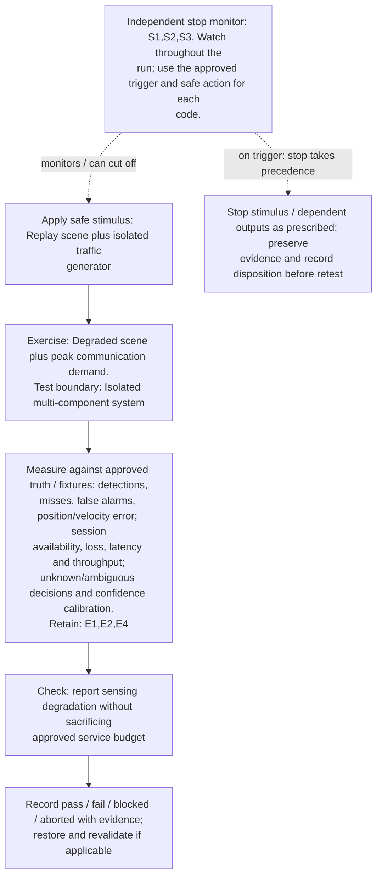
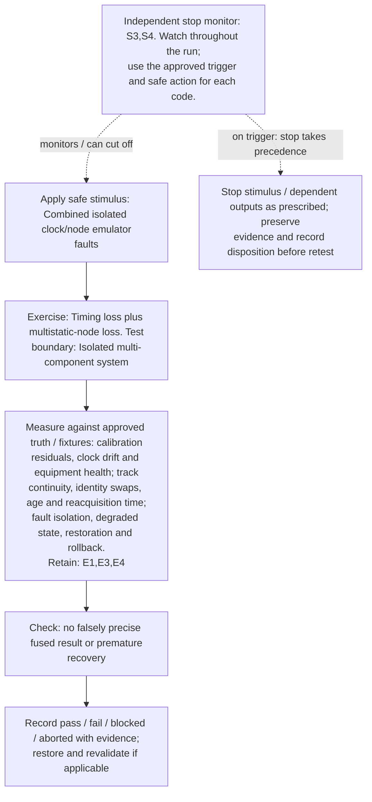
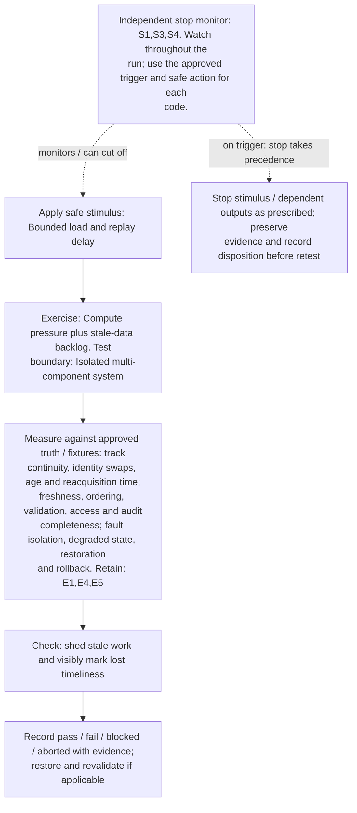
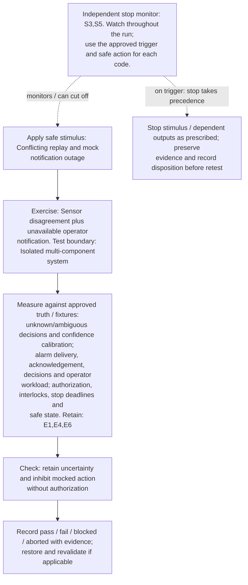
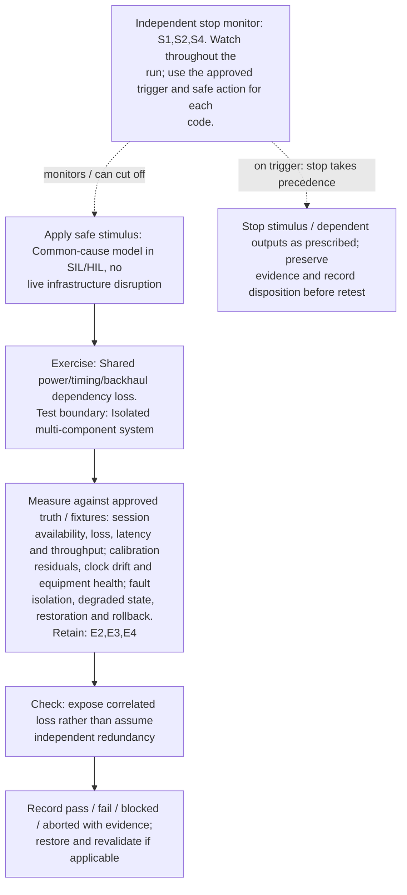
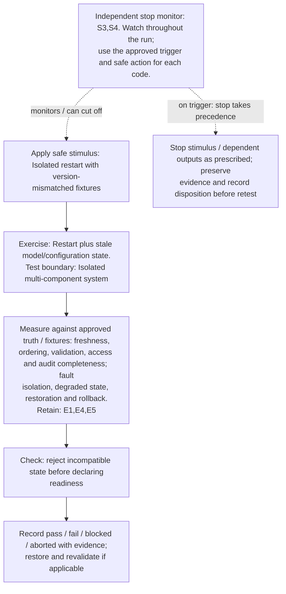
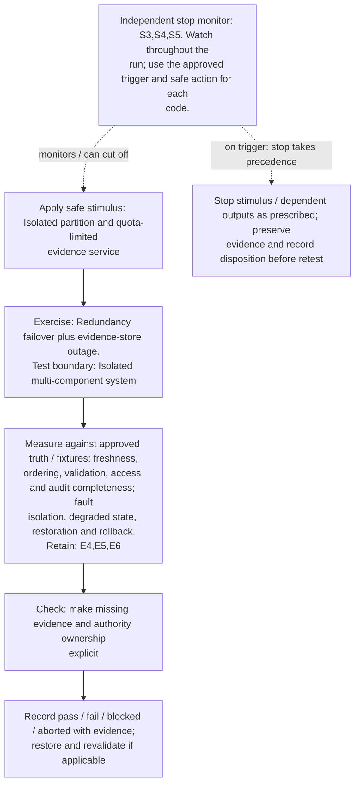
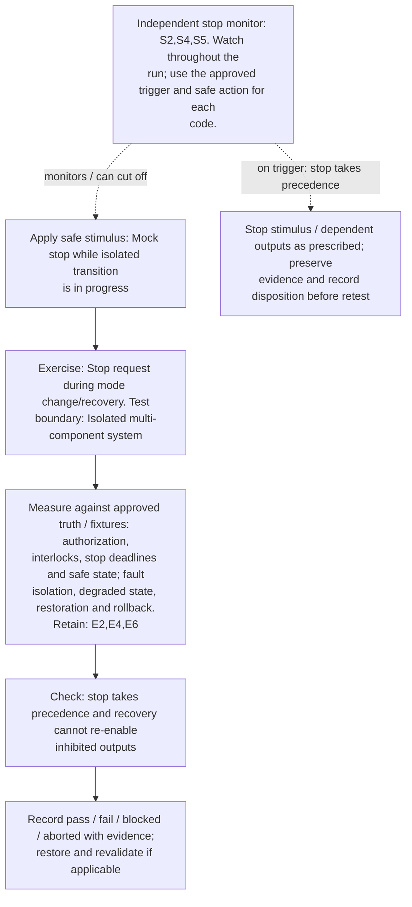
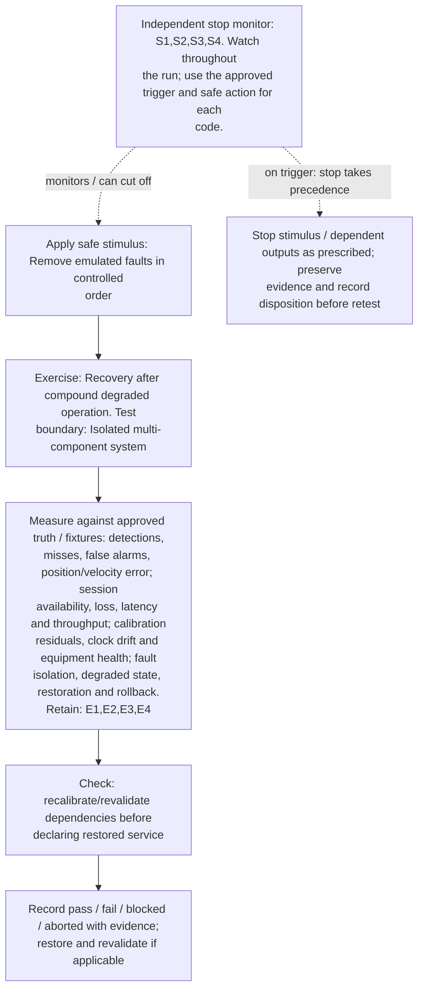
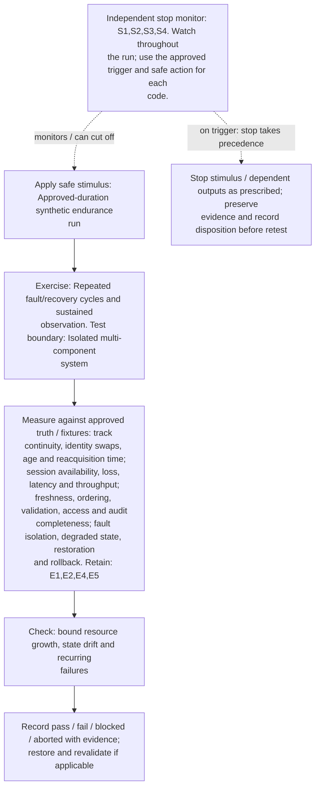

# Selected compound failures and restoration: designer test diagrams

[Visual guide and shared execution rules](../../README.md#designer-visual-test-guide) | [Authoritative scenario matrix](../../README.md#traceable-scenario-coverage-matrix)

These are test-design flows, not measured results or an asserted deployment architecture. Solid arrows show the test/evidence flow; dashed arrows show independent stop control. Apply the shared approval gate before every instance. Expand the declared axes and frequency overlay; never treat one diagram as coverage of every configuration.

## TC-051

**What you test:** Degraded scene plus peak communication demand.

**Setup:** `V/Q/M=ALL` applicable. Create an approved instance with ground truth, baseline, limits and a named independent stop owner. Apply the exact frequency configuration and its reviewed applicability.

Show test flow and independent stop path

**Measure against:** A-SEN,A-COM,A-UNC. [Use every applicable metric and the approved limits](../../README.md#acceptance-profiles); the case-specific check does not replace those profiles.

**Retain:** E1: scene truth, detections, tracks and scores; E2: test communication traffic and service KPIs; E4: faults, queues, alarms and recovery state.

**Stop plan:** S1,S2,S3; [trigger definitions and safe outcomes](../../README.md#evidence-and-safe-stop-codes). **Requirements:** REQ-SEN,REQ-COM,REQ-UNC.

## TC-052

**What you test:** Timing loss plus multistatic-node loss.

**Setup:** Use the applicable declared configuration and reviewed scenario conditions. Create an approved instance with ground truth, baseline, limits and a named independent stop owner. Apply the exact frequency configuration and its reviewed applicability.

Show test flow and independent stop path

**Measure against:** A-RAD,A-TRK,A-RES. [Use every applicable metric and the approved limits](../../README.md#acceptance-profiles); the case-specific check does not replace those profiles.

**Retain:** E1: scene truth, detections, tracks and scores; E3: radio, timing, calibration and instrument health; E4: faults, queues, alarms and recovery state.

**Stop plan:** S3,S4; [trigger definitions and safe outcomes](../../README.md#evidence-and-safe-stop-codes). **Requirements:** REQ-RAD,REQ-SEN,REQ-RES.

## TC-053

**What you test:** Compute pressure plus stale-data backlog.

**Setup:** Use the applicable declared configuration and reviewed scenario conditions. Create an approved instance with ground truth, baseline, limits and a named independent stop owner. Apply the exact frequency configuration and its reviewed applicability.

Show test flow and independent stop path

**Measure against:** A-TRK,A-DAT,A-RES. [Use every applicable metric and the approved limits](../../README.md#acceptance-profiles); the case-specific check does not replace those profiles.

**Retain:** E1: scene truth, detections, tracks and scores; E4: faults, queues, alarms and recovery state; E5: input provenance, validation, access and integrity.

**Stop plan:** S1,S3,S4; [trigger definitions and safe outcomes](../../README.md#evidence-and-safe-stop-codes). **Requirements:** REQ-SEN,REQ-DAT,REQ-RES.

## TC-054

**What you test:** Sensor disagreement plus unavailable operator notification.

**Setup:** Use the applicable declared configuration and reviewed scenario conditions. Create an approved instance with ground truth, baseline, limits and a named independent stop owner. Apply the exact frequency configuration and its reviewed applicability.

Show test flow and independent stop path

**Measure against:** A-UNC,A-HUM,A-SAF. [Use every applicable metric and the approved limits](../../README.md#acceptance-profiles); the case-specific check does not replace those profiles.

**Retain:** E1: scene truth, detections, tracks and scores; E4: faults, queues, alarms and recovery state; E6: operator actions, mock calls, interlocks and stops.

**Stop plan:** S3,S5; [trigger definitions and safe outcomes](../../README.md#evidence-and-safe-stop-codes). **Requirements:** REQ-UNC,REQ-HUM,REQ-SAF.

## TC-055

**What you test:** Shared power/timing/backhaul dependency loss.

**Setup:** Use the applicable declared configuration and reviewed scenario conditions. Create an approved instance with ground truth, baseline, limits and a named independent stop owner. Apply the exact frequency configuration and its reviewed applicability.

Show test flow and independent stop path

**Measure against:** A-COM,A-RAD,A-RES. [Use every applicable metric and the approved limits](../../README.md#acceptance-profiles); the case-specific check does not replace those profiles.

**Retain:** E2: test communication traffic and service KPIs; E3: radio, timing, calibration and instrument health; E4: faults, queues, alarms and recovery state.

**Stop plan:** S1,S2,S4; [trigger definitions and safe outcomes](../../README.md#evidence-and-safe-stop-codes). **Requirements:** REQ-COM,REQ-RAD,REQ-RES.

## TC-056

**What you test:** Restart plus stale model/configuration state.

**Setup:** Use the applicable declared configuration and reviewed scenario conditions. Create an approved instance with ground truth, baseline, limits and a named independent stop owner. Apply the exact frequency configuration and its reviewed applicability.

Show test flow and independent stop path

**Measure against:** A-DAT,A-RES. [Use every applicable metric and the approved limits](../../README.md#acceptance-profiles); the case-specific check does not replace those profiles.

**Retain:** E1: scene truth, detections, tracks and scores; E4: faults, queues, alarms and recovery state; E5: input provenance, validation, access and integrity.

**Stop plan:** S3,S4; [trigger definitions and safe outcomes](../../README.md#evidence-and-safe-stop-codes). **Requirements:** REQ-DAT,REQ-RES.

## TC-057

**What you test:** Redundancy failover plus evidence-store outage.

**Setup:** Use the applicable declared configuration and reviewed scenario conditions. Create an approved instance with ground truth, baseline, limits and a named independent stop owner. Apply the exact frequency configuration and its reviewed applicability.

Show test flow and independent stop path

**Measure against:** A-DAT,A-RES. [Use every applicable metric and the approved limits](../../README.md#acceptance-profiles); the case-specific check does not replace those profiles.

**Retain:** E4: faults, queues, alarms and recovery state; E5: input provenance, validation, access and integrity; E6: operator actions, mock calls, interlocks and stops.

**Stop plan:** S3,S4,S5; [trigger definitions and safe outcomes](../../README.md#evidence-and-safe-stop-codes). **Requirements:** REQ-DAT,REQ-RES.

## TC-058

**What you test:** Stop request during mode change/recovery.

**Setup:** Use the applicable declared configuration and reviewed scenario conditions. Create an approved instance with ground truth, baseline, limits and a named independent stop owner. Apply the exact frequency configuration and its reviewed applicability.

Show test flow and independent stop path

**Measure against:** A-SAF,A-RES. [Use every applicable metric and the approved limits](../../README.md#acceptance-profiles); the case-specific check does not replace those profiles.

**Retain:** E2: test communication traffic and service KPIs; E4: faults, queues, alarms and recovery state; E6: operator actions, mock calls, interlocks and stops.

**Stop plan:** S2,S4,S5; [trigger definitions and safe outcomes](../../README.md#evidence-and-safe-stop-codes). **Requirements:** REQ-SAF,REQ-RES.

## TC-059

**What you test:** Recovery after compound degraded operation.

**Setup:** `L/N=ALL`. Create an approved instance with ground truth, baseline, limits and a named independent stop owner. Apply the exact frequency configuration and its reviewed applicability.

Show test flow and independent stop path

**Measure against:** A-SEN,A-COM,A-RAD,A-RES. [Use every applicable metric and the approved limits](../../README.md#acceptance-profiles); the case-specific check does not replace those profiles.

**Retain:** E1: scene truth, detections, tracks and scores; E2: test communication traffic and service KPIs; E3: radio, timing, calibration and instrument health; E4: faults, queues, alarms and recovery state.

**Stop plan:** S1,S2,S3,S4; [trigger definitions and safe outcomes](../../README.md#evidence-and-safe-stop-codes). **Requirements:** REQ-SEN,REQ-COM,REQ-RAD,REQ-RES.

## TC-060

**What you test:** Repeated fault/recovery cycles and sustained observation.

**Setup:** Use the applicable declared configuration and reviewed scenario conditions. Create an approved instance with ground truth, baseline, limits and a named independent stop owner. Apply the exact frequency configuration and its reviewed applicability.

Show test flow and independent stop path

**Measure against:** A-TRK,A-COM,A-DAT,A-RES. [Use every applicable metric and the approved limits](../../README.md#acceptance-profiles); the case-specific check does not replace those profiles.

**Retain:** E1: scene truth, detections, tracks and scores; E2: test communication traffic and service KPIs; E4: faults, queues, alarms and recovery state; E5: input provenance, validation, access and integrity.

**Stop plan:** S1,S2,S3,S4; [trigger definitions and safe outcomes](../../README.md#evidence-and-safe-stop-codes). **Requirements:** REQ-SEN,REQ-COM,REQ-DAT,REQ-RES.
