# Core-network and sensing-service stress: designer test diagrams

[Visual guide and shared execution rules](../../README.md#designer-visual-test-guide) | [Authoritative scenario matrix](../../README.md#traceable-scenario-coverage-matrix)

These are test-design flows, not measured results or an asserted deployment architecture. Solid arrows show the test/evidence flow; dashed arrows show independent stop control. Apply the shared approval gate before every instance. Expand the declared axes and frequency overlay; never treat one diagram as coverage of every configuration.

## TC-061

**What you test:** Sensing capability discovery/admission.

**Setup:** `C/B/M/R=ALL`. Create an approved instance with ground truth, baseline, limits and a named independent stop owner. Apply the exact frequency configuration and its reviewed applicability.

<details>
<summary>Show test flow and independent stop path</summary>

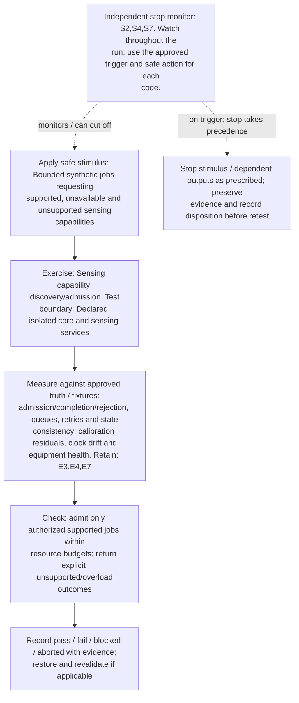

</details>

**Measure against:** A-CORE,A-RAD. [Use every applicable metric and the approved limits](../../README.md#acceptance-profiles); the case-specific check does not replace those profiles.

**Retain:** E3: radio, timing, calibration and instrument health; E4: faults, queues, alarms and recovery state; E7: synthetic identities, core APIs and distributed traces.

**Stop plan:** S2,S4,S7; [trigger definitions and safe outcomes](../../README.md#evidence-and-safe-stop-codes). **Requirements:** REQ-CORE,REQ-RAD.

## TC-062

**What you test:** UE registration and re-registration burst.

**Setup:** `C/B/U=ALL`. Create an approved instance with ground truth, baseline, limits and a named independent stop owner. Apply the exact frequency configuration and its reviewed applicability.

<details>
<summary>Show test flow and independent stop path</summary>

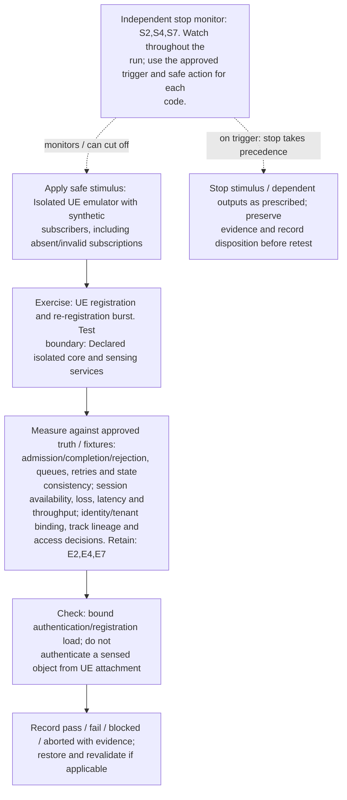

</details>

**Measure against:** A-CORE,A-COM,A-ID. [Use every applicable metric and the approved limits](../../README.md#acceptance-profiles); the case-specific check does not replace those profiles.

**Retain:** E2: test communication traffic and service KPIs; E4: faults, queues, alarms and recovery state; E7: synthetic identities, core APIs and distributed traces.

**Stop plan:** S2,S4,S7; [trigger definitions and safe outcomes](../../README.md#evidence-and-safe-stop-codes). **Requirements:** REQ-CORE,REQ-COM,REQ-ID.

## TC-063

**What you test:** Session setup/modify/release churn.

**Setup:** `C/B/N=ALL`. Create an approved instance with ground truth, baseline, limits and a named independent stop owner. Apply the exact frequency configuration and its reviewed applicability.

<details>
<summary>Show test flow and independent stop path</summary>


</details>

**Measure against:** A-CORE,A-COM. [Use every applicable metric and the approved limits](../../README.md#acceptance-profiles); the case-specific check does not replace those profiles.

**Retain:** E2: test communication traffic and service KPIs; E4: faults, queues, alarms and recovery state; E7: synthetic identities, core APIs and distributed traces.

**Stop plan:** S2,S4; [trigger definitions and safe outcomes](../../README.md#evidence-and-safe-stop-codes). **Requirements:** REQ-CORE,REQ-COM,REQ-RES.

## TC-064

**What you test:** Device mobility, idle/paging and serving-node changes.

**Setup:** `C/B/U/L=ALL`. Create an approved instance with ground truth, baseline, limits and a named independent stop owner. Apply the exact frequency configuration and its reviewed applicability.

<details>
<summary>Show test flow and independent stop path</summary>

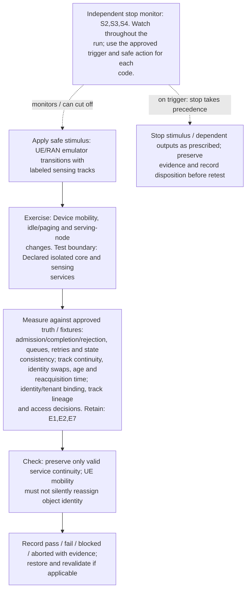

</details>

**Measure against:** A-CORE,A-TRK,A-ID. [Use every applicable metric and the approved limits](../../README.md#acceptance-profiles); the case-specific check does not replace those profiles.

**Retain:** E1: scene truth, detections, tracks and scores; E2: test communication traffic and service KPIs; E7: synthetic identities, core APIs and distributed traces.

**Stop plan:** S2,S3,S4; [trigger definitions and safe outcomes](../../README.md#evidence-and-safe-stop-codes). **Requirements:** REQ-CORE,REQ-SEN,REQ-ID.

## TC-065

**What you test:** Sensing-data transport/UPF contention where applicable.

**Setup:** `C/B/Q=ALL`. Create an approved instance with ground truth, baseline, limits and a named independent stop owner. Apply the exact frequency configuration and its reviewed applicability.

<details>
<summary>Show test flow and independent stop path</summary>

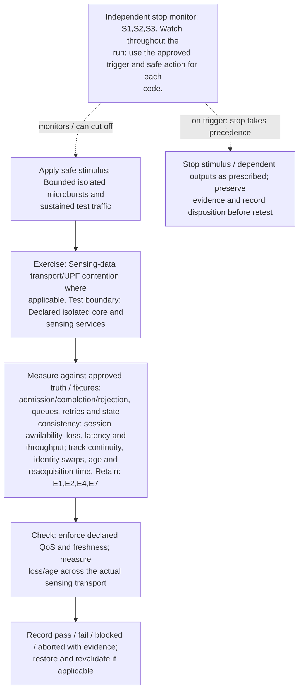

</details>

**Measure against:** A-CORE,A-COM,A-TRK. [Use every applicable metric and the approved limits](../../README.md#acceptance-profiles); the case-specific check does not replace those profiles.

**Retain:** E1: scene truth, detections, tracks and scores; E2: test communication traffic and service KPIs; E4: faults, queues, alarms and recovery state; E7: synthetic identities, core APIs and distributed traces.

**Stop plan:** S1,S2,S3; [trigger definitions and safe outcomes](../../README.md#evidence-and-safe-stop-codes). **Requirements:** REQ-CORE,REQ-COM,REQ-SEN.

## TC-066

**What you test:** Policy conflicts and admission priority.

**Setup:** `C/B/M/H=ALL`. Create an approved instance with ground truth, baseline, limits and a named independent stop owner. Apply the exact frequency configuration and its reviewed applicability.

<details>
<summary>Show test flow and independent stop path</summary>

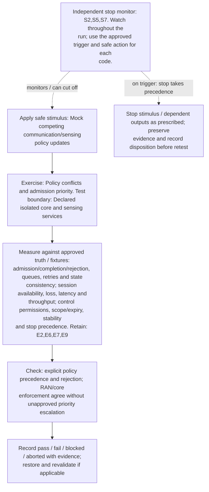

</details>

**Measure against:** A-CORE,A-COM,A-CTL. [Use every applicable metric and the approved limits](../../README.md#acceptance-profiles); the case-specific check does not replace those profiles.

**Retain:** E2: test communication traffic and service KPIs; E6: operator actions, mock calls, interlocks and stops; E7: synthetic identities, core APIs and distributed traces; E9: approvals, lineage, rollout and governance/control audit.

**Stop plan:** S2,S5,S7; [trigger definitions and safe outcomes](../../README.md#evidence-and-safe-stop-codes). **Requirements:** REQ-CORE,REQ-COM,REQ-CTL.

## TC-067

**What you test:** Tenant/slice isolation and noisy neighbors.

**Setup:** `C/B/H=ALL`. Create an approved instance with ground truth, baseline, limits and a named independent stop owner. Apply the exact frequency configuration and its reviewed applicability.

<details>
<summary>Show test flow and independent stop path</summary>

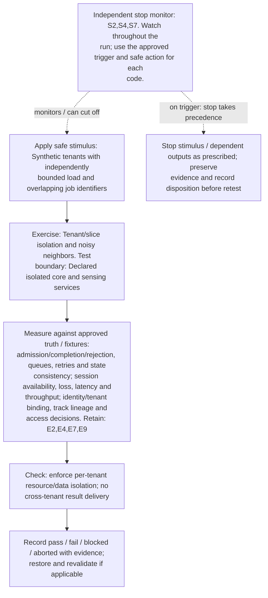

</details>

**Measure against:** A-CORE,A-COM,A-ID. [Use every applicable metric and the approved limits](../../README.md#acceptance-profiles); the case-specific check does not replace those profiles.

**Retain:** E2: test communication traffic and service KPIs; E4: faults, queues, alarms and recovery state; E7: synthetic identities, core APIs and distributed traces; E9: approvals, lineage, rollout and governance/control audit.

**Stop plan:** S2,S4,S7; [trigger definitions and safe outcomes](../../README.md#evidence-and-safe-stop-codes). **Requirements:** REQ-CORE,REQ-COM,REQ-ID.

## TC-068

**What you test:** Authentication/subscription dependency loss and revocation.

**Setup:** `C/B/H=ALL`. Create an approved instance with ground truth, baseline, limits and a named independent stop owner. Apply the exact frequency configuration and its reviewed applicability.

<details>
<summary>Show test flow and independent stop path</summary>

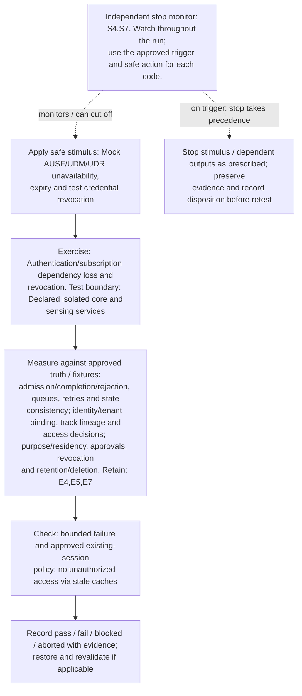

</details>

**Measure against:** A-CORE,A-ID,A-GOV. [Use every applicable metric and the approved limits](../../README.md#acceptance-profiles); the case-specific check does not replace those profiles.

**Retain:** E4: faults, queues, alarms and recovery state; E5: input provenance, validation, access and integrity; E7: synthetic identities, core APIs and distributed traces.

**Stop plan:** S4,S7; [trigger definitions and safe outcomes](../../README.md#evidence-and-safe-stop-codes). **Requirements:** REQ-CORE,REQ-ID,REQ-GOV.

## TC-069

**What you test:** Discovery/routing staleness during scaling.

**Setup:** `C/B/L=ALL`. Create an approved instance with ground truth, baseline, limits and a named independent stop owner. Apply the exact frequency configuration and its reviewed applicability.

<details>
<summary>Show test flow and independent stop path</summary>

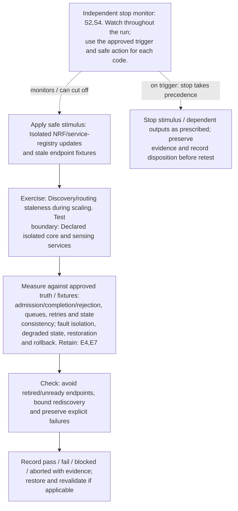

</details>

**Measure against:** A-CORE,A-RES. [Use every applicable metric and the approved limits](../../README.md#acceptance-profiles); the case-specific check does not replace those profiles.

**Retain:** E4: faults, queues, alarms and recovery state; E7: synthetic identities, core APIs and distributed traces.

**Stop plan:** S2,S4; [trigger definitions and safe outcomes](../../README.md#evidence-and-safe-stop-codes). **Requirements:** REQ-CORE,REQ-RES.

## TC-070

**What you test:** Service API/SCP overload and retry amplification.

**Setup:** `C/B=ALL`. Create an approved instance with ground truth, baseline, limits and a named independent stop owner. Apply the exact frequency configuration and its reviewed applicability.

<details>
<summary>Show test flow and independent stop path</summary>

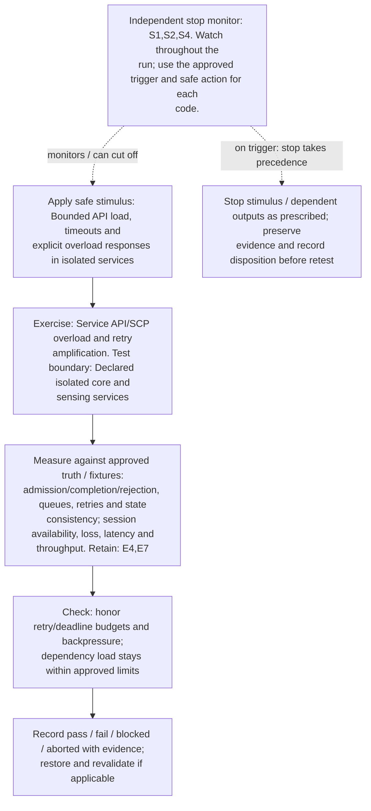

</details>

**Measure against:** A-CORE,A-COM. [Use every applicable metric and the approved limits](../../README.md#acceptance-profiles); the case-specific check does not replace those profiles.

**Retain:** E4: faults, queues, alarms and recovery state; E7: synthetic identities, core APIs and distributed traces.

**Stop plan:** S1,S2,S4; [trigger definitions and safe outcomes](../../README.md#evidence-and-safe-stop-codes). **Requirements:** REQ-CORE,REQ-COM,REQ-RES.

## TC-071

**What you test:** Exposure/subscription fan-out and slow consumers.

**Setup:** `C/B/H=ALL`. Create an approved instance with ground truth, baseline, limits and a named independent stop owner. Apply the exact frequency configuration and its reviewed applicability.

<details>
<summary>Show test flow and independent stop path</summary>

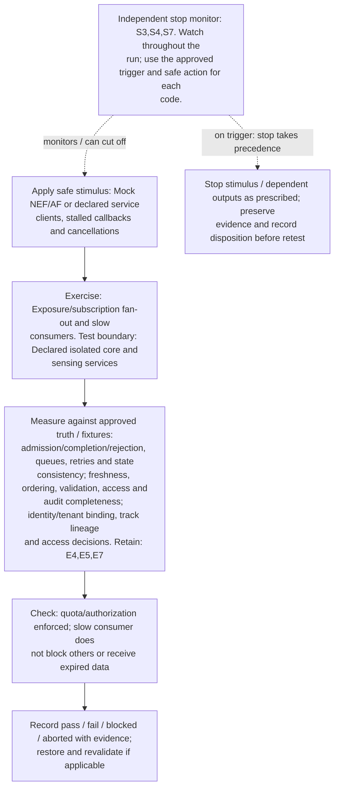

</details>

**Measure against:** A-CORE,A-DAT,A-ID. [Use every applicable metric and the approved limits](../../README.md#acceptance-profiles); the case-specific check does not replace those profiles.

**Retain:** E4: faults, queues, alarms and recovery state; E5: input provenance, validation, access and integrity; E7: synthetic identities, core APIs and distributed traces.

**Stop plan:** S3,S4,S7; [trigger definitions and safe outcomes](../../README.md#evidence-and-safe-stop-codes). **Requirements:** REQ-CORE,REQ-DAT,REQ-ID.

## TC-072

**What you test:** NWDAF analytics load, expiry and unavailable input.

**Setup:** `C/B/J=ALL`. Create an approved instance with ground truth, baseline, limits and a named independent stop owner. Apply the exact frequency configuration and its reviewed applicability.

<details>
<summary>Show test flow and independent stop path</summary>

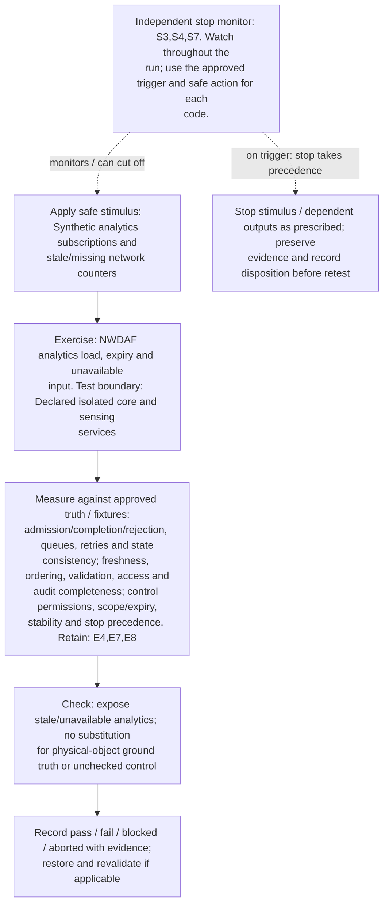

</details>

**Measure against:** A-CORE,A-DAT,A-CTL. [Use every applicable metric and the approved limits](../../README.md#acceptance-profiles); the case-specific check does not replace those profiles.

**Retain:** E4: faults, queues, alarms and recovery state; E7: synthetic identities, core APIs and distributed traces; E8: dataset/model versions, AI outputs and quality telemetry.

**Stop plan:** S3,S4,S7; [trigger definitions and safe outcomes](../../README.md#evidence-and-safe-stop-codes). **Requirements:** REQ-CORE,REQ-DAT,REQ-CTL.

## TC-073

**What you test:** Event/observation broker backlog and schema evolution.

**Setup:** `C/B/X=ALL`. Create an approved instance with ground truth, baseline, limits and a named independent stop owner. Apply the exact frequency configuration and its reviewed applicability.

<details>
<summary>Show test flow and independent stop path</summary>

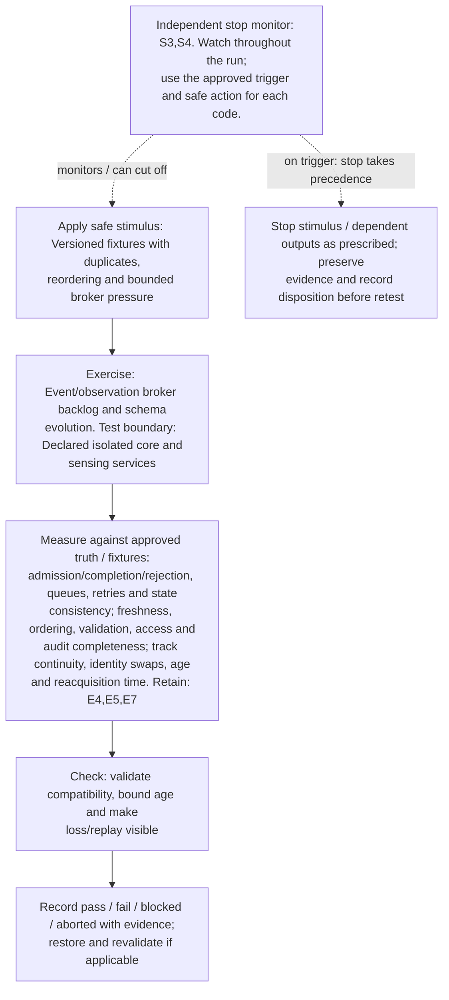

</details>

**Measure against:** A-CORE,A-DAT,A-TRK. [Use every applicable metric and the approved limits](../../README.md#acceptance-profiles); the case-specific check does not replace those profiles.

**Retain:** E4: faults, queues, alarms and recovery state; E5: input provenance, validation, access and integrity; E7: synthetic identities, core APIs and distributed traces.

**Stop plan:** S3,S4; [trigger definitions and safe outcomes](../../README.md#evidence-and-safe-stop-codes). **Requirements:** REQ-CORE,REQ-DAT,REQ-SEN.

## TC-074

**What you test:** Sensing-job cancel/retry/expiry race.

**Setup:** `C/B/L=ALL`. Create an approved instance with ground truth, baseline, limits and a named independent stop owner. Apply the exact frequency configuration and its reviewed applicability.

<details>
<summary>Show test flow and independent stop path</summary>

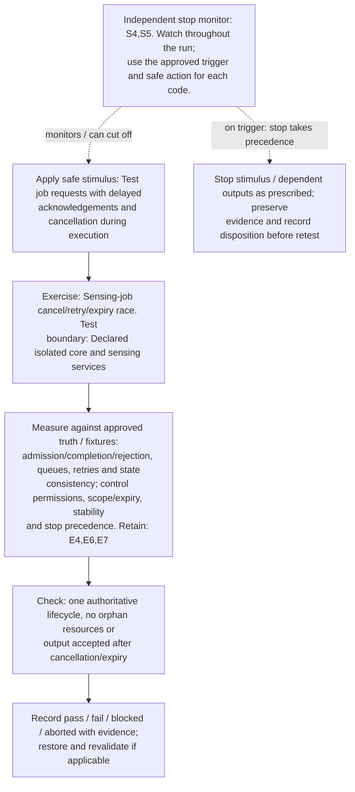

</details>

**Measure against:** A-CORE,A-CTL. [Use every applicable metric and the approved limits](../../README.md#acceptance-profiles); the case-specific check does not replace those profiles.

**Retain:** E4: faults, queues, alarms and recovery state; E6: operator actions, mock calls, interlocks and stops; E7: synthetic identities, core APIs and distributed traces.

**Stop plan:** S4,S5; [trigger definitions and safe outcomes](../../README.md#evidence-and-safe-stop-codes). **Requirements:** REQ-CORE,REQ-RES,REQ-CTL.

## TC-075

**What you test:** Core/application state-store partition and leader conflict.

**Setup:** `C/N=ALL`. Create an approved instance with ground truth, baseline, limits and a named independent stop owner. Apply the exact frequency configuration and its reviewed applicability.

<details>
<summary>Show test flow and independent stop path</summary>

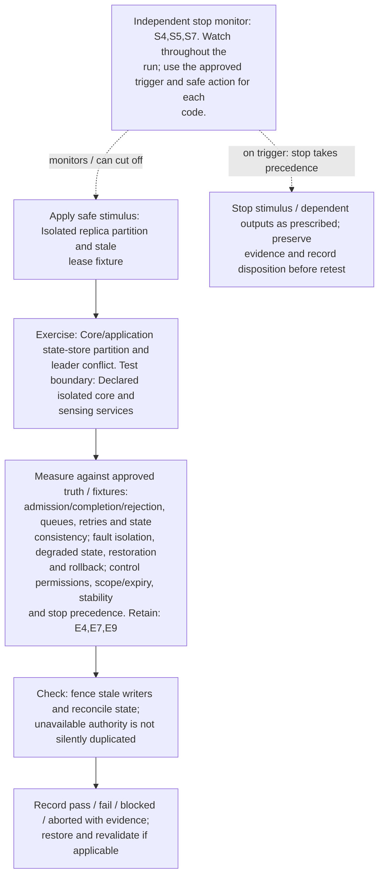

</details>

**Measure against:** A-CORE,A-RES,A-CTL. [Use every applicable metric and the approved limits](../../README.md#acceptance-profiles); the case-specific check does not replace those profiles.

**Retain:** E4: faults, queues, alarms and recovery state; E7: synthetic identities, core APIs and distributed traces; E9: approvals, lineage, rollout and governance/control audit.

**Stop plan:** S4,S5,S7; [trigger definitions and safe outcomes](../../README.md#evidence-and-safe-stop-codes). **Requirements:** REQ-CORE,REQ-RES,REQ-CTL.

## TC-076

**What you test:** Regional/core-service failover and restoration.

**Setup:** `C/L=ALL`. Create an approved instance with ground truth, baseline, limits and a named independent stop owner. Apply the exact frequency configuration and its reviewed applicability.

<details>
<summary>Show test flow and independent stop path</summary>

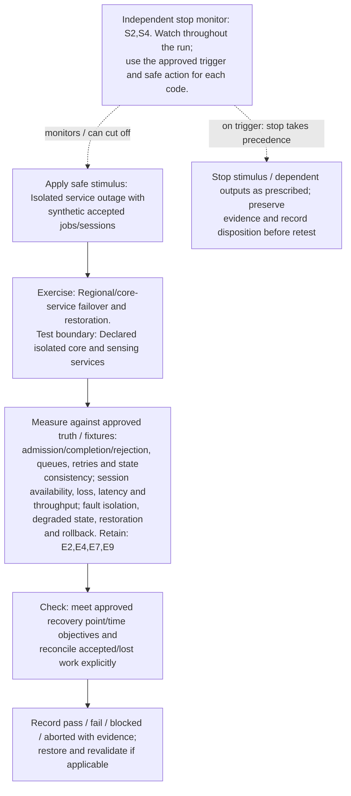

</details>

**Measure against:** A-CORE,A-COM,A-RES. [Use every applicable metric and the approved limits](../../README.md#acceptance-profiles); the case-specific check does not replace those profiles.

**Retain:** E2: test communication traffic and service KPIs; E4: faults, queues, alarms and recovery state; E7: synthetic identities, core APIs and distributed traces; E9: approvals, lineage, rollout and governance/control audit.

**Stop plan:** S2,S4; [trigger definitions and safe outcomes](../../README.md#evidence-and-safe-stop-codes). **Requirements:** REQ-CORE,REQ-COM,REQ-RES.

## TC-077

**What you test:** Inter-operator/federated/roaming boundary where supported.

**Setup:** `C/H=ALL`. Create an approved instance with ground truth, baseline, limits and a named independent stop owner. Apply the exact frequency configuration and its reviewed applicability.

<details>
<summary>Show test flow and independent stop path</summary>

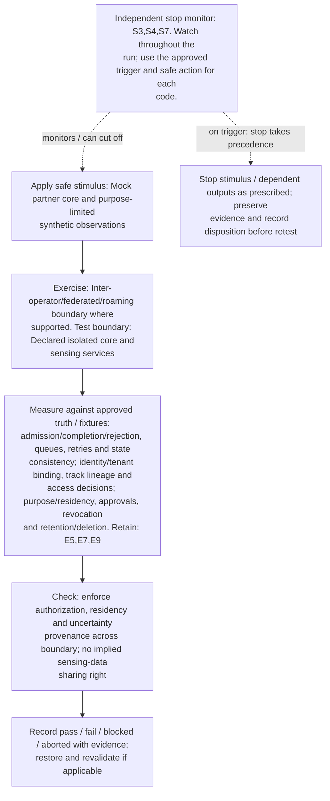

</details>

**Measure against:** A-CORE,A-ID,A-GOV. [Use every applicable metric and the approved limits](../../README.md#acceptance-profiles); the case-specific check does not replace those profiles.

**Retain:** E5: input provenance, validation, access and integrity; E7: synthetic identities, core APIs and distributed traces; E9: approvals, lineage, rollout and governance/control audit.

**Stop plan:** S3,S4,S7; [trigger definitions and safe outcomes](../../README.md#evidence-and-safe-stop-codes). **Requirements:** REQ-CORE,REQ-ID,REQ-GOV.

## TC-078

**What you test:** Core location/time/frame metadata stale or conflicting.

**Setup:** `C/G/R=ALL`. Create an approved instance with ground truth, baseline, limits and a named independent stop owner. Apply the exact frequency configuration and its reviewed applicability.

<details>
<summary>Show test flow and independent stop path</summary>

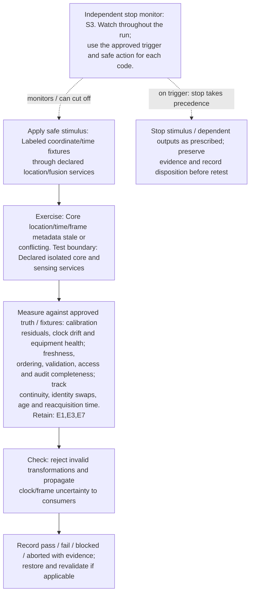

</details>

**Measure against:** A-RAD,A-DAT,A-TRK. [Use every applicable metric and the approved limits](../../README.md#acceptance-profiles); the case-specific check does not replace those profiles.

**Retain:** E1: scene truth, detections, tracks and scores; E3: radio, timing, calibration and instrument health; E7: synthetic identities, core APIs and distributed traces.

**Stop plan:** S3; [trigger definitions and safe outcomes](../../README.md#evidence-and-safe-stop-codes). **Requirements:** REQ-RAD,REQ-DAT,REQ-SEN.

## TC-079

**What you test:** Quota/accounting/charging dependency outage.

**Setup:** `C/B/H=ALL`. Create an approved instance with ground truth, baseline, limits and a named independent stop owner. Apply the exact frequency configuration and its reviewed applicability.

<details>
<summary>Show test flow and independent stop path</summary>

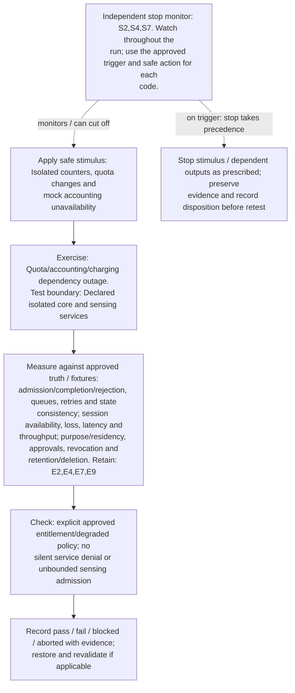

</details>

**Measure against:** A-CORE,A-COM,A-GOV. [Use every applicable metric and the approved limits](../../README.md#acceptance-profiles); the case-specific check does not replace those profiles.

**Retain:** E2: test communication traffic and service KPIs; E4: faults, queues, alarms and recovery state; E7: synthetic identities, core APIs and distributed traces; E9: approvals, lineage, rollout and governance/control audit.

**Stop plan:** S2,S4,S7; [trigger definitions and safe outcomes](../../README.md#evidence-and-safe-stop-codes). **Requirements:** REQ-CORE,REQ-COM,REQ-GOV.

## TC-080

**What you test:** Core rolling upgrade/autoscale with active jobs.

**Setup:** `C/B/L=ALL`. Create an approved instance with ground truth, baseline, limits and a named independent stop owner. Apply the exact frequency configuration and its reviewed applicability.

<details>
<summary>Show test flow and independent stop path</summary>

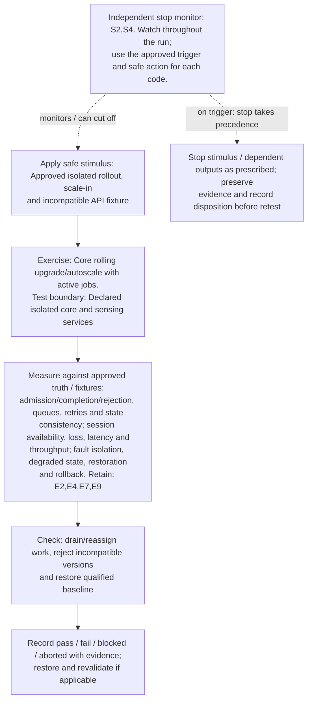

</details>

**Measure against:** A-CORE,A-COM,A-RES. [Use every applicable metric and the approved limits](../../README.md#acceptance-profiles); the case-specific check does not replace those profiles.

**Retain:** E2: test communication traffic and service KPIs; E4: faults, queues, alarms and recovery state; E7: synthetic identities, core APIs and distributed traces; E9: approvals, lineage, rollout and governance/control audit.

**Stop plan:** S2,S4; [trigger definitions and safe outcomes](../../README.md#evidence-and-safe-stop-codes). **Requirements:** REQ-CORE,REQ-COM,REQ-RES.

## TC-081

**What you test:** Shared DNS/PKI/secret service failure or rotation.

**Setup:** `C/H/L=ALL`. Create an approved instance with ground truth, baseline, limits and a named independent stop owner. Apply the exact frequency configuration and its reviewed applicability.

<details>
<summary>Show test flow and independent stop path</summary>

```mermaid
flowchart TD
    stimulus["Apply safe stimulus: Mock resolution failure and test<br/>certificate/token expiry/rotation"]
    exercise["Exercise: Shared DNS/PKI/secret service failure or<br/>rotation. Test boundary: Declared isolated core and<br/>sensing services"]
    capture["Measure against approved truth / fixtures:<br/>admission/completion/rejection, queues, retries and state<br/>consistency; identity/tenant binding, track lineage and<br/>access decisions; fault isolation, degraded state,<br/>restoration and rollback. Retain: E4,E5,E7"]
    checks["Check: bounded retries and recovery without disabling<br/>authentication or accepting revoked identities"]
    disposition["Record pass / fail / blocked / aborted with evidence;<br/>restore and revalidate if applicable"]
    monitor["Independent stop monitor: S4,S7. Watch throughout the run;<br/>use the approved trigger and safe action for each code."]
    safe["Stop stimulus / dependent outputs as prescribed; preserve<br/>evidence and record disposition before retest"]
    stimulus --> exercise --> capture --> checks --> disposition
    monitor -. "monitors / can cut off" .-> stimulus
    monitor -. "on trigger: stop takes precedence" .-> safe
```

</details>

**Measure against:** A-CORE,A-ID,A-RES. [Use every applicable metric and the approved limits](../../README.md#acceptance-profiles); the case-specific check does not replace those profiles.

**Retain:** E4: faults, queues, alarms and recovery state; E5: input provenance, validation, access and integrity; E7: synthetic identities, core APIs and distributed traces.

**Stop plan:** S4,S7; [trigger definitions and safe outcomes](../../README.md#evidence-and-safe-stop-codes). **Requirements:** REQ-CORE,REQ-ID,REQ-RES.

## TC-082

**What you test:** Purpose/permission withdrawal and retention propagation.

**Setup:** `C/H=ALL`. Create an approved instance with ground truth, baseline, limits and a named independent stop owner. Apply the exact frequency configuration and its reviewed applicability.

<details>
<summary>Show test flow and independent stop path</summary>

```mermaid
flowchart TD
    stimulus["Apply safe stimulus: Synthetic revocation/deletion<br/>fixtures across caches, replicas and derived outputs"]
    exercise["Exercise: Purpose/permission withdrawal and retention<br/>propagation. Test boundary: Declared isolated core and<br/>sensing services"]
    capture["Measure against approved truth / fixtures: freshness,<br/>ordering, validation, access and audit completeness;<br/>purpose/residency, approvals, revocation and<br/>retention/deletion. Retain: E5,E7,E9"]
    checks["Check: enforce approved legal retention/deletion basis and<br/>approved propagation deadline; expose residual copies"]
    disposition["Record pass / fail / blocked / aborted with evidence;<br/>restore and revalidate if applicable"]
    monitor["Independent stop monitor: S3,S7. Watch throughout the run;<br/>use the approved trigger and safe action for each code."]
    safe["Stop stimulus / dependent outputs as prescribed; preserve<br/>evidence and record disposition before retest"]
    stimulus --> exercise --> capture --> checks --> disposition
    monitor -. "monitors / can cut off" .-> stimulus
    monitor -. "on trigger: stop takes precedence" .-> safe
```

</details>

**Measure against:** A-DAT,A-GOV. [Use every applicable metric and the approved limits](../../README.md#acceptance-profiles); the case-specific check does not replace those profiles.

**Retain:** E5: input provenance, validation, access and integrity; E7: synthetic identities, core APIs and distributed traces; E9: approvals, lineage, rollout and governance/control audit.

**Stop plan:** S3,S7; [trigger definitions and safe outcomes](../../README.md#evidence-and-safe-stop-codes). **Requirements:** REQ-DAT,REQ-GOV.

## TC-083

**What you test:** Communication/emergency-service priority under sensing load.

**Setup:** `C/B/M/Q=ALL`. Create an approved instance with ground truth, baseline, limits and a named independent stop owner. Apply the exact frequency configuration and its reviewed applicability.

<details>
<summary>Show test flow and independent stop path</summary>

```mermaid
flowchart TD
    stimulus["Apply safe stimulus: Isolated test sessions representing<br/>approved priority classes, never real emergency numbers"]
    exercise["Exercise: Communication/emergency-service priority under<br/>sensing load. Test boundary: Declared isolated core and<br/>sensing services"]
    capture["Measure against approved truth / fixtures: session<br/>availability, loss, latency and throughput;<br/>admission/completion/rejection, queues, retries and state<br/>consistency. Retain: E2,E4,E7"]
    checks["Check: preserve approved service budgets and visibly<br/>reject excess sensing demand"]
    disposition["Record pass / fail / blocked / aborted with evidence;<br/>restore and revalidate if applicable"]
    monitor["Independent stop monitor: S2,S4. Watch throughout the run;<br/>use the approved trigger and safe action for each code."]
    safe["Stop stimulus / dependent outputs as prescribed; preserve<br/>evidence and record disposition before retest"]
    stimulus --> exercise --> capture --> checks --> disposition
    monitor -. "monitors / can cut off" .-> stimulus
    monitor -. "on trigger: stop takes precedence" .-> safe
```

</details>

**Measure against:** A-COM,A-CORE. [Use every applicable metric and the approved limits](../../README.md#acceptance-profiles); the case-specific check does not replace those profiles.

**Retain:** E2: test communication traffic and service KPIs; E4: faults, queues, alarms and recovery state; E7: synthetic identities, core APIs and distributed traces.

**Stop plan:** S2,S4; [trigger definitions and safe outcomes](../../README.md#evidence-and-safe-stop-codes). **Requirements:** REQ-COM,REQ-CORE,REQ-SAF.

## TC-084

**What you test:** Partial core transaction completion and lost acknowledgement.

**Setup:** `C/B/L=ALL`. Create an approved instance with ground truth, baseline, limits and a named independent stop owner. Apply the exact frequency configuration and its reviewed applicability.

<details>
<summary>Show test flow and independent stop path</summary>

```mermaid
flowchart TD
    stimulus["Apply safe stimulus: Fail isolated service between<br/>resource reservation, state update and reply"]
    exercise["Exercise: Partial core transaction completion and lost<br/>acknowledgement. Test boundary: Declared isolated core and<br/>sensing services"]
    capture["Measure against approved truth / fixtures:<br/>admission/completion/rejection, queues, retries and state<br/>consistency; fault isolation, degraded state, restoration<br/>and rollback. Retain: E4,E7,E9"]
    checks["Check: idempotent retry or explicit reconciliation; no<br/>false success, orphan reservation or duplicate logical<br/>action"]
    disposition["Record pass / fail / blocked / aborted with evidence;<br/>restore and revalidate if applicable"]
    monitor["Independent stop monitor: S4,S5. Watch throughout the run;<br/>use the approved trigger and safe action for each code."]
    safe["Stop stimulus / dependent outputs as prescribed; preserve<br/>evidence and record disposition before retest"]
    stimulus --> exercise --> capture --> checks --> disposition
    monitor -. "monitors / can cut off" .-> stimulus
    monitor -. "on trigger: stop takes precedence" .-> safe
```

</details>

**Measure against:** A-CORE,A-RES. [Use every applicable metric and the approved limits](../../README.md#acceptance-profiles); the case-specific check does not replace those profiles.

**Retain:** E4: faults, queues, alarms and recovery state; E7: synthetic identities, core APIs and distributed traces; E9: approvals, lineage, rollout and governance/control audit.

**Stop plan:** S4,S5; [trigger definitions and safe outcomes](../../README.md#evidence-and-safe-stop-codes). **Requirements:** REQ-CORE,REQ-RES,REQ-CTL.
