# Device-RAN-core-AI compound failures and end-to-end assurance: designer test diagrams

[Visual guide and shared execution rules](../../README.md#designer-visual-test-guide) | [Authoritative scenario matrix](../../README.md#traceable-scenario-coverage-matrix)

**KPI / PM events:** use each TC ID in the [case-focus table](../kpi-pm.md#case-specific-focus-checks), plus all measurement/event groups inherited from its acceptance profiles. Actual collector names and thresholds need approval; local event labels are not standardized counters.

These are test-design flows, not measured results or an asserted deployment architecture. Solid arrows show the test/evidence flow; dashed arrows show independent stop control. Apply the shared approval gate before every instance. Expand the declared axes and frequency overlay; never treat one diagram as coverage of every configuration.

## TC-113

**What you test:** Observation-to-operator latency/freshness under concurrent load.

**Setup:** `C/B/J/M/R=ALL`. Create an approved instance with ground truth, baseline, limits and a named independent stop owner. Apply the exact frequency configuration and its reviewed applicability.

Show test flow and independent stop path

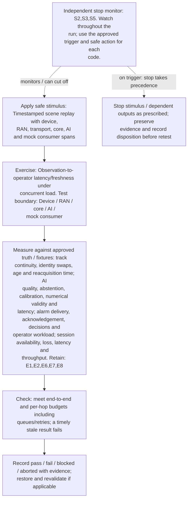

**Measure against:** A-TRK,A-AI,A-HUM,A-COM. [Use every applicable metric and the approved limits](../../README.md#acceptance-profiles); the case-specific check does not replace those profiles.

**Retain:** E1: scene truth, detections, tracks and scores; E2: test communication traffic and service KPIs; E6: operator actions, mock calls, interlocks and stops; E7: synthetic identities, core APIs and distributed traces; E8: dataset/model versions, AI outputs and quality telemetry.

**Stop plan:** S2,S3,S5; [trigger definitions and safe outcomes](../../README.md#evidence-and-safe-stop-codes). **Requirements:** REQ-SEN,REQ-AI,REQ-HUM,REQ-COM.

## TC-114

**What you test:** AI-serving burst plus UE registration/session surge.

**Setup:** `C/B/J/Q=ALL`. Create an approved instance with ground truth, baseline, limits and a named independent stop owner. Apply the exact frequency configuration and its reviewed applicability.

Show test flow and independent stop path

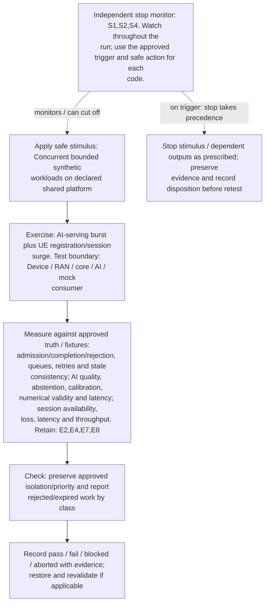

**Measure against:** A-CORE,A-AI,A-COM. [Use every applicable metric and the approved limits](../../README.md#acceptance-profiles); the case-specific check does not replace those profiles.

**Retain:** E2: test communication traffic and service KPIs; E4: faults, queues, alarms and recovery state; E7: synthetic identities, core APIs and distributed traces; E8: dataset/model versions, AI outputs and quality telemetry.

**Stop plan:** S1,S2,S4; [trigger definitions and safe outcomes](../../README.md#evidence-and-safe-stop-codes). **Requirements:** REQ-CORE,REQ-AI,REQ-COM.

## TC-115

**What you test:** Core disconnection plus continued local observations.

**Setup:** `C/J/U=ALL`. Create an approved instance with ground truth, baseline, limits and a named independent stop owner. Apply the exact frequency configuration and its reviewed applicability.

Show test flow and independent stop path

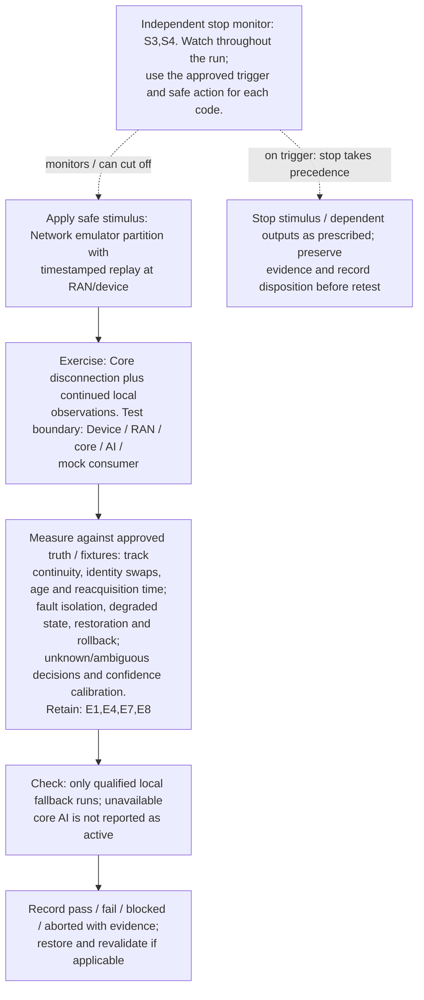

**Measure against:** A-TRK,A-RES,A-UNC. [Use every applicable metric and the approved limits](../../README.md#acceptance-profiles); the case-specific check does not replace those profiles.

**Retain:** E1: scene truth, detections, tracks and scores; E4: faults, queues, alarms and recovery state; E7: synthetic identities, core APIs and distributed traces; E8: dataset/model versions, AI outputs and quality telemetry.

**Stop plan:** S3,S4; [trigger definitions and safe outcomes](../../README.md#evidence-and-safe-stop-codes). **Requirements:** REQ-SEN,REQ-RES,REQ-UNC.

## TC-116

**What you test:** Reconnection backlog plus changed model/policy.

**Setup:** `C/B/J/L=ALL`. Create an approved instance with ground truth, baseline, limits and a named independent stop owner. Apply the exact frequency configuration and its reviewed applicability.

Show test flow and independent stop path

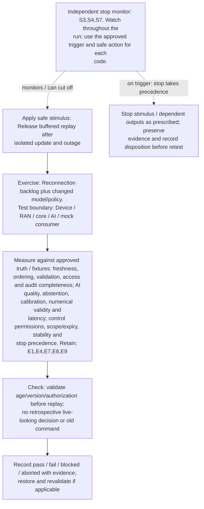

**Measure against:** A-DAT,A-AI,A-CTL. [Use every applicable metric and the approved limits](../../README.md#acceptance-profiles); the case-specific check does not replace those profiles.

**Retain:** E1: scene truth, detections, tracks and scores; E4: faults, queues, alarms and recovery state; E7: synthetic identities, core APIs and distributed traces; E8: dataset/model versions, AI outputs and quality telemetry; E9: approvals, lineage, rollout and governance/control audit.

**Stop plan:** S3,S4,S7; [trigger definitions and safe outcomes](../../README.md#evidence-and-safe-stop-codes). **Requirements:** REQ-DAT,REQ-AI,REQ-CTL.

## TC-117

**What you test:** Shared core/AI cluster, storage or region loss.

**Setup:** `C/N/J=ALL`. Create an approved instance with ground truth, baseline, limits and a named independent stop owner. Apply the exact frequency configuration and its reviewed applicability.

Show test flow and independent stop path

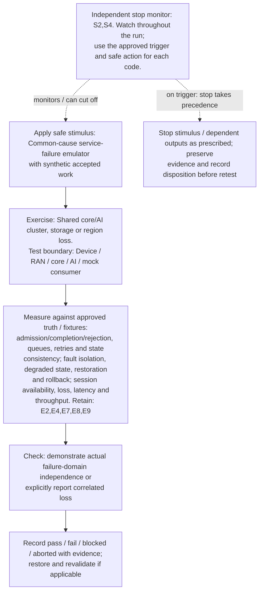

**Measure against:** A-CORE,A-RES,A-COM. [Use every applicable metric and the approved limits](../../README.md#acceptance-profiles); the case-specific check does not replace those profiles.

**Retain:** E2: test communication traffic and service KPIs; E4: faults, queues, alarms and recovery state; E7: synthetic identities, core APIs and distributed traces; E8: dataset/model versions, AI outputs and quality telemetry; E9: approvals, lineage, rollout and governance/control audit.

**Stop plan:** S2,S4; [trigger definitions and safe outcomes](../../README.md#evidence-and-safe-stop-codes). **Requirements:** REQ-CORE,REQ-RES,REQ-COM.

## TC-118

**What you test:** Uncertain AI result plus failed operator delivery.

**Setup:** `C/J/X=ALL`. Create an approved instance with ground truth, baseline, limits and a named independent stop owner. Apply the exact frequency configuration and its reviewed applicability.

Show test flow and independent stop path

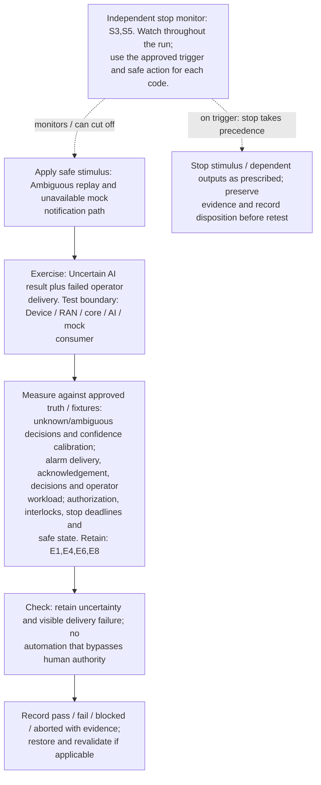

**Measure against:** A-UNC,A-HUM,A-SAF. [Use every applicable metric and the approved limits](../../README.md#acceptance-profiles); the case-specific check does not replace those profiles.

**Retain:** E1: scene truth, detections, tracks and scores; E4: faults, queues, alarms and recovery state; E6: operator actions, mock calls, interlocks and stops; E8: dataset/model versions, AI outputs and quality telemetry.

**Stop plan:** S3,S5; [trigger definitions and safe outcomes](../../README.md#evidence-and-safe-stop-codes). **Requirements:** REQ-UNC,REQ-HUM,REQ-SAF.

## TC-119

**What you test:** Revocation during active inference/federation.

**Setup:** `C/J/H=ALL`. Create an approved instance with ground truth, baseline, limits and a named independent stop owner. Apply the exact frequency configuration and its reviewed applicability.

Show test flow and independent stop path

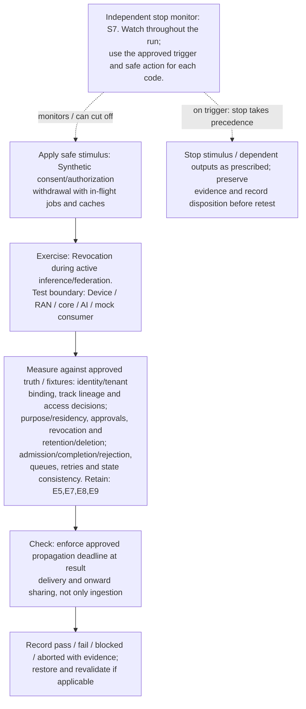

**Measure against:** A-ID,A-GOV,A-CORE. [Use every applicable metric and the approved limits](../../README.md#acceptance-profiles); the case-specific check does not replace those profiles.

**Retain:** E5: input provenance, validation, access and integrity; E7: synthetic identities, core APIs and distributed traces; E8: dataset/model versions, AI outputs and quality telemetry; E9: approvals, lineage, rollout and governance/control audit.

**Stop plan:** S7; [trigger definitions and safe outcomes](../../README.md#evidence-and-safe-stop-codes). **Requirements:** REQ-ID,REQ-GOV,REQ-CORE.

## TC-120

**What you test:** Device/RAN timing/calibration loss plus AI confidence.

**Setup:** `C/J/R/G=ALL`. Create an approved instance with ground truth, baseline, limits and a named independent stop owner. Apply the exact frequency configuration and its reviewed applicability.

Show test flow and independent stop path

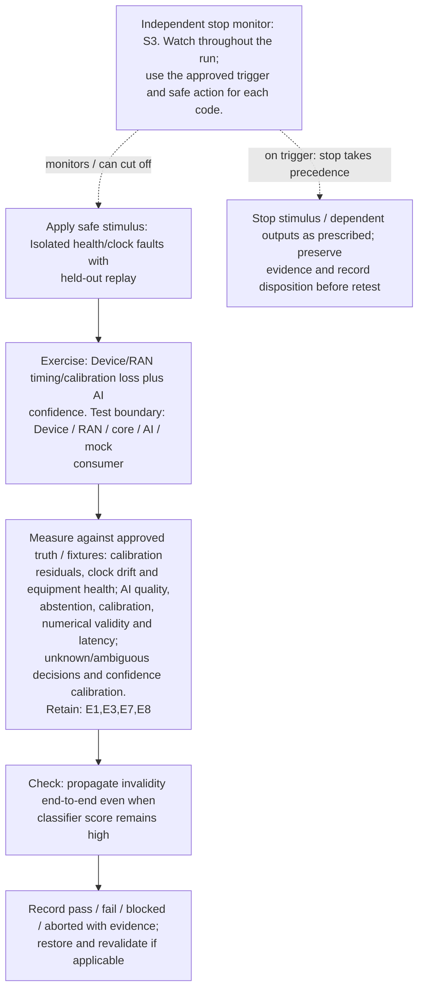

**Measure against:** A-RAD,A-AI,A-UNC. [Use every applicable metric and the approved limits](../../README.md#acceptance-profiles); the case-specific check does not replace those profiles.

**Retain:** E1: scene truth, detections, tracks and scores; E3: radio, timing, calibration and instrument health; E7: synthetic identities, core APIs and distributed traces; E8: dataset/model versions, AI outputs and quality telemetry.

**Stop plan:** S3; [trigger definitions and safe outcomes](../../README.md#evidence-and-safe-stop-codes). **Requirements:** REQ-RAD,REQ-AI,REQ-UNC.

## TC-121

**What you test:** Tenant pressure plus core/AI scale-in/failover.

**Setup:** `C/B/J/H=ALL`. Create an approved instance with ground truth, baseline, limits and a named independent stop owner. Apply the exact frequency configuration and its reviewed applicability.

Show test flow and independent stop path

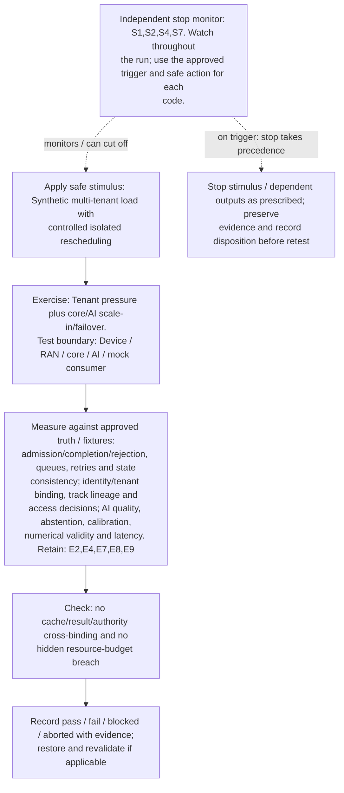

**Measure against:** A-CORE,A-ID,A-AI. [Use every applicable metric and the approved limits](../../README.md#acceptance-profiles); the case-specific check does not replace those profiles.

**Retain:** E2: test communication traffic and service KPIs; E4: faults, queues, alarms and recovery state; E7: synthetic identities, core APIs and distributed traces; E8: dataset/model versions, AI outputs and quality telemetry; E9: approvals, lineage, rollout and governance/control audit.

**Stop plan:** S1,S2,S4,S7; [trigger definitions and safe outcomes](../../README.md#evidence-and-safe-stop-codes). **Requirements:** REQ-CORE,REQ-ID,REQ-AI.

## TC-122

**What you test:** Model update plus radio/mode/core API transition.

**Setup:** `C/J/M/R/L=ALL`. Create an approved instance with ground truth, baseline, limits and a named independent stop owner. Apply the exact frequency configuration and its reviewed applicability.

Show test flow and independent stop path

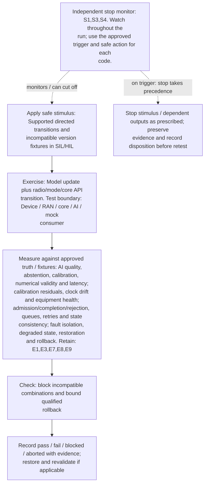

**Measure against:** A-AI,A-RAD,A-CORE,A-RES. [Use every applicable metric and the approved limits](../../README.md#acceptance-profiles); the case-specific check does not replace those profiles.

**Retain:** E1: scene truth, detections, tracks and scores; E3: radio, timing, calibration and instrument health; E7: synthetic identities, core APIs and distributed traces; E8: dataset/model versions, AI outputs and quality telemetry; E9: approvals, lineage, rollout and governance/control audit.

**Stop plan:** S1,S3,S4; [trigger definitions and safe outcomes](../../README.md#evidence-and-safe-stop-codes). **Requirements:** REQ-AI,REQ-RAD,REQ-CORE,REQ-RES.

## TC-123

**What you test:** Stop/revocation during AI-driven network change.

**Setup:** `C/J/L=ALL`. Create an approved instance with ground truth, baseline, limits and a named independent stop owner. Apply the exact frequency configuration and its reviewed applicability.

Show test flow and independent stop path

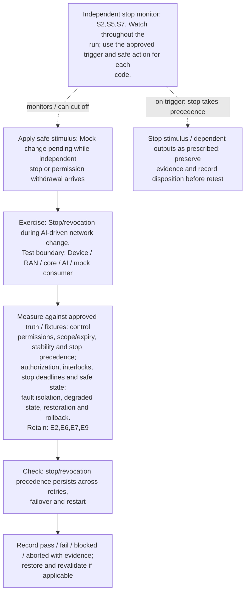

**Measure against:** A-CTL,A-SAF,A-RES. [Use every applicable metric and the approved limits](../../README.md#acceptance-profiles); the case-specific check does not replace those profiles.

**Retain:** E2: test communication traffic and service KPIs; E6: operator actions, mock calls, interlocks and stops; E7: synthetic identities, core APIs and distributed traces; E9: approvals, lineage, rollout and governance/control audit.

**Stop plan:** S2,S5,S7; [trigger definitions and safe outcomes](../../README.md#evidence-and-safe-stop-codes). **Requirements:** REQ-CTL,REQ-SAF,REQ-RES.

## TC-124

**What you test:** Recovery from mismatched core/model/data backups.

**Setup:** `C/J/L=ALL`. Create an approved instance with ground truth, baseline, limits and a named independent stop owner. Apply the exact frequency configuration and its reviewed applicability.

Show test flow and independent stop path

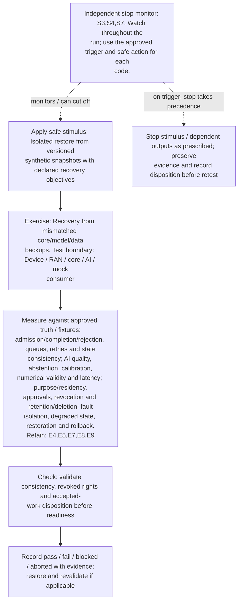

**Measure against:** A-CORE,A-AI,A-GOV,A-RES. [Use every applicable metric and the approved limits](../../README.md#acceptance-profiles); the case-specific check does not replace those profiles.

**Retain:** E4: faults, queues, alarms and recovery state; E5: input provenance, validation, access and integrity; E7: synthetic identities, core APIs and distributed traces; E8: dataset/model versions, AI outputs and quality telemetry; E9: approvals, lineage, rollout and governance/control audit.

**Stop plan:** S3,S4,S7; [trigger definitions and safe outcomes](../../README.md#evidence-and-safe-stop-codes). **Requirements:** REQ-CORE,REQ-AI,REQ-GOV,REQ-RES.

## TC-125

**What you test:** Multi-site object handoff versus UE/session mobility.

**Setup:** `C/G/J/U=ALL`. Create an approved instance with ground truth, baseline, limits and a named independent stop owner. Apply the exact frequency configuration and its reviewed applicability.

Show test flow and independent stop path

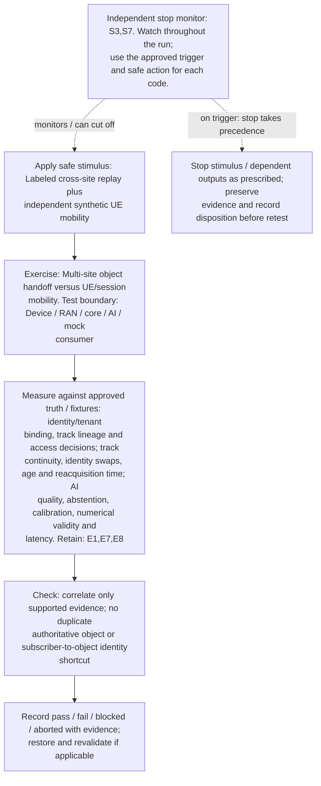

**Measure against:** A-ID,A-TRK,A-AI. [Use every applicable metric and the approved limits](../../README.md#acceptance-profiles); the case-specific check does not replace those profiles.

**Retain:** E1: scene truth, detections, tracks and scores; E7: synthetic identities, core APIs and distributed traces; E8: dataset/model versions, AI outputs and quality telemetry.

**Stop plan:** S3,S7; [trigger definitions and safe outcomes](../../README.md#evidence-and-safe-stop-codes). **Requirements:** REQ-ID,REQ-SEN,REQ-AI.

## TC-126

**What you test:** Core/AI privacy controls under evidence-store failure.

**Setup:** `C/J/H=ALL`. Create an approved instance with ground truth, baseline, limits and a named independent stop owner. Apply the exact frequency configuration and its reviewed applicability.

Show test flow and independent stop path

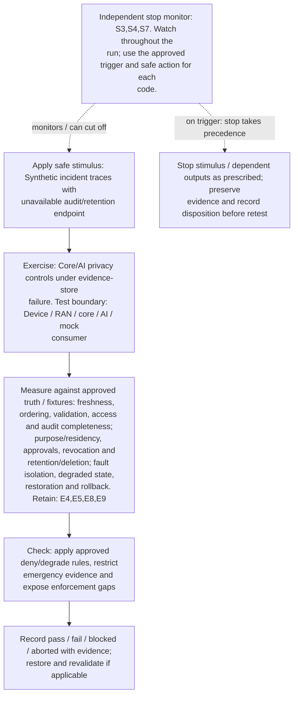

**Measure against:** A-DAT,A-GOV,A-RES. [Use every applicable metric and the approved limits](../../README.md#acceptance-profiles); the case-specific check does not replace those profiles.

**Retain:** E4: faults, queues, alarms and recovery state; E5: input provenance, validation, access and integrity; E8: dataset/model versions, AI outputs and quality telemetry; E9: approvals, lineage, rollout and governance/control audit.

**Stop plan:** S3,S4,S7; [trigger definitions and safe outcomes](../../README.md#evidence-and-safe-stop-codes). **Requirements:** REQ-DAT,REQ-GOV,REQ-RES.

## TC-127

**What you test:** Long-duration core/AI churn and repeated degraded recovery.

**Setup:** `C/B/J/L=ALL`. Create an approved instance with ground truth, baseline, limits and a named independent stop owner. Apply the exact frequency configuration and its reviewed applicability.

Show test flow and independent stop path

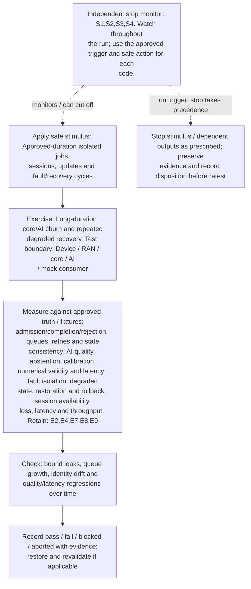

**Measure against:** A-CORE,A-AI,A-RES,A-COM. [Use every applicable metric and the approved limits](../../README.md#acceptance-profiles); the case-specific check does not replace those profiles.

**Retain:** E2: test communication traffic and service KPIs; E4: faults, queues, alarms and recovery state; E7: synthetic identities, core APIs and distributed traces; E8: dataset/model versions, AI outputs and quality telemetry; E9: approvals, lineage, rollout and governance/control audit.

**Stop plan:** S1,S2,S3,S4; [trigger definitions and safe outcomes](../../README.md#evidence-and-safe-stop-codes). **Requirements:** REQ-CORE,REQ-AI,REQ-RES,REQ-COM.

## TC-128

**What you test:** Pre-approved multi-domain acceptance and operator handoff rehearsal.

**Setup:** all applicable axes. Create an approved instance with ground truth, baseline, limits and a named independent stop owner. Apply the exact frequency configuration and its reviewed applicability.

Show test flow and independent stop path

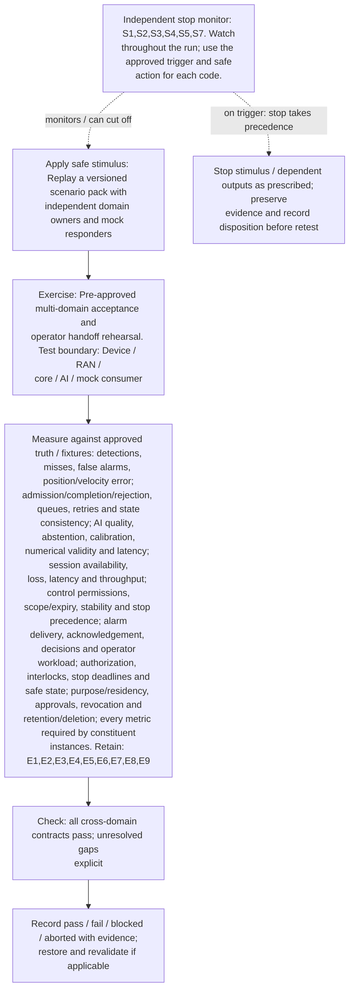

**Measure against:** A-SEN,A-CORE,A-AI,A-COM,A-CTL,A-HUM,A-SAF,A-GOV plus every profile required by constituent instances. [Use every applicable metric and the approved limits](../../README.md#acceptance-profiles); the case-specific check does not replace those profiles.

**Retain:** E1: scene truth, detections, tracks and scores; E2: test communication traffic and service KPIs; E3: radio, timing, calibration and instrument health; E4: faults, queues, alarms and recovery state; E5: input provenance, validation, access and integrity; E6: operator actions, mock calls, interlocks and stops; E7: synthetic identities, core APIs and distributed traces; E8: dataset/model versions, AI outputs and quality telemetry; E9: approvals, lineage, rollout and governance/control audit.

**Stop plan:** S1,S2,S3,S4,S5,S7; [trigger definitions and safe outcomes](../../README.md#evidence-and-safe-stop-codes). **Requirements:** REQ-SEN,REQ-CORE,REQ-AI,REQ-COM,REQ-CTL,REQ-HUM,REQ-SAF,REQ-GOV.
