# Data, service, and infrastructure fault injection: designer test diagrams

[Visual guide and shared execution rules](../../README.md#designer-visual-test-guide) | [Authoritative scenario matrix](../../README.md#traceable-scenario-coverage-matrix)

These are test-design flows, not measured results or an asserted deployment architecture. Solid arrows show the test/evidence flow; dashed arrows show independent stop control. Apply the shared approval gate before every instance. Expand the declared axes and frequency overlay; never treat one diagram as coverage of every configuration.

## TC-027

**What you test:** Stale/reordered/duplicate observations.

**Setup:** `X/N/Q=ALL`. Create an approved instance with ground truth, baseline, limits and a named independent stop owner. Apply the exact frequency configuration and its reviewed applicability.

Show test flow and independent stop path

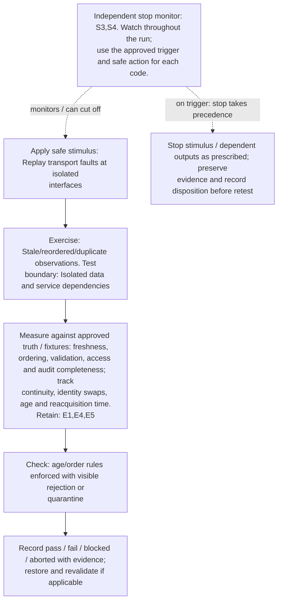

**Measure against:** A-DAT,A-TRK. [Use every applicable metric and the approved limits](../../README.md#acceptance-profiles); the case-specific check does not replace those profiles.

**Retain:** E1: scene truth, detections, tracks and scores; E4: faults, queues, alarms and recovery state; E5: input provenance, validation, access and integrity.

**Stop plan:** S3,S4; [trigger definitions and safe outcomes](../../README.md#evidence-and-safe-stop-codes). **Requirements:** REQ-DAT,REQ-SEN.

## TC-028

**What you test:** Invalid schema, units or reference frame.

**Setup:** `R/X=ALL`. Create an approved instance with ground truth, baseline, limits and a named independent stop owner. Apply the exact frequency configuration and its reviewed applicability.

Show test flow and independent stop path

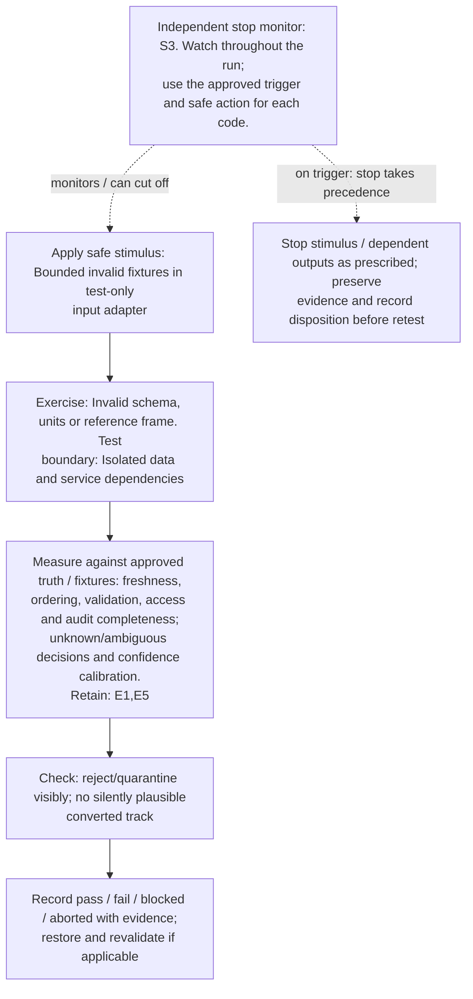

**Measure against:** A-DAT,A-UNC. [Use every applicable metric and the approved limits](../../README.md#acceptance-profiles); the case-specific check does not replace those profiles.

**Retain:** E1: scene truth, detections, tracks and scores; E5: input provenance, validation, access and integrity.

**Stop plan:** S3; [trigger definitions and safe outcomes](../../README.md#evidence-and-safe-stop-codes). **Requirements:** REQ-DAT,REQ-UNC.

## TC-029

**What you test:** Missing/untrusted input provenance.

**Setup:** `X/N=ALL`. Create an approved instance with ground truth, baseline, limits and a named independent stop owner. Apply the exact frequency configuration and its reviewed applicability.

Show test flow and independent stop path

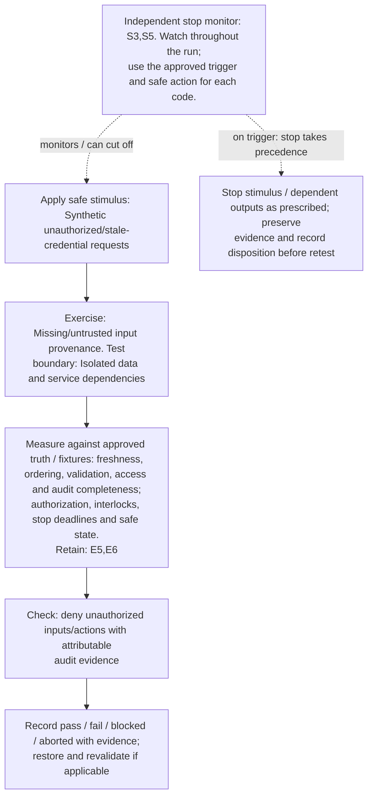

**Measure against:** A-DAT,A-SAF. [Use every applicable metric and the approved limits](../../README.md#acceptance-profiles); the case-specific check does not replace those profiles.

**Retain:** E5: input provenance, validation, access and integrity; E6: operator actions, mock calls, interlocks and stops.

**Stop plan:** S3,S5; [trigger definitions and safe outcomes](../../README.md#evidence-and-safe-stop-codes). **Requirements:** REQ-DAT,REQ-SAF.

## TC-030

**What you test:** Sensor disconnection or RF-chain health loss.

**Setup:** `R/X=ALL`. Create an approved instance with ground truth, baseline, limits and a named independent stop owner. Apply the exact frequency configuration and its reviewed applicability.

Show test flow and independent stop path

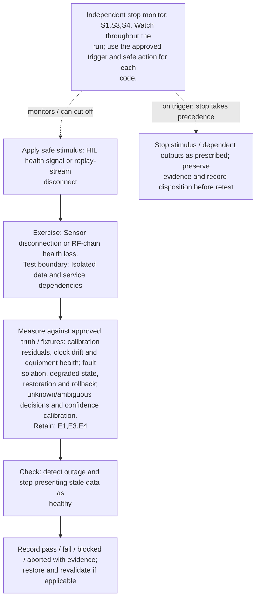

**Measure against:** A-RAD,A-RES,A-UNC. [Use every applicable metric and the approved limits](../../README.md#acceptance-profiles); the case-specific check does not replace those profiles.

**Retain:** E1: scene truth, detections, tracks and scores; E3: radio, timing, calibration and instrument health; E4: faults, queues, alarms and recovery state.

**Stop plan:** S1,S3,S4; [trigger definitions and safe outcomes](../../README.md#evidence-and-safe-stop-codes). **Requirements:** REQ-RAD,REQ-RES,REQ-UNC.

## TC-031

**What you test:** Compute/accelerator pressure.

**Setup:** `M/Q/N=ALL`. Create an approved instance with ground truth, baseline, limits and a named independent stop owner. Apply the exact frequency configuration and its reviewed applicability.

Show test flow and independent stop path

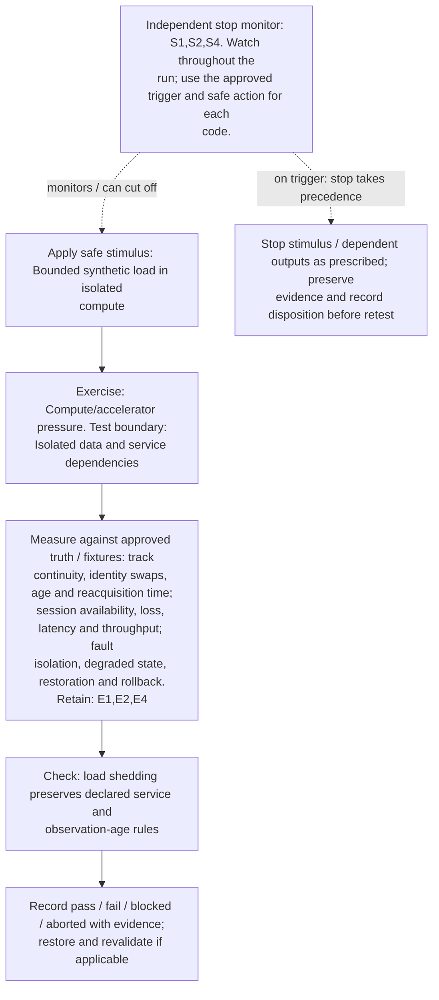

**Measure against:** A-TRK,A-COM,A-RES. [Use every applicable metric and the approved limits](../../README.md#acceptance-profiles); the case-specific check does not replace those profiles.

**Retain:** E1: scene truth, detections, tracks and scores; E2: test communication traffic and service KPIs; E4: faults, queues, alarms and recovery state.

**Stop plan:** S1,S2,S4; [trigger definitions and safe outcomes](../../README.md#evidence-and-safe-stop-codes). **Requirements:** REQ-SEN,REQ-COM,REQ-RES.

## TC-032

**What you test:** Queue/storage pressure and evidence loss.

**Setup:** `Q/N=ALL`. Create an approved instance with ground truth, baseline, limits and a named independent stop owner. Apply the exact frequency configuration and its reviewed applicability.

Show test flow and independent stop path

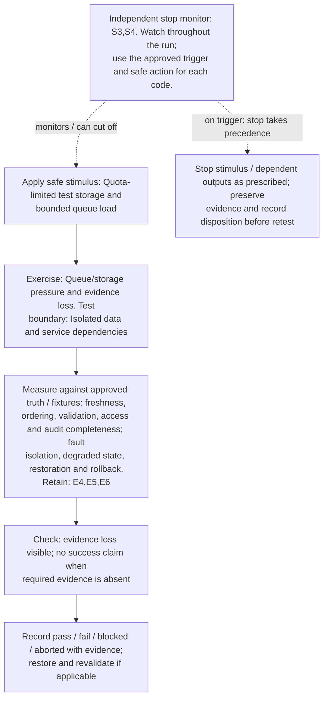

**Measure against:** A-DAT,A-RES. [Use every applicable metric and the approved limits](../../README.md#acceptance-profiles); the case-specific check does not replace those profiles.

**Retain:** E4: faults, queues, alarms and recovery state; E5: input provenance, validation, access and integrity; E6: operator actions, mock calls, interlocks and stops.

**Stop plan:** S3,S4; [trigger definitions and safe outcomes](../../README.md#evidence-and-safe-stop-codes). **Requirements:** REQ-DAT,REQ-RES.

## TC-033

**What you test:** Backhaul delay, loss or disconnection.

**Setup:** `N/Q=ALL`. Create an approved instance with ground truth, baseline, limits and a named independent stop owner. Apply the exact frequency configuration and its reviewed applicability.

Show test flow and independent stop path

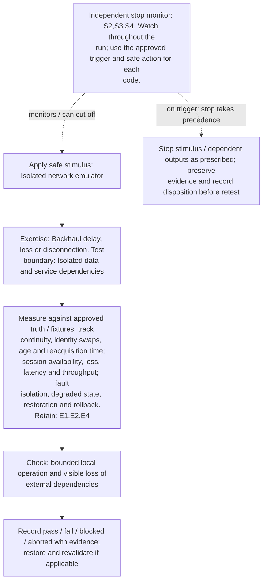

**Measure against:** A-TRK,A-COM,A-RES. [Use every applicable metric and the approved limits](../../README.md#acceptance-profiles); the case-specific check does not replace those profiles.

**Retain:** E1: scene truth, detections, tracks and scores; E2: test communication traffic and service KPIs; E4: faults, queues, alarms and recovery state.

**Stop plan:** S2,S3,S4; [trigger definitions and safe outcomes](../../README.md#evidence-and-safe-stop-codes). **Requirements:** REQ-SEN,REQ-COM,REQ-RES.

## TC-034

**What you test:** Core/control-service unavailable.

**Setup:** `N/L=ALL`. Create an approved instance with ground truth, baseline, limits and a named independent stop owner. Apply the exact frequency configuration and its reviewed applicability.

Show test flow and independent stop path

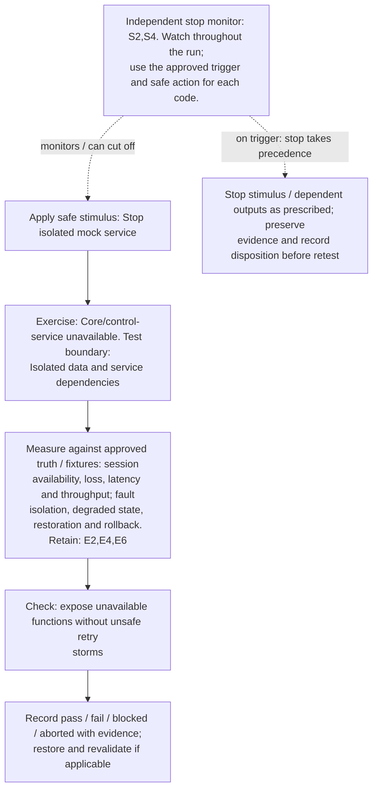

**Measure against:** A-COM,A-RES. [Use every applicable metric and the approved limits](../../README.md#acceptance-profiles); the case-specific check does not replace those profiles.

**Retain:** E2: test communication traffic and service KPIs; E4: faults, queues, alarms and recovery state; E6: operator actions, mock calls, interlocks and stops.

**Stop plan:** S2,S4; [trigger definitions and safe outcomes](../../README.md#evidence-and-safe-stop-codes). **Requirements:** REQ-COM,REQ-RES.

## TC-035

**What you test:** Power-state transition or restart.

**Setup:** `R/N/L=ALL`. Create an approved instance with ground truth, baseline, limits and a named independent stop owner. Apply the exact frequency configuration and its reviewed applicability.

Show test flow and independent stop path

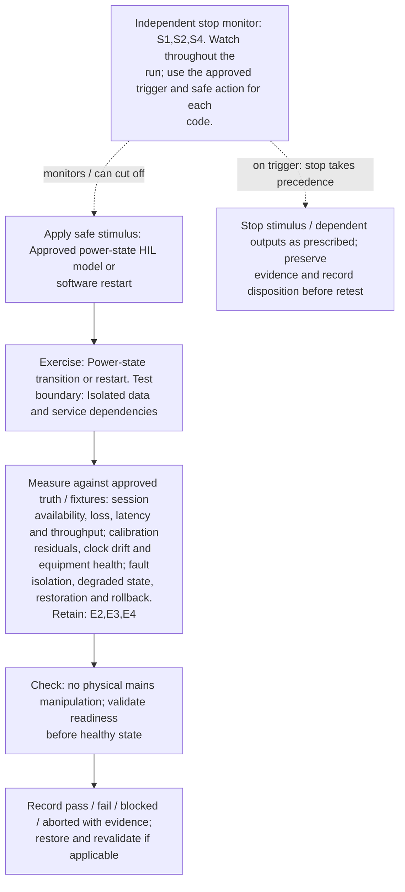

**Measure against:** A-COM,A-RAD,A-RES. [Use every applicable metric and the approved limits](../../README.md#acceptance-profiles); the case-specific check does not replace those profiles.

**Retain:** E2: test communication traffic and service KPIs; E3: radio, timing, calibration and instrument health; E4: faults, queues, alarms and recovery state.

**Stop plan:** S1,S2,S4; [trigger definitions and safe outcomes](../../README.md#evidence-and-safe-stop-codes). **Requirements:** REQ-COM,REQ-RAD,REQ-RES.

## TC-036

**What you test:** Thermal warning/derating.

**Setup:** `R/Q/L=ALL`. Create an approved instance with ground truth, baseline, limits and a named independent stop owner. Apply the exact frequency configuration and its reviewed applicability.

Show test flow and independent stop path

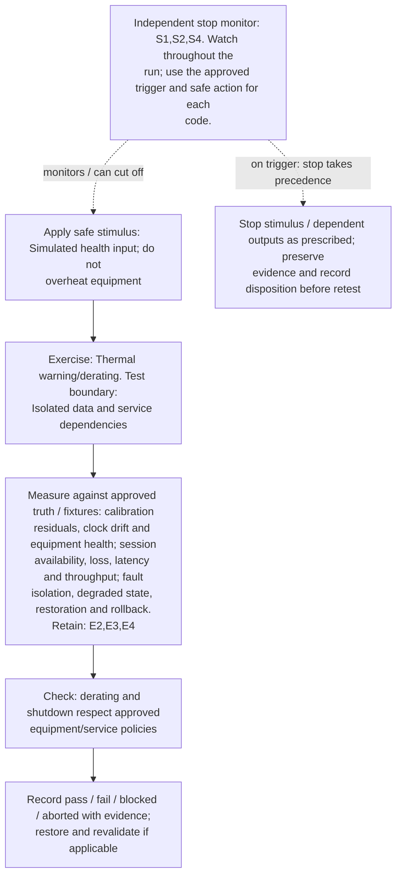

**Measure against:** A-RAD,A-COM,A-RES. [Use every applicable metric and the approved limits](../../README.md#acceptance-profiles); the case-specific check does not replace those profiles.

**Retain:** E2: test communication traffic and service KPIs; E3: radio, timing, calibration and instrument health; E4: faults, queues, alarms and recovery state.

**Stop plan:** S1,S2,S4; [trigger definitions and safe outcomes](../../README.md#evidence-and-safe-stop-codes). **Requirements:** REQ-RAD,REQ-COM,REQ-RES.

## TC-037

**What you test:** Component crash and restart loop.

**Setup:** `N/L=ALL`. Create an approved instance with ground truth, baseline, limits and a named independent stop owner. Apply the exact frequency configuration and its reviewed applicability.

Show test flow and independent stop path

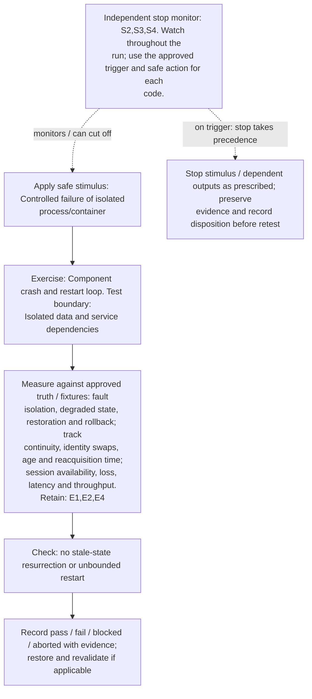

**Measure against:** A-RES,A-TRK,A-COM. [Use every applicable metric and the approved limits](../../README.md#acceptance-profiles); the case-specific check does not replace those profiles.

**Retain:** E1: scene truth, detections, tracks and scores; E2: test communication traffic and service KPIs; E4: faults, queues, alarms and recovery state.

**Stop plan:** S2,S3,S4; [trigger definitions and safe outcomes](../../README.md#evidence-and-safe-stop-codes). **Requirements:** REQ-RES,REQ-SEN,REQ-COM.

## TC-038

**What you test:** Model/configuration update and rollback.

**Setup:** `M/R/L=ALL`. Create an approved instance with ground truth, baseline, limits and a named independent stop owner. Apply the exact frequency configuration and its reviewed applicability.

Show test flow and independent stop path

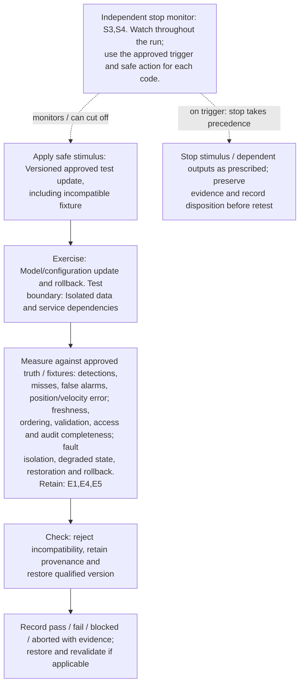

**Measure against:** A-SEN,A-DAT,A-RES. [Use every applicable metric and the approved limits](../../README.md#acceptance-profiles); the case-specific check does not replace those profiles.

**Retain:** E1: scene truth, detections, tracks and scores; E4: faults, queues, alarms and recovery state; E5: input provenance, validation, access and integrity.

**Stop plan:** S3,S4; [trigger definitions and safe outcomes](../../README.md#evidence-and-safe-stop-codes). **Requirements:** REQ-SEN,REQ-DAT,REQ-RES.

## TC-039

**What you test:** Redundant-node failover and split view.

**Setup:** `N/G=ALL`. Create an approved instance with ground truth, baseline, limits and a named independent stop owner. Apply the exact frequency configuration and its reviewed applicability.

Show test flow and independent stop path

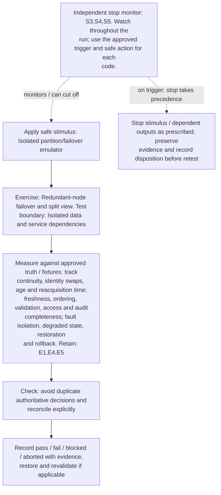

**Measure against:** A-TRK,A-DAT,A-RES. [Use every applicable metric and the approved limits](../../README.md#acceptance-profiles); the case-specific check does not replace those profiles.

**Retain:** E1: scene truth, detections, tracks and scores; E4: faults, queues, alarms and recovery state; E5: input provenance, validation, access and integrity.

**Stop plan:** S3,S4,S5; [trigger definitions and safe outcomes](../../README.md#evidence-and-safe-stop-codes). **Requirements:** REQ-SEN,REQ-DAT,REQ-RES.

## TC-040

**What you test:** Alarm delivery/acknowledgement path failure.

**Setup:** `N/L/Q=ALL`. Create an approved instance with ground truth, baseline, limits and a named independent stop owner. Apply the exact frequency configuration and its reviewed applicability.

Show test flow and independent stop path

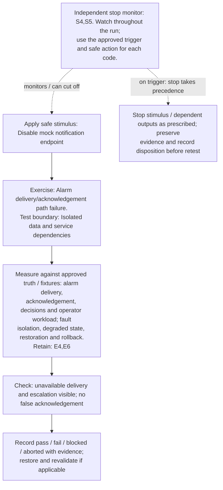

**Measure against:** A-HUM,A-RES. [Use every applicable metric and the approved limits](../../README.md#acceptance-profiles); the case-specific check does not replace those profiles.

**Retain:** E4: faults, queues, alarms and recovery state; E6: operator actions, mock calls, interlocks and stops.

**Stop plan:** S4,S5; [trigger definitions and safe outcomes](../../README.md#evidence-and-safe-stop-codes). **Requirements:** REQ-HUM,REQ-RES.
