# FR2/mmWave and experimental sub-THz qualification and stress: designer test diagrams

[Visual guide and shared execution rules](../../README.md#designer-visual-test-guide) | [Authoritative scenario matrix](../../README.md#traceable-scenario-coverage-matrix)

**KPI / PM events:** use each TC ID in the [case-focus table](../kpi-pm.md#case-specific-focus-checks), plus all measurement/event groups inherited from its acceptance profiles. Actual collector names and thresholds need approval; local event labels are not standardized counters.

These are test-design flows, not measured results or an asserted deployment architecture. Solid arrows show the test/evidence flow; dashed arrows show independent stop control. Apply the shared approval gate before every instance. Expand the declared axes and frequency overlay; never treat one diagram as coverage of every configuration.

## TC-129

**What you test:** Blockage and intermittent observability.

**Setup:** `K/G/V=ALL`. Create an approved instance with ground truth, baseline, limits and a named independent stop owner. Apply the exact frequency configuration and its reviewed applicability.

<details>
<summary>Show test flow and independent stop path</summary>

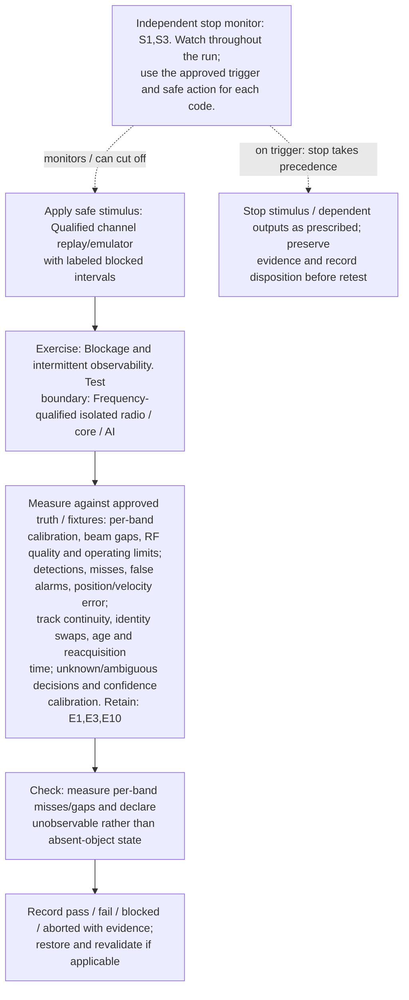

</details>

**Measure against:** A-HF,A-SEN,A-TRK,A-UNC. [Use every applicable metric and the approved limits](../../README.md#acceptance-profiles); the case-specific check does not replace those profiles.

**Retain:** E1: scene truth, detections, tracks and scores; E3: radio, timing, calibration and instrument health; E10: frequency/beam manifest and qualified RF/model evidence.

**Stop plan:** S1,S3; [trigger definitions and safe outcomes](../../README.md#evidence-and-safe-stop-codes). **Requirements:** REQ-HF,REQ-SEN,REQ-UNC.

## TC-130

**What you test:** Separate communication/sensing beam acquisition and recovery.

**Setup:** `K/W/R/Q=ALL`. Create an approved instance with ground truth, baseline, limits and a named independent stop owner. Apply the exact frequency configuration and its reviewed applicability.

<details>
<summary>Show test flow and independent stop path</summary>

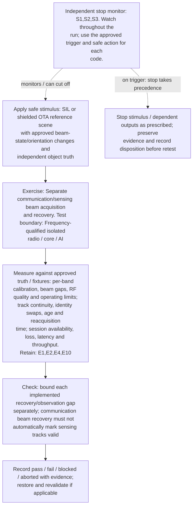

</details>

**Measure against:** A-HF,A-TRK,A-COM. [Use every applicable metric and the approved limits](../../README.md#acceptance-profiles); the case-specific check does not replace those profiles.

**Retain:** E1: scene truth, detections, tracks and scores; E2: test communication traffic and service KPIs; E4: faults, queues, alarms and recovery state; E10: frequency/beam manifest and qualified RF/model evidence.

**Stop plan:** S1,S2,S3; [trigger definitions and safe outcomes](../../README.md#evidence-and-safe-stop-codes). **Requirements:** REQ-HF,REQ-SEN,REQ-COM.

## TC-131

**What you test:** Wideband beam squint and frequency-dependent array response.

**Setup:** `K/D/W=ALL`. Create an approved instance with ground truth, baseline, limits and a named independent stop owner. Apply the exact frequency configuration and its reviewed applicability.

<details>
<summary>Show test flow and independent stop path</summary>

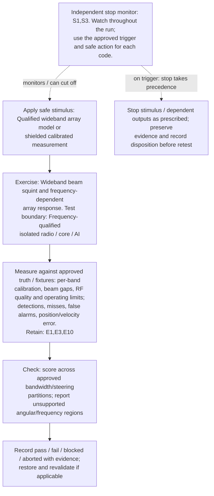

</details>

**Measure against:** A-HF,A-SEN. [Use every applicable metric and the approved limits](../../README.md#acceptance-profiles); the case-specific check does not replace those profiles.

**Retain:** E1: scene truth, detections, tracks and scores; E3: radio, timing, calibration and instrument health; E10: frequency/beam manifest and qualified RF/model evidence.

**Stop plan:** S1,S3; [trigger definitions and safe outcomes](../../README.md#evidence-and-safe-stop-codes). **Requirements:** REQ-HF,REQ-RAD,REQ-SEN.

## TC-132

**What you test:** Near/far-field model validity and focusing assumptions.

**Setup:** `K/G/R=ALL`. Create an approved instance with ground truth, baseline, limits and a named independent stop owner. Apply the exact frequency configuration and its reviewed applicability.

<details>
<summary>Show test flow and independent stop path</summary>

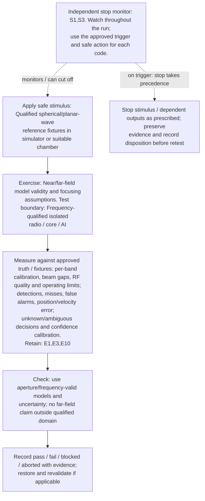

</details>

**Measure against:** A-HF,A-SEN,A-UNC. [Use every applicable metric and the approved limits](../../README.md#acceptance-profiles); the case-specific check does not replace those profiles.

**Retain:** E1: scene truth, detections, tracks and scores; E3: radio, timing, calibration and instrument health; E10: frequency/beam manifest and qualified RF/model evidence.

**Stop plan:** S1,S3; [trigger definitions and safe outcomes](../../README.md#evidence-and-safe-stop-codes). **Requirements:** REQ-HF,REQ-RAD,REQ-UNC.

## TC-133

**What you test:** Frequency/path-dependent gas, rain and cloud/fog effects.

**Setup:** `K/V=ALL`. Create an approved instance with ground truth, baseline, limits and a named independent stop owner. Apply the exact frequency configuration and its reviewed applicability.

<details>
<summary>Show test flow and independent stop path</summary>

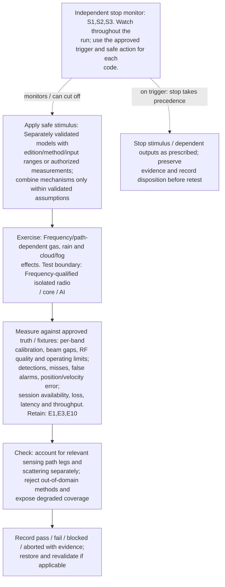

</details>

**Measure against:** A-HF,A-SEN,A-COM. [Use every applicable metric and the approved limits](../../README.md#acceptance-profiles); the case-specific check does not replace those profiles.

**Retain:** E1: scene truth, detections, tracks and scores; E3: radio, timing, calibration and instrument health; E10: frequency/beam manifest and qualified RF/model evidence.

**Stop plan:** S1,S2,S3; [trigger definitions and safe outcomes](../../README.md#evidence-and-safe-stop-codes). **Requirements:** REQ-HF,REQ-SEN,REQ-COM.

## TC-134

**What you test:** Material/roughness/polarization and target-scattering variability.

**Setup:** `K/G/V=ALL`. Create an approved instance with ground truth, baseline, limits and a named independent stop owner. Apply the exact frequency configuration and its reviewed applicability.

<details>
<summary>Show test flow and independent stop path</summary>

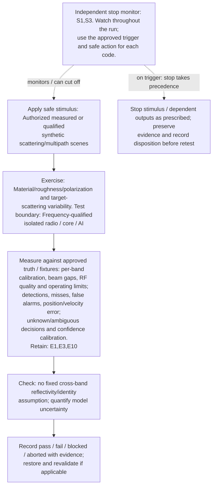

</details>

**Measure against:** A-HF,A-SEN,A-UNC. [Use every applicable metric and the approved limits](../../README.md#acceptance-profiles); the case-specific check does not replace those profiles.

**Retain:** E1: scene truth, detections, tracks and scores; E3: radio, timing, calibration and instrument health; E10: frequency/beam manifest and qualified RF/model evidence.

**Stop plan:** S1,S3; [trigger definitions and safe outcomes](../../README.md#evidence-and-safe-stop-codes). **Requirements:** REQ-HF,REQ-SEN,REQ-UNC.

## TC-135

**What you test:** Radome/enclosure loss and mounting variation.

**Setup:** `K/R/L=ALL`. Create an approved instance with ground truth, baseline, limits and a named independent stop owner. Apply the exact frequency configuration and its reviewed applicability.

<details>
<summary>Show test flow and independent stop path</summary>

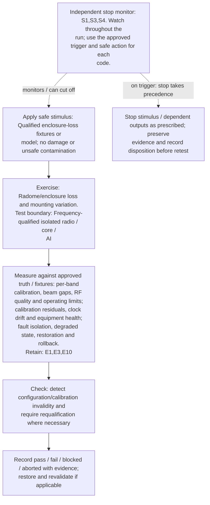

</details>

**Measure against:** A-HF,A-RAD,A-RES. [Use every applicable metric and the approved limits](../../README.md#acceptance-profiles); the case-specific check does not replace those profiles.

**Retain:** E1: scene truth, detections, tracks and scores; E3: radio, timing, calibration and instrument health; E10: frequency/beam manifest and qualified RF/model evidence.

**Stop plan:** S1,S3,S4; [trigger definitions and safe outcomes](../../README.md#evidence-and-safe-stop-codes). **Requirements:** REQ-HF,REQ-RAD,REQ-RES.

## TC-136

**What you test:** Phase noise, frequency offset and LO/multiplier impairments.

**Setup:** `K/D/G=ALL`. Create an approved instance with ground truth, baseline, limits and a named independent stop owner. Apply the exact frequency configuration and its reviewed applicability.

<details>
<summary>Show test flow and independent stop path</summary>

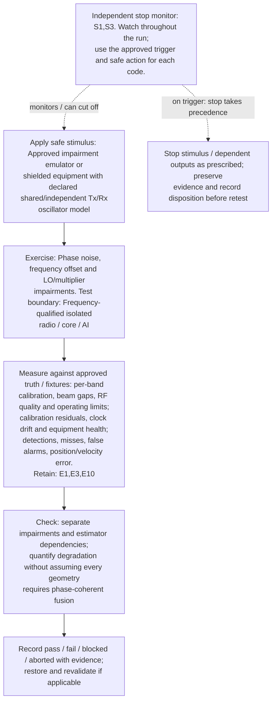

</details>

**Measure against:** A-HF,A-RAD,A-SEN. [Use every applicable metric and the approved limits](../../README.md#acceptance-profiles); the case-specific check does not replace those profiles.

**Retain:** E1: scene truth, detections, tracks and scores; E3: radio, timing, calibration and instrument health; E10: frequency/beam manifest and qualified RF/model evidence.

**Stop plan:** S1,S3; [trigger definitions and safe outcomes](../../README.md#evidence-and-safe-stop-codes). **Requirements:** REQ-HF,REQ-RAD,REQ-SEN.

## TC-137

**What you test:** PA/receiver nonlinearity, dynamic range and self-leakage.

**Setup:** `K/R/D=ALL`. Create an approved instance with ground truth, baseline, limits and a named independent stop owner. Apply the exact frequency configuration and its reviewed applicability.

<details>
<summary>Show test flow and independent stop path</summary>

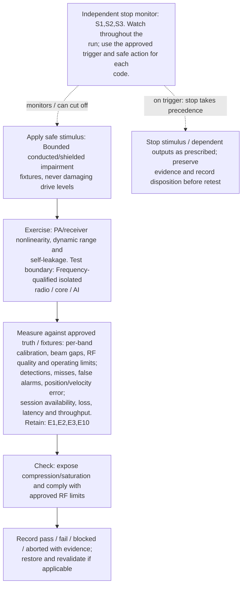

</details>

**Measure against:** A-HF,A-SEN,A-COM. [Use every applicable metric and the approved limits](../../README.md#acceptance-profiles); the case-specific check does not replace those profiles.

**Retain:** E1: scene truth, detections, tracks and scores; E2: test communication traffic and service KPIs; E3: radio, timing, calibration and instrument health; E10: frequency/beam manifest and qualified RF/model evidence.

**Stop plan:** S1,S2,S3; [trigger definitions and safe outcomes](../../README.md#evidence-and-safe-stop-codes). **Requirements:** REQ-HF,REQ-RAD,REQ-SEN,REQ-COM.

## TC-138

**What you test:** Converter precision, clipping and usable bandwidth.

**Setup:** `K/D/J=ALL`. Create an approved instance with ground truth, baseline, limits and a named independent stop owner. Apply the exact frequency configuration and its reviewed applicability.

<details>
<summary>Show test flow and independent stop path</summary>

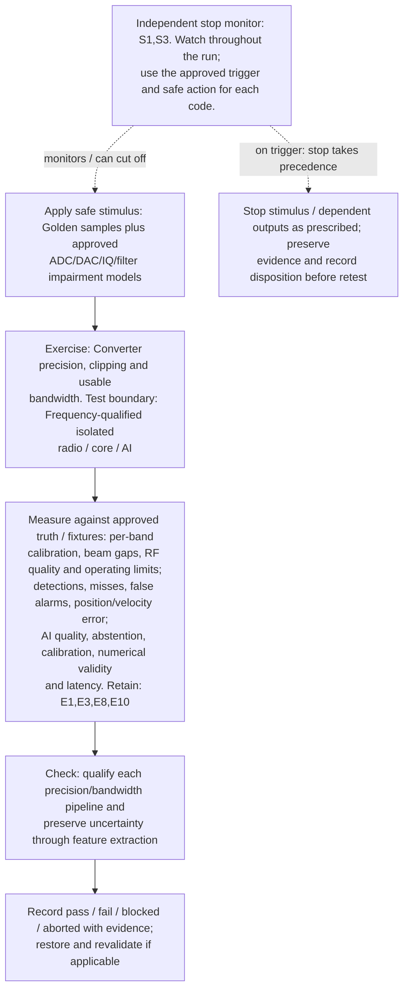

</details>

**Measure against:** A-HF,A-SEN,A-AI. [Use every applicable metric and the approved limits](../../README.md#acceptance-profiles); the case-specific check does not replace those profiles.

**Retain:** E1: scene truth, detections, tracks and scores; E3: radio, timing, calibration and instrument health; E8: dataset/model versions, AI outputs and quality telemetry; E10: frequency/beam manifest and qualified RF/model evidence.

**Stop plan:** S1,S3; [trigger definitions and safe outcomes](../../README.md#evidence-and-safe-stop-codes). **Requirements:** REQ-HF,REQ-SEN,REQ-AI.

## TC-139

**What you test:** Array element/panel fault and calibration drift.

**Setup:** `K/R/W=ALL`. Create an approved instance with ground truth, baseline, limits and a named independent stop owner. Apply the exact frequency configuration and its reviewed applicability.

<details>
<summary>Show test flow and independent stop path</summary>

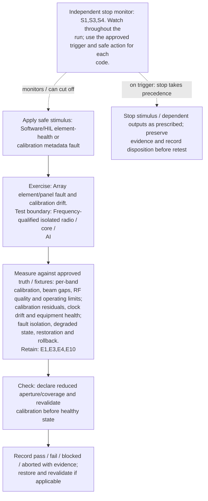

</details>

**Measure against:** A-HF,A-RAD,A-RES. [Use every applicable metric and the approved limits](../../README.md#acceptance-profiles); the case-specific check does not replace those profiles.

**Retain:** E1: scene truth, detections, tracks and scores; E3: radio, timing, calibration and instrument health; E4: faults, queues, alarms and recovery state; E10: frequency/beam manifest and qualified RF/model evidence.

**Stop plan:** S1,S3,S4; [trigger definitions and safe outcomes](../../README.md#evidence-and-safe-stop-codes). **Requirements:** REQ-HF,REQ-RAD,REQ-RES.

## TC-140

**What you test:** Thermal/power derating with beam/sensing workload.

**Setup:** `K/R/Q=ALL`. Create an approved instance with ground truth, baseline, limits and a named independent stop owner. Apply the exact frequency configuration and its reviewed applicability.

<details>
<summary>Show test flow and independent stop path</summary>

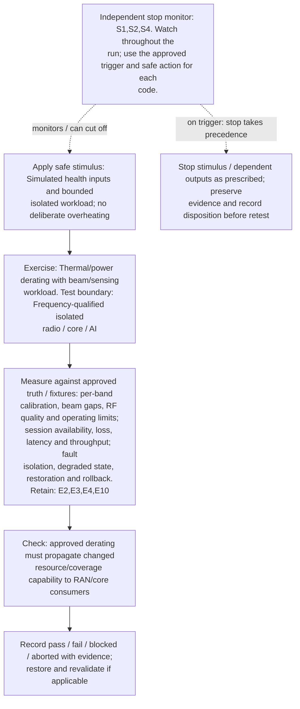

</details>

**Measure against:** A-HF,A-COM,A-RES. [Use every applicable metric and the approved limits](../../README.md#acceptance-profiles); the case-specific check does not replace those profiles.

**Retain:** E2: test communication traffic and service KPIs; E3: radio, timing, calibration and instrument health; E4: faults, queues, alarms and recovery state; E10: frequency/beam manifest and qualified RF/model evidence.

**Stop plan:** S1,S2,S4; [trigger definitions and safe outcomes](../../README.md#evidence-and-safe-stop-codes). **Requirements:** REQ-HF,REQ-COM,REQ-RES.

## TC-141

**What you test:** Cross-radio time/frequency/phase and sample-clock mismatch.

**Setup:** `K/G/N=ALL`. Create an approved instance with ground truth, baseline, limits and a named independent stop owner. Apply the exact frequency configuration and its reviewed applicability.

<details>
<summary>Show test flow and independent stop path</summary>

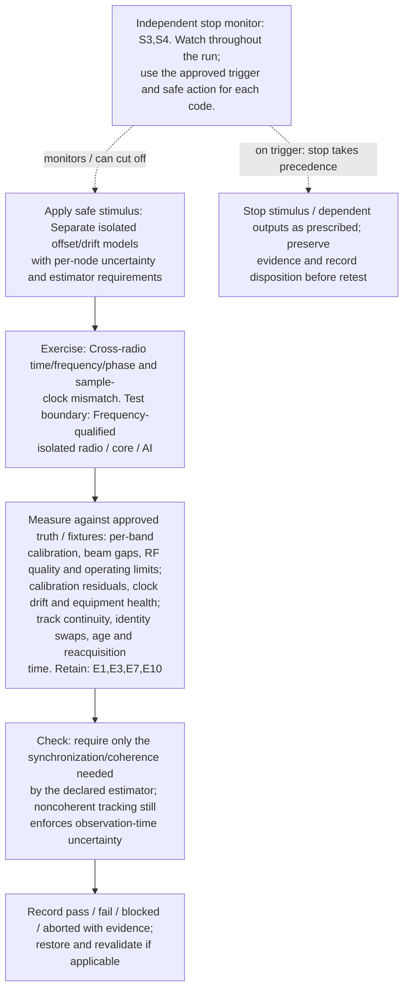

</details>

**Measure against:** A-HF,A-RAD,A-TRK. [Use every applicable metric and the approved limits](../../README.md#acceptance-profiles); the case-specific check does not replace those profiles.

**Retain:** E1: scene truth, detections, tracks and scores; E3: radio, timing, calibration and instrument health; E7: synthetic identities, core APIs and distributed traces; E10: frequency/beam manifest and qualified RF/model evidence.

**Stop plan:** S3,S4; [trigger definitions and safe outcomes](../../README.md#evidence-and-safe-stop-codes). **Requirements:** REQ-HF,REQ-RAD,REQ-SEN.

## TC-142

**What you test:** Valid waveform tuples, ambiguity and sampling gaps.

**Setup:** `K/D/W=ALL`. Create an approved instance with ground truth, baseline, limits and a named independent stop owner. Apply the exact frequency configuration and its reviewed applicability.

<details>
<summary>Show test flow and independent stop path</summary>

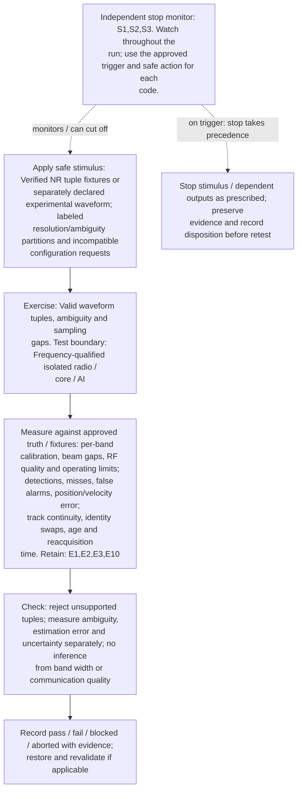

</details>

**Measure against:** A-HF,A-SEN,A-TRK. [Use every applicable metric and the approved limits](../../README.md#acceptance-profiles); the case-specific check does not replace those profiles.

**Retain:** E1: scene truth, detections, tracks and scores; E2: test communication traffic and service KPIs; E3: radio, timing, calibration and instrument health; E10: frequency/beam manifest and qualified RF/model evidence.

**Stop plan:** S1,S2,S3; [trigger definitions and safe outcomes](../../README.md#evidence-and-safe-stop-codes). **Requirements:** REQ-HF,REQ-SEN,REQ-UNC.

## TC-143

**What you test:** OTA instrumentation/chamber/converter validity.

**Setup:** `K/R=ALL`. Create an approved instance with ground truth, baseline, limits and a named independent stop owner. Apply the exact frequency configuration and its reviewed applicability.

<details>
<summary>Show test flow and independent stop path</summary>

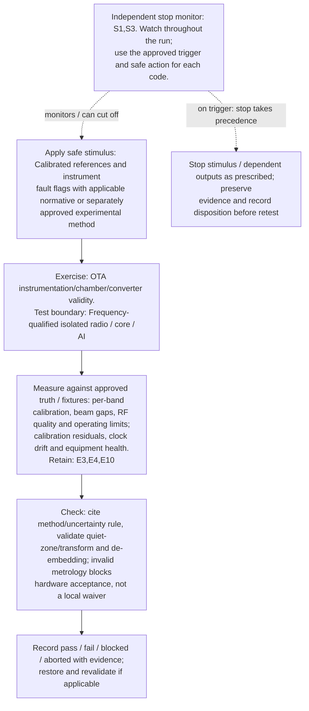

</details>

**Measure against:** A-HF,A-RAD. [Use every applicable metric and the approved limits](../../README.md#acceptance-profiles); the case-specific check does not replace those profiles.

**Retain:** E3: radio, timing, calibration and instrument health; E4: faults, queues, alarms and recovery state; E10: frequency/beam manifest and qualified RF/model evidence.

**Stop plan:** S1,S3; [trigger definitions and safe outcomes](../../README.md#evidence-and-safe-stop-codes). **Requirements:** REQ-HF,REQ-RAD.

## TC-144

**What you test:** UE panel/orientation, power-state and mobility dependencies.

**Setup:** `K/R/U/L=ALL`. Create an approved instance with ground truth, baseline, limits and a named independent stop owner. Apply the exact frequency configuration and its reviewed applicability.

<details>
<summary>Show test flow and independent stop path</summary>

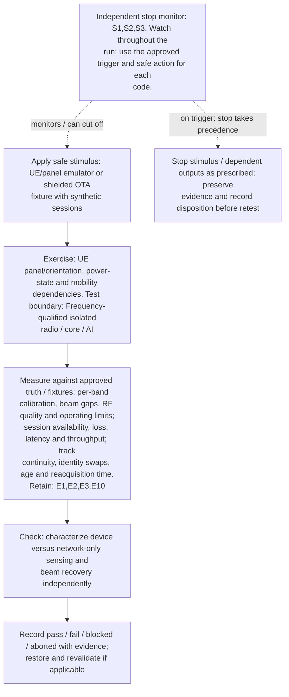

</details>

**Measure against:** A-HF,A-COM,A-TRK. [Use every applicable metric and the approved limits](../../README.md#acceptance-profiles); the case-specific check does not replace those profiles.

**Retain:** E1: scene truth, detections, tracks and scores; E2: test communication traffic and service KPIs; E3: radio, timing, calibration and instrument health; E10: frequency/beam manifest and qualified RF/model evidence.

**Stop plan:** S1,S2,S3; [trigger definitions and safe outcomes](../../README.md#evidence-and-safe-stop-codes). **Requirements:** REQ-HF,REQ-COM,REQ-SEN.

## TC-145

**What you test:** Cross-band fallback, carrier/panel transition and hysteresis.

**Setup:** mixed `K/M/L`. Create an approved instance with ground truth, baseline, limits and a named independent stop owner. Apply the exact frequency configuration and its reviewed applicability.

<details>
<summary>Show test flow and independent stop path</summary>

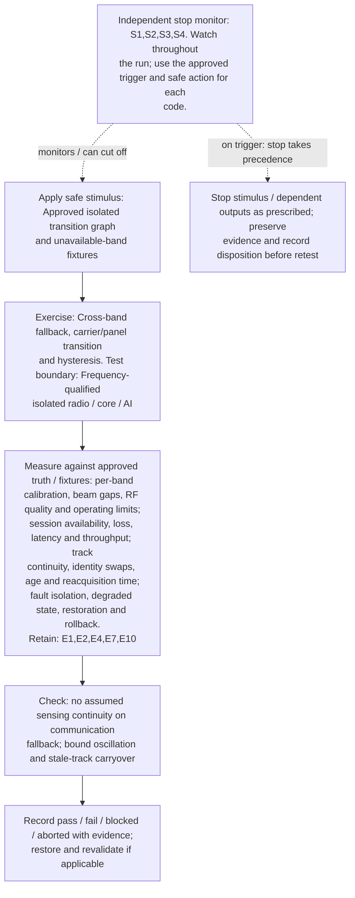

</details>

**Measure against:** A-HF,A-COM,A-TRK,A-RES. [Use every applicable metric and the approved limits](../../README.md#acceptance-profiles); the case-specific check does not replace those profiles.

**Retain:** E1: scene truth, detections, tracks and scores; E2: test communication traffic and service KPIs; E4: faults, queues, alarms and recovery state; E7: synthetic identities, core APIs and distributed traces; E10: frequency/beam manifest and qualified RF/model evidence.

**Stop plan:** S1,S2,S3,S4; [trigger definitions and safe outcomes](../../README.md#evidence-and-safe-stop-codes). **Requirements:** REQ-HF,REQ-COM,REQ-SEN,REQ-RES.

## TC-146

**What you test:** AI cross-band domain shift and hardware signatures.

**Setup:** `K/J/R/V=ALL`. Create an approved instance with ground truth, baseline, limits and a named independent stop owner. Apply the exact frequency configuration and its reviewed applicability.

<details>
<summary>Show test flow and independent stop path</summary>

```mermaid
flowchart TD
    stimulus["Apply safe stimulus: Independent held-out corpora per<br/>band/hardware and unsupported-manifest fixtures; include<br/>jointly trained multi-band model if implemented"]
    exercise["Exercise: AI cross-band domain shift and hardware<br/>signatures. Test boundary: Frequency-qualified isolated<br/>radio / core / AI"]
    capture["Measure against approved truth / fixtures: per-band<br/>calibration, beam gaps, RF quality and operating limits;<br/>AI quality, abstention, calibration, numerical validity<br/>and latency; unknown/ambiguous decisions and confidence<br/>calibration. Retain: E1,E8,E9,E10"]
    checks["Check: qualify the actual model&#x27;s declared band domain;<br/>reject unqualified transfer but do not require a separate<br/>model per band"]
    disposition["Record pass / fail / blocked / aborted with evidence;<br/>restore and revalidate if applicable"]
    monitor["Independent stop monitor: S3,S7. Watch throughout the run;<br/>use the approved trigger and safe action for each code."]
    safe["Stop stimulus / dependent outputs as prescribed; preserve<br/>evidence and record disposition before retest"]
    stimulus --> exercise --> capture --> checks --> disposition
    monitor -. "monitors / can cut off" .-> stimulus
    monitor -. "on trigger: stop takes precedence" .-> safe
```

</details>

**Measure against:** A-HF,A-AI,A-UNC. [Use every applicable metric and the approved limits](../../README.md#acceptance-profiles); the case-specific check does not replace those profiles.

**Retain:** E1: scene truth, detections, tracks and scores; E8: dataset/model versions, AI outputs and quality telemetry; E9: approvals, lineage, rollout and governance/control audit; E10: frequency/beam manifest and qualified RF/model evidence.

**Stop plan:** S3,S7; [trigger definitions and safe outcomes](../../README.md#evidence-and-safe-stop-codes). **Requirements:** REQ-HF,REQ-AI,REQ-UNC.

## TC-147

**What you test:** Actual exported data/beam-event load on core/AI.

**Setup:** `K/B/C/J/Q=ALL`. Create an approved instance with ground truth, baseline, limits and a named independent stop owner. Apply the exact frequency configuration and its reviewed applicability.

<details>
<summary>Show test flow and independent stop path</summary>

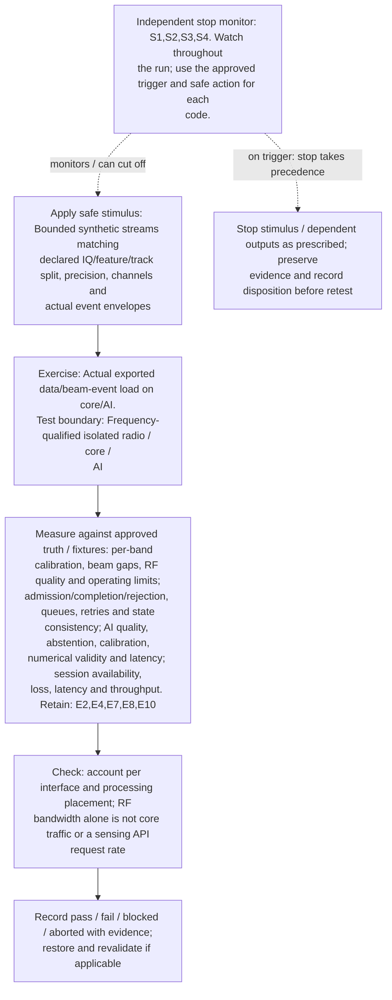

</details>

**Measure against:** A-HF,A-CORE,A-AI,A-COM. [Use every applicable metric and the approved limits](../../README.md#acceptance-profiles); the case-specific check does not replace those profiles.

**Retain:** E2: test communication traffic and service KPIs; E4: faults, queues, alarms and recovery state; E7: synthetic identities, core APIs and distributed traces; E8: dataset/model versions, AI outputs and quality telemetry; E10: frequency/beam manifest and qualified RF/model evidence.

**Stop plan:** S1,S2,S3,S4; [trigger definitions and safe outcomes](../../README.md#evidence-and-safe-stop-codes). **Requirements:** REQ-HF,REQ-CORE,REQ-AI,REQ-COM.

## TC-148

**What you test:** Mixed-band fusion, registration and identity lineage.

**Setup:** mixed `K/G/X/J`. Create an approved instance with ground truth, baseline, limits and a named independent stop owner. Apply the exact frequency configuration and its reviewed applicability.

<details>
<summary>Show test flow and independent stop path</summary>

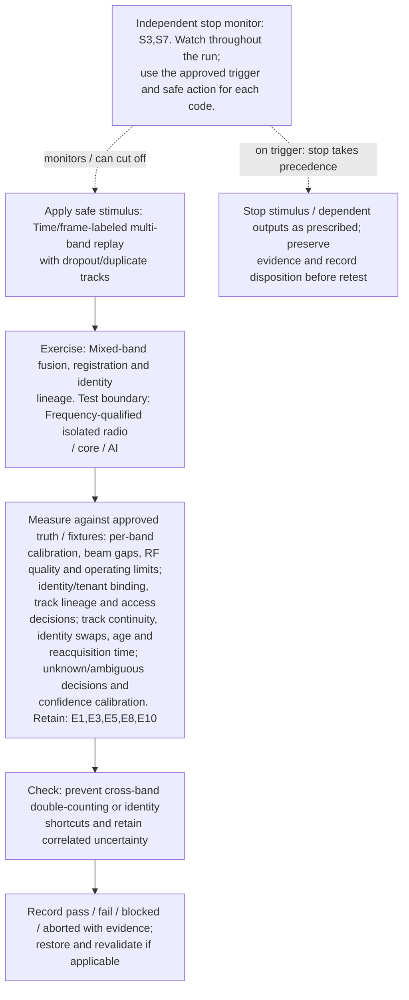

</details>

**Measure against:** A-HF,A-ID,A-TRK,A-UNC. [Use every applicable metric and the approved limits](../../README.md#acceptance-profiles); the case-specific check does not replace those profiles.

**Retain:** E1: scene truth, detections, tracks and scores; E3: radio, timing, calibration and instrument health; E5: input provenance, validation, access and integrity; E8: dataset/model versions, AI outputs and quality telemetry; E10: frequency/beam manifest and qualified RF/model evidence.

**Stop plan:** S3,S7; [trigger definitions and safe outcomes](../../README.md#evidence-and-safe-stop-codes). **Requirements:** REQ-HF,REQ-ID,REQ-SEN,REQ-UNC.

## TC-149

**What you test:** Spectrum permission, exposure and containment interlocks.

**Setup:** `K/R/H=ALL`. Create an approved instance with ground truth, baseline, limits and a named independent stop owner. Apply the exact frequency configuration and its reviewed applicability.

<details>
<summary>Show test flow and independent stop path</summary>

```mermaid
flowchart TD
    stimulus["Apply safe stimulus: Mock permission/limit withdrawal and<br/>instrument status in approved isolated facility"]
    exercise["Exercise: Spectrum permission, exposure and containment<br/>interlocks. Test boundary: Frequency-qualified isolated<br/>radio / core / AI"]
    capture["Measure against approved truth / fixtures: per-band<br/>calibration, beam gaps, RF quality and operating limits;<br/>authorization, interlocks, stop deadlines and safe state;<br/>purpose/residency, approvals, revocation and<br/>retention/deletion. Retain: E3,E6,E9,E10"]
    checks["Check: independent RF inhibit on invalid<br/>permission/monitor state; never exceed limits to test<br/>protection"]
    disposition["Record pass / fail / blocked / aborted with evidence;<br/>restore and revalidate if applicable"]
    monitor["Independent stop monitor: S1,S5,S7. Watch throughout the<br/>run; use the approved trigger and safe action for each<br/>code."]
    safe["Stop stimulus / dependent outputs as prescribed; preserve<br/>evidence and record disposition before retest"]
    stimulus --> exercise --> capture --> checks --> disposition
    monitor -. "monitors / can cut off" .-> stimulus
    monitor -. "on trigger: stop takes precedence" .-> safe
```

</details>

**Measure against:** A-HF,A-SAF,A-GOV. [Use every applicable metric and the approved limits](../../README.md#acceptance-profiles); the case-specific check does not replace those profiles.

**Retain:** E3: radio, timing, calibration and instrument health; E6: operator actions, mock calls, interlocks and stops; E9: approvals, lineage, rollout and governance/control audit; E10: frequency/beam manifest and qualified RF/model evidence.

**Stop plan:** S1,S5,S7; [trigger definitions and safe outcomes](../../README.md#evidence-and-safe-stop-codes). **Requirements:** REQ-HF,REQ-SAF,REQ-GOV.

## TC-150

**What you test:** Band-specific propagation loss plus beam fault plus core/AI contention.

**Setup:** applicable `K/V/F/C/J/Q`. Create an approved instance with ground truth, baseline, limits and a named independent stop owner. Apply the exact frequency configuration and its reviewed applicability.

<details>
<summary>Show test flow and independent stop path</summary>

```mermaid
flowchart TD
    stimulus["Apply safe stimulus: Qualified combined emulator faults<br/>and bounded isolated workload"]
    exercise["Exercise: Band-specific propagation loss plus beam fault<br/>plus core/AI contention. Test boundary: Frequency-<br/>qualified isolated radio / core / AI"]
    capture["Measure against approved truth / fixtures: per-band<br/>calibration, beam gaps, RF quality and operating limits;<br/>detections, misses, false alarms, position/velocity error;<br/>session availability, loss, latency and throughput; AI<br/>quality, abstention, calibration, numerical validity and<br/>latency; fault isolation, degraded state, restoration and<br/>rollback. Retain: E1,E2,E3,E4,E7,E8,E10"]
    checks["Check: uncertainty and degraded state propagate despite<br/>shared load; no falsely healthy fused result"]
    disposition["Record pass / fail / blocked / aborted with evidence;<br/>restore and revalidate if applicable"]
    monitor["Independent stop monitor: S1,S2,S3,S4. Watch throughout<br/>the run; use the approved trigger and safe action for each<br/>code."]
    safe["Stop stimulus / dependent outputs as prescribed; preserve<br/>evidence and record disposition before retest"]
    stimulus --> exercise --> capture --> checks --> disposition
    monitor -. "monitors / can cut off" .-> stimulus
    monitor -. "on trigger: stop takes precedence" .-> safe
```

</details>

**Measure against:** A-HF,A-SEN,A-COM,A-AI,A-RES. [Use every applicable metric and the approved limits](../../README.md#acceptance-profiles); the case-specific check does not replace those profiles.

**Retain:** E1: scene truth, detections, tracks and scores; E2: test communication traffic and service KPIs; E3: radio, timing, calibration and instrument health; E4: faults, queues, alarms and recovery state; E7: synthetic identities, core APIs and distributed traces; E8: dataset/model versions, AI outputs and quality telemetry; E10: frequency/beam manifest and qualified RF/model evidence.

**Stop plan:** S1,S2,S3,S4; [trigger definitions and safe outcomes](../../README.md#evidence-and-safe-stop-codes). **Requirements:** REQ-HF,REQ-SEN,REQ-COM,REQ-AI,REQ-RES.

## TC-151

**What you test:** Restart/restore after band or front-end change.

**Setup:** `K/R/J/L=ALL`. Create an approved instance with ground truth, baseline, limits and a named independent stop owner. Apply the exact frequency configuration and its reviewed applicability.

<details>
<summary>Show test flow and independent stop path</summary>

```mermaid
flowchart TD
    stimulus["Apply safe stimulus: Isolated restore with mismatched<br/>calibration/beam/model artifacts"]
    exercise["Exercise: Restart/restore after band or front-end change.<br/>Test boundary: Frequency-qualified isolated radio / core /<br/>AI"]
    capture["Measure against approved truth / fixtures: per-band<br/>calibration, beam gaps, RF quality and operating limits;<br/>calibration residuals, clock drift and equipment health;<br/>AI quality, abstention, calibration, numerical validity<br/>and latency; fault isolation, degraded state, restoration<br/>and rollback. Retain: E1,E3,E4,E8,E9,E10"]
    checks["Check: validate matching radio/calibration/model manifest<br/>before readiness; rollback if incompatible"]
    disposition["Record pass / fail / blocked / aborted with evidence;<br/>restore and revalidate if applicable"]
    monitor["Independent stop monitor: S1,S3,S4,S7. Watch throughout<br/>the run; use the approved trigger and safe action for each<br/>code."]
    safe["Stop stimulus / dependent outputs as prescribed; preserve<br/>evidence and record disposition before retest"]
    stimulus --> exercise --> capture --> checks --> disposition
    monitor -. "monitors / can cut off" .-> stimulus
    monitor -. "on trigger: stop takes precedence" .-> safe
```

</details>

**Measure against:** A-HF,A-RAD,A-AI,A-RES. [Use every applicable metric and the approved limits](../../README.md#acceptance-profiles); the case-specific check does not replace those profiles.

**Retain:** E1: scene truth, detections, tracks and scores; E3: radio, timing, calibration and instrument health; E4: faults, queues, alarms and recovery state; E8: dataset/model versions, AI outputs and quality telemetry; E9: approvals, lineage, rollout and governance/control audit; E10: frequency/beam manifest and qualified RF/model evidence.

**Stop plan:** S1,S3,S4,S7; [trigger definitions and safe outcomes](../../README.md#evidence-and-safe-stop-codes). **Requirements:** REQ-HF,REQ-RAD,REQ-AI,REQ-RES.

## TC-152

**What you test:** Per-profile end-to-end qualification and evidence closure.

**Setup:** `K=ALL`. Create an approved instance with ground truth, baseline, limits and a named independent stop owner. Apply the exact frequency configuration and its reviewed applicability.

<details>
<summary>Show test flow and independent stop path</summary>

```mermaid
flowchart TD
    stimulus["Apply safe stimulus: Replay each approved band-specific<br/>acceptance pack with independent reviewers"]
    exercise["Exercise: Per-profile end-to-end qualification and<br/>evidence closure. Test boundary: Frequency-qualified<br/>isolated radio / core / AI"]
    capture["Measure against approved truth / fixtures: per-band<br/>calibration, beam gaps, RF quality and operating limits;<br/>every metric required by constituent instances. Retain:<br/>E1,E2,E3,E4,E5,E6,E7,E8,E9,E10"]
    checks["Check: every original-case/profile entry has reviewed<br/>disposition and traceable evidence; no simulated result<br/>labeled hardware pass"]
    disposition["Record pass / fail / blocked / aborted with evidence;<br/>restore and revalidate if applicable"]
    monitor["Independent stop monitor: S1,S2,S3,S4,S5,S7. Watch<br/>throughout the run; use the approved trigger and safe<br/>action for each code."]
    safe["Stop stimulus / dependent outputs as prescribed; preserve<br/>evidence and record disposition before retest"]
    stimulus --> exercise --> capture --> checks --> disposition
    monitor -. "monitors / can cut off" .-> stimulus
    monitor -. "on trigger: stop takes precedence" .-> safe
```

</details>

**Measure against:** A-HF plus all constituent profiles. [Use every applicable metric and the approved limits](../../README.md#acceptance-profiles); the case-specific check does not replace those profiles.

**Retain:** E1: scene truth, detections, tracks and scores; E2: test communication traffic and service KPIs; E3: radio, timing, calibration and instrument health; E4: faults, queues, alarms and recovery state; E5: input provenance, validation, access and integrity; E6: operator actions, mock calls, interlocks and stops; E7: synthetic identities, core APIs and distributed traces; E8: dataset/model versions, AI outputs and quality telemetry; E9: approvals, lineage, rollout and governance/control audit; E10: frequency/beam manifest and qualified RF/model evidence.

**Stop plan:** S1,S2,S3,S4,S5,S7; [trigger definitions and safe outcomes](../../README.md#evidence-and-safe-stop-codes). **Requirements:** REQ-HF,REQ-SEN,REQ-COM,REQ-CORE,REQ-AI,REQ-SAF.
