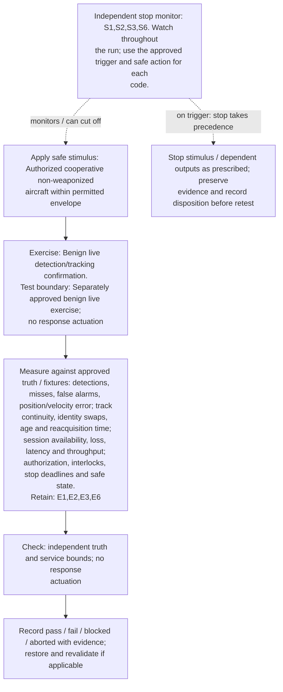
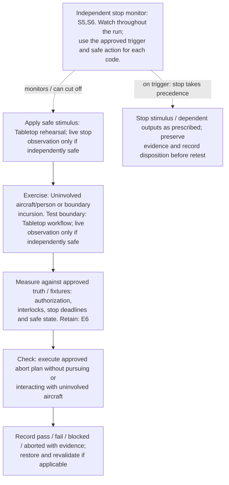
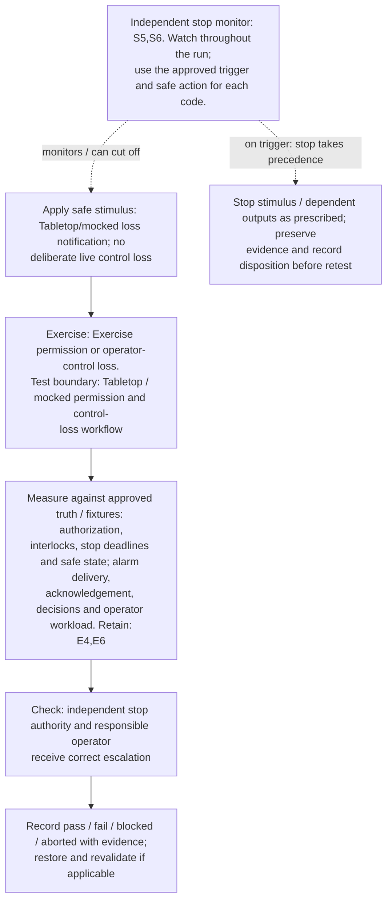
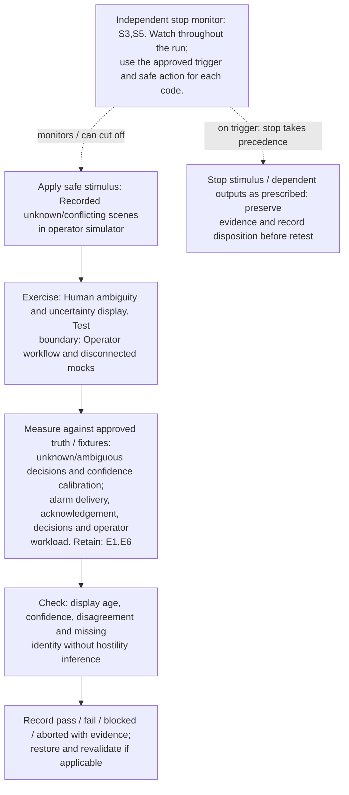
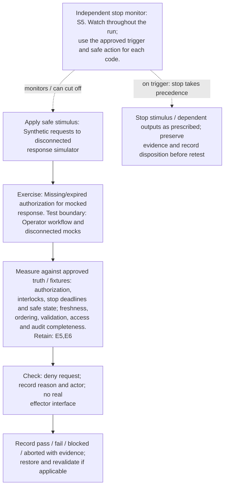
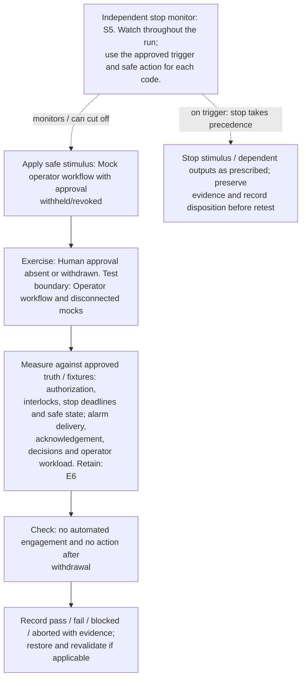
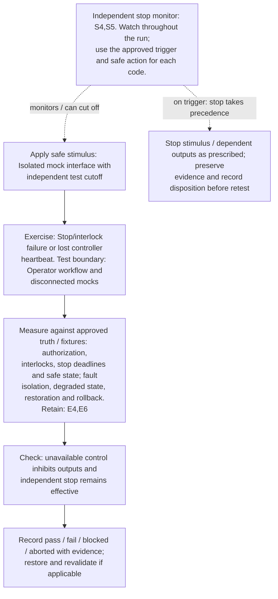
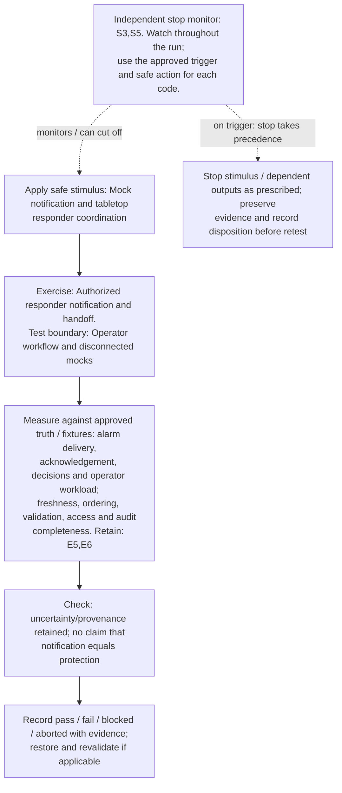
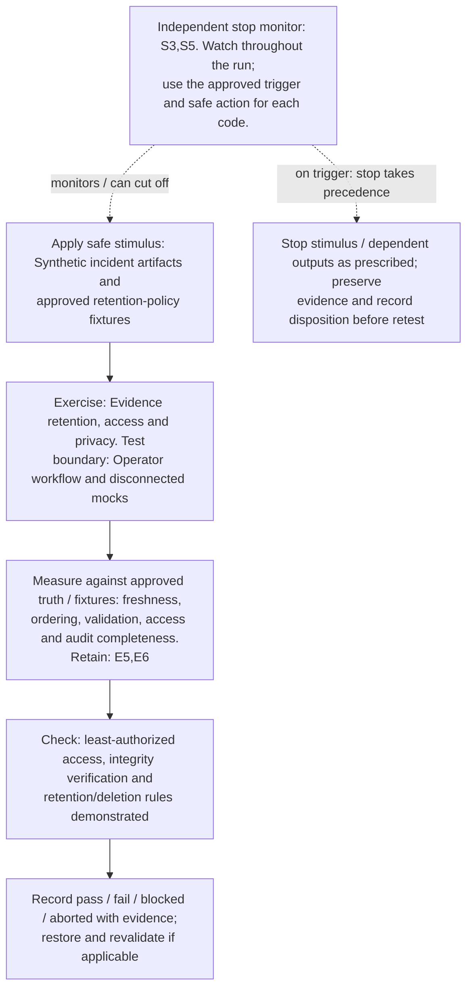

# Operator safeguards and authorized benign live exercises: designer test diagrams

[Visual guide and shared execution rules](../../README.md#designer-visual-test-guide) | [Authoritative scenario matrix](../../README.md#traceable-scenario-coverage-matrix)

**KPI / PM events:** use each TC ID in the [case-focus table](../kpi-pm.md#case-specific-focus-checks), plus all measurement/event groups inherited from its acceptance profiles. Actual collector names and thresholds need approval; local event labels are not standardized counters.

These are test-design flows, not measured results or an asserted deployment architecture. Solid arrows show the test/evidence flow; dashed arrows show independent stop control. Apply the shared approval gate before every instance. Expand the declared axes and frequency overlay; never treat one diagram as coverage of every configuration.

## TC-041

**What you test:** Benign live detection/tracking confirmation.

**Setup:** approved `M/R/V` subset. Create an approved instance with ground truth, baseline, limits and a named independent stop owner. Apply the exact frequency configuration and its reviewed applicability.

Show test flow and independent stop path

**Measure against:** A-SEN,A-TRK,A-COM,A-SAF. [Use every applicable metric and the approved limits](../../README.md#acceptance-profiles); the case-specific check does not replace those profiles.

**Retain:** E1: scene truth, detections, tracks and scores; E2: test communication traffic and service KPIs; E3: radio, timing, calibration and instrument health; E6: operator actions, mock calls, interlocks and stops.

**Stop plan:** S1,S2,S3,S6; [trigger definitions and safe outcomes](../../README.md#evidence-and-safe-stop-codes). **Requirements:** REQ-SEN,REQ-COM,REQ-SAF.

## TC-042

**What you test:** Uninvolved aircraft/person or boundary incursion.

**Setup:** Use the applicable declared configuration and reviewed scenario conditions. Create an approved instance with ground truth, baseline, limits and a named independent stop owner. Apply the exact frequency configuration and its reviewed applicability.

Show test flow and independent stop path

**Measure against:** A-SAF. [Use every applicable metric and the approved limits](../../README.md#acceptance-profiles); the case-specific check does not replace those profiles.

**Retain:** E6: operator actions, mock calls, interlocks and stops.

**Stop plan:** S5,S6; [trigger definitions and safe outcomes](../../README.md#evidence-and-safe-stop-codes). **Requirements:** REQ-SAF.

## TC-043

**What you test:** Exercise permission or operator-control loss.

**Setup:** Use the applicable declared configuration and reviewed scenario conditions. Create an approved instance with ground truth, baseline, limits and a named independent stop owner. Apply the exact frequency configuration and its reviewed applicability.

Show test flow and independent stop path

**Measure against:** A-SAF,A-HUM. [Use every applicable metric and the approved limits](../../README.md#acceptance-profiles); the case-specific check does not replace those profiles.

**Retain:** E4: faults, queues, alarms and recovery state; E6: operator actions, mock calls, interlocks and stops.

**Stop plan:** S5,S6; [trigger definitions and safe outcomes](../../README.md#evidence-and-safe-stop-codes). **Requirements:** REQ-SAF,REQ-HUM.

## TC-044

**What you test:** Human ambiguity and uncertainty display.

**Setup:** `X/Q=ALL`. Create an approved instance with ground truth, baseline, limits and a named independent stop owner. Apply the exact frequency configuration and its reviewed applicability.

Show test flow and independent stop path

**Measure against:** A-UNC,A-HUM. [Use every applicable metric and the approved limits](../../README.md#acceptance-profiles); the case-specific check does not replace those profiles.

**Retain:** E1: scene truth, detections, tracks and scores; E6: operator actions, mock calls, interlocks and stops.

**Stop plan:** S3,S5; [trigger definitions and safe outcomes](../../README.md#evidence-and-safe-stop-codes). **Requirements:** REQ-UNC,REQ-HUM.

## TC-045

**What you test:** Alarm burst and operator handover.

**Setup:** `Q/L=ALL`. Create an approved instance with ground truth, baseline, limits and a named independent stop owner. Apply the exact frequency configuration and its reviewed applicability.

Show test flow and independent stop path

**Measure against:** A-HUM,A-SAF. [Use every applicable metric and the approved limits](../../README.md#acceptance-profiles); the case-specific check does not replace those profiles.

**Retain:** E4: faults, queues, alarms and recovery state; E6: operator actions, mock calls, interlocks and stops.

**Stop plan:** S5; [trigger definitions and safe outcomes](../../README.md#evidence-and-safe-stop-codes). **Requirements:** REQ-HUM,REQ-SAF.

## TC-046

**What you test:** Missing/expired authorization for mocked response.

**Setup:** Use the applicable declared configuration and reviewed scenario conditions. Create an approved instance with ground truth, baseline, limits and a named independent stop owner. Apply the exact frequency configuration and its reviewed applicability.

Show test flow and independent stop path

**Measure against:** A-SAF,A-DAT. [Use every applicable metric and the approved limits](../../README.md#acceptance-profiles); the case-specific check does not replace those profiles.

**Retain:** E5: input provenance, validation, access and integrity; E6: operator actions, mock calls, interlocks and stops.

**Stop plan:** S5; [trigger definitions and safe outcomes](../../README.md#evidence-and-safe-stop-codes). **Requirements:** REQ-SAF,REQ-DAT.

## TC-047

**What you test:** Human approval absent or withdrawn.

**Setup:** Use the applicable declared configuration and reviewed scenario conditions. Create an approved instance with ground truth, baseline, limits and a named independent stop owner. Apply the exact frequency configuration and its reviewed applicability.

Show test flow and independent stop path

**Measure against:** A-SAF,A-HUM. [Use every applicable metric and the approved limits](../../README.md#acceptance-profiles); the case-specific check does not replace those profiles.

**Retain:** E6: operator actions, mock calls, interlocks and stops.

**Stop plan:** S5; [trigger definitions and safe outcomes](../../README.md#evidence-and-safe-stop-codes). **Requirements:** REQ-SAF,REQ-HUM.

## TC-048

**What you test:** Stop/interlock failure or lost controller heartbeat.

**Setup:** Use the applicable declared configuration and reviewed scenario conditions. Create an approved instance with ground truth, baseline, limits and a named independent stop owner. Apply the exact frequency configuration and its reviewed applicability.

Show test flow and independent stop path

**Measure against:** A-SAF,A-RES. [Use every applicable metric and the approved limits](../../README.md#acceptance-profiles); the case-specific check does not replace those profiles.

**Retain:** E4: faults, queues, alarms and recovery state; E6: operator actions, mock calls, interlocks and stops.

**Stop plan:** S4,S5; [trigger definitions and safe outcomes](../../README.md#evidence-and-safe-stop-codes). **Requirements:** REQ-SAF,REQ-RES.

## TC-049

**What you test:** Authorized responder notification and handoff.

**Setup:** Use the applicable declared configuration and reviewed scenario conditions. Create an approved instance with ground truth, baseline, limits and a named independent stop owner. Apply the exact frequency configuration and its reviewed applicability.

Show test flow and independent stop path

**Measure against:** A-HUM,A-DAT. [Use every applicable metric and the approved limits](../../README.md#acceptance-profiles); the case-specific check does not replace those profiles.

**Retain:** E5: input provenance, validation, access and integrity; E6: operator actions, mock calls, interlocks and stops.

**Stop plan:** S3,S5; [trigger definitions and safe outcomes](../../README.md#evidence-and-safe-stop-codes). **Requirements:** REQ-HUM,REQ-DAT.

## TC-050

**What you test:** Evidence retention, access and privacy.

**Setup:** Use the applicable declared configuration and reviewed scenario conditions. Create an approved instance with ground truth, baseline, limits and a named independent stop owner. Apply the exact frequency configuration and its reviewed applicability.

Show test flow and independent stop path

**Measure against:** A-DAT. [Use every applicable metric and the approved limits](../../README.md#acceptance-profiles); the case-specific check does not replace those profiles.

**Retain:** E5: input provenance, validation, access and integrity; E6: operator actions, mock calls, interlocks and stops.

**Stop plan:** S3,S5; [trigger definitions and safe outcomes](../../README.md#evidence-and-safe-stop-codes). **Requirements:** REQ-DAT.
