# Radiated OTA qualification for ISAC-enabled systems: designer test diagrams

[Visual guide and shared execution rules](../../README.md#designer-visual-test-guide) | [Authoritative scenario matrix](../../README.md#traceable-scenario-coverage-matrix)

**KPI / PM events:** use each TC ID in the [case-focus table](../kpi-pm.md#case-specific-focus-checks), plus all measurement/event groups inherited from its acceptance profiles. Actual collector names and thresholds need approval; local event labels are not standardized counters.

These are test-design flows, not measured results or an asserted deployment architecture. Solid arrows show the test/evidence flow; dashed arrows show independent stop control. Apply the shared approval gate before every instance. Expand the declared axes and frequency overlay; never treat one diagram as coverage of every configuration.

## TC-153

**What you test:** OTA facility, quiet-zone and range qualification.

**Setup:** `K/R=ALL`. Create an approved instance with ground truth, baseline, limits and a named independent stop owner. Apply the exact frequency configuration and its reviewed applicability.

<details>
<summary>Show test flow and independent stop path</summary>

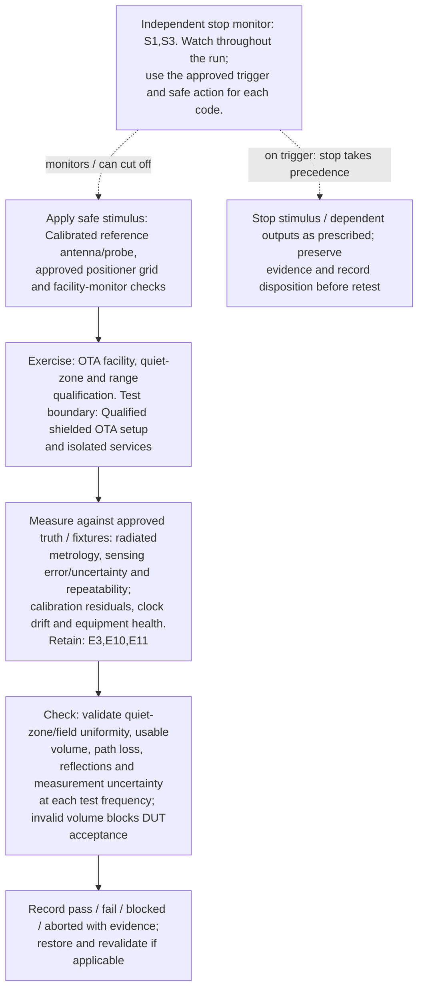

</details>

**Measure against:** A-OTA,A-RAD. [Use every applicable metric and the approved limits](../../README.md#acceptance-profiles); the case-specific check does not replace those profiles.

**Retain:** E3: radio, timing, calibration and instrument health; E10: frequency/beam manifest and qualified RF/model evidence; E11: calibrated radiated OTA setup, truth and uncertainty.

**Stop plan:** S1,S3; [trigger definitions and safe outcomes](../../README.md#evidence-and-safe-stop-codes). **Requirements:** REQ-OTA,REQ-RAD,REQ-HF.

## TC-154

**What you test:** Reference-plane, cable/fixture de-embedding and path-loss calibration.

**Setup:** `K/R/D=ALL`. Create an approved instance with ground truth, baseline, limits and a named independent stop owner. Apply the exact frequency configuration and its reviewed applicability.

<details>
<summary>Show test flow and independent stop path</summary>

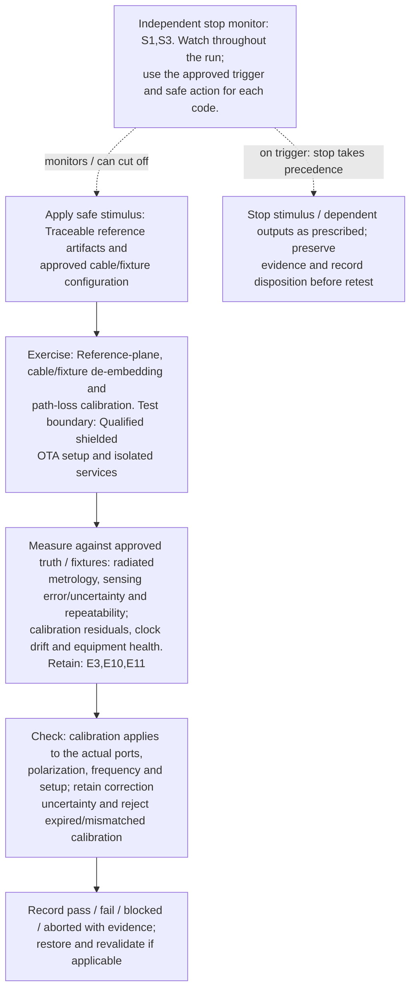

</details>

**Measure against:** A-OTA,A-RAD. [Use every applicable metric and the approved limits](../../README.md#acceptance-profiles); the case-specific check does not replace those profiles.

**Retain:** E3: radio, timing, calibration and instrument health; E10: frequency/beam manifest and qualified RF/model evidence; E11: calibrated radiated OTA setup, truth and uncertainty.

**Stop plan:** S1,S3; [trigger definitions and safe outcomes](../../README.md#evidence-and-safe-stop-codes). **Requirements:** REQ-OTA,REQ-RAD.

## TC-155

**What you test:** Radiated antenna/array pattern, scan-volume and polarization coverage.

**Setup:** `K/R/W/D=ALL`. Create an approved instance with ground truth, baseline, limits and a named independent stop owner. Apply the exact frequency configuration and its reviewed applicability.

<details>
<summary>Show test flow and independent stop path</summary>

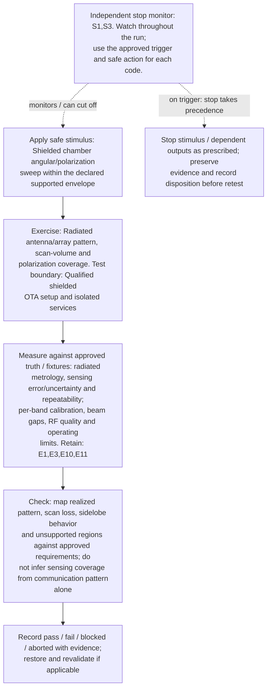

</details>

**Measure against:** A-OTA,A-HF. [Use every applicable metric and the approved limits](../../README.md#acceptance-profiles); the case-specific check does not replace those profiles.

**Retain:** E1: scene truth, detections, tracks and scores; E3: radio, timing, calibration and instrument health; E10: frequency/beam manifest and qualified RF/model evidence; E11: calibrated radiated OTA setup, truth and uncertainty.

**Stop plan:** S1,S3; [trigger definitions and safe outcomes](../../README.md#evidence-and-safe-stop-codes). **Requirements:** REQ-OTA,REQ-HF,REQ-SEN.

## TC-156

**What you test:** Transmit power, radiated emissions and configuration-dependent limits.

**Setup:** `K/R/D/W=ALL`. Create an approved instance with ground truth, baseline, limits and a named independent stop owner. Apply the exact frequency configuration and its reviewed applicability.

<details>
<summary>Show test flow and independent stop path</summary>

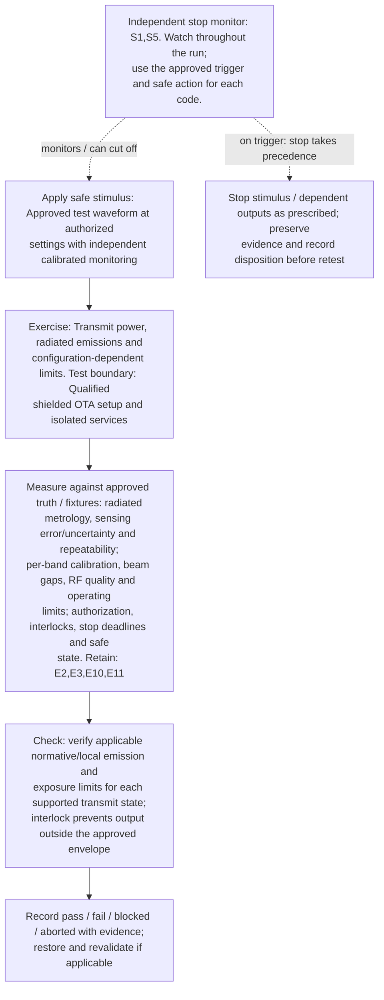

</details>

**Measure against:** A-OTA,A-HF,A-SAF. [Use every applicable metric and the approved limits](../../README.md#acceptance-profiles); the case-specific check does not replace those profiles.

**Retain:** E2: test communication traffic and service KPIs; E3: radio, timing, calibration and instrument health; E10: frequency/beam manifest and qualified RF/model evidence; E11: calibrated radiated OTA setup, truth and uncertainty.

**Stop plan:** S1,S5; [trigger definitions and safe outcomes](../../README.md#evidence-and-safe-stop-codes). **Requirements:** REQ-OTA,REQ-HF,REQ-SAF.

## TC-157

**What you test:** OTA receiver sensitivity, noise floor, dynamic range and saturation.

**Setup:** `K/R/D=ALL`. Create an approved instance with ground truth, baseline, limits and a named independent stop owner. Apply the exact frequency configuration and its reviewed applicability.

<details>
<summary>Show test flow and independent stop path</summary>

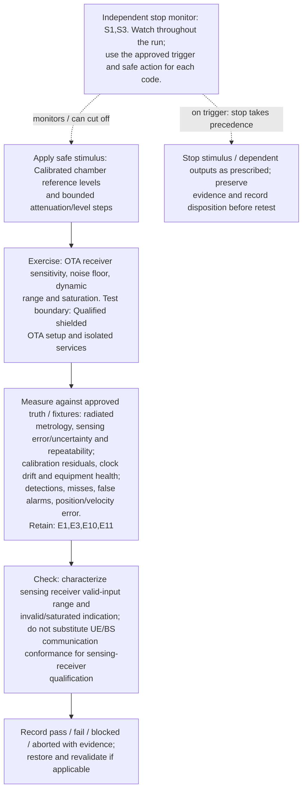

</details>

**Measure against:** A-OTA,A-RAD,A-SEN. [Use every applicable metric and the approved limits](../../README.md#acceptance-profiles); the case-specific check does not replace those profiles.

**Retain:** E1: scene truth, detections, tracks and scores; E3: radio, timing, calibration and instrument health; E10: frequency/beam manifest and qualified RF/model evidence; E11: calibrated radiated OTA setup, truth and uncertainty.

**Stop plan:** S1,S3; [trigger definitions and safe outcomes](../../README.md#evidence-and-safe-stop-codes). **Requirements:** REQ-OTA,REQ-RAD,REQ-SEN.

## TC-158

**What you test:** Radiated reference-scene detection and false-alarm performance.

**Setup:** `K/G/R/V=ALL`. Create an approved instance with ground truth, baseline, limits and a named independent stop owner. Apply the exact frequency configuration and its reviewed applicability.

<details>
<summary>Show test flow and independent stop path</summary>

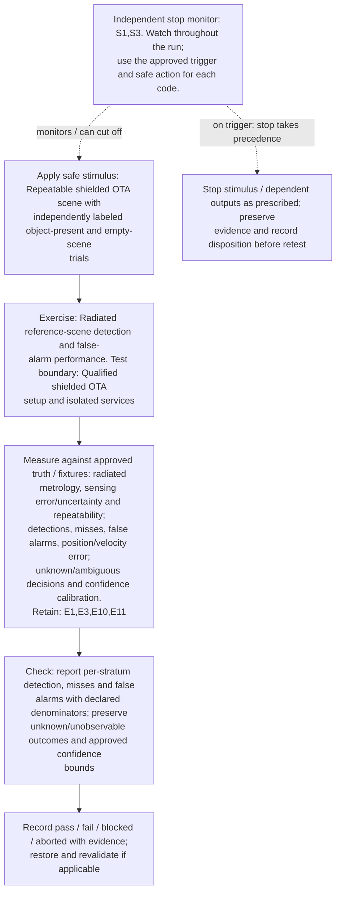

</details>

**Measure against:** A-OTA,A-SEN,A-UNC. [Use every applicable metric and the approved limits](../../README.md#acceptance-profiles); the case-specific check does not replace those profiles.

**Retain:** E1: scene truth, detections, tracks and scores; E3: radio, timing, calibration and instrument health; E10: frequency/beam manifest and qualified RF/model evidence; E11: calibrated radiated OTA setup, truth and uncertainty.

**Stop plan:** S1,S3; [trigger definitions and safe outcomes](../../README.md#evidence-and-safe-stop-codes). **Requirements:** REQ-OTA,REQ-SEN,REQ-UNC.

## TC-159

**What you test:** OTA range, angle and velocity estimation accuracy/uncertainty.

**Setup:** `K/G/R/D=ALL`. Create an approved instance with ground truth, baseline, limits and a named independent stop owner. Apply the exact frequency configuration and its reviewed applicability.

<details>
<summary>Show test flow and independent stop path</summary>

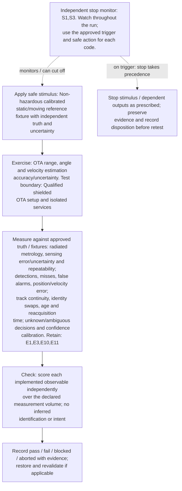

</details>

**Measure against:** A-OTA,A-SEN,A-TRK,A-UNC. [Use every applicable metric and the approved limits](../../README.md#acceptance-profiles); the case-specific check does not replace those profiles.

**Retain:** E1: scene truth, detections, tracks and scores; E3: radio, timing, calibration and instrument health; E10: frequency/beam manifest and qualified RF/model evidence; E11: calibrated radiated OTA setup, truth and uncertainty.

**Stop plan:** S1,S3; [trigger definitions and safe outcomes](../../README.md#evidence-and-safe-stop-codes). **Requirements:** REQ-OTA,REQ-SEN,REQ-UNC.

## TC-160

**What you test:** OTA target/reference-fixture and scene-truth validity.

**Setup:** `K/G/X/V=ALL`. Create an approved instance with ground truth, baseline, limits and a named independent stop owner. Apply the exact frequency configuration and its reviewed applicability.

<details>
<summary>Show test flow and independent stop path</summary>

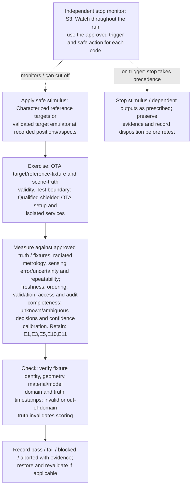

</details>

**Measure against:** A-OTA,A-DAT,A-UNC. [Use every applicable metric and the approved limits](../../README.md#acceptance-profiles); the case-specific check does not replace those profiles.

**Retain:** E1: scene truth, detections, tracks and scores; E3: radio, timing, calibration and instrument health; E5: input provenance, validation, access and integrity; E10: frequency/beam manifest and qualified RF/model evidence; E11: calibrated radiated OTA setup, truth and uncertainty.

**Stop plan:** S3; [trigger definitions and safe outcomes](../../README.md#evidence-and-safe-stop-codes). **Requirements:** REQ-OTA,REQ-DAT,REQ-UNC.

## TC-161

**What you test:** Chamber multipath, clutter and ghost-track response.

**Setup:** `K/G/V=ALL`. Create an approved instance with ground truth, baseline, limits and a named independent stop owner. Apply the exact frequency configuration and its reviewed applicability.

<details>
<summary>Show test flow and independent stop path</summary>

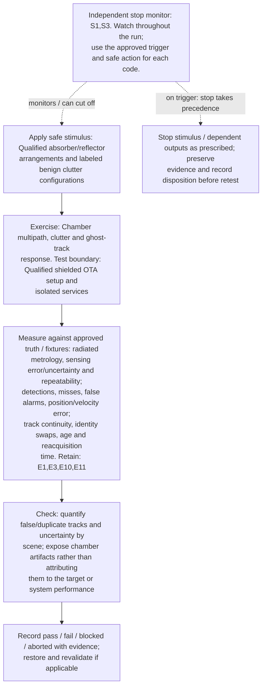

</details>

**Measure against:** A-OTA,A-SEN,A-TRK. [Use every applicable metric and the approved limits](../../README.md#acceptance-profiles); the case-specific check does not replace those profiles.

**Retain:** E1: scene truth, detections, tracks and scores; E3: radio, timing, calibration and instrument health; E10: frequency/beam manifest and qualified RF/model evidence; E11: calibrated radiated OTA setup, truth and uncertainty.

**Stop plan:** S1,S3; [trigger definitions and safe outcomes](../../README.md#evidence-and-safe-stop-codes). **Requirements:** REQ-OTA,REQ-SEN,REQ-UNC.

## TC-162

**What you test:** Radiated blockage and sensing-coverage boundary.

**Setup:** `K/G/R/U/V=ALL`. Create an approved instance with ground truth, baseline, limits and a named independent stop owner. Apply the exact frequency configuration and its reviewed applicability.

<details>
<summary>Show test flow and independent stop path</summary>


</details>

**Measure against:** A-OTA,A-SEN,A-TRK. [Use every applicable metric and the approved limits](../../README.md#acceptance-profiles); the case-specific check does not replace those profiles.

**Retain:** E1: scene truth, detections, tracks and scores; E3: radio, timing, calibration and instrument health; E10: frequency/beam manifest and qualified RF/model evidence; E11: calibrated radiated OTA setup, truth and uncertainty.

**Stop plan:** S1,S3; [trigger definitions and safe outcomes](../../README.md#evidence-and-safe-stop-codes). **Requirements:** REQ-OTA,REQ-SEN,REQ-UNC.

## TC-163

**What you test:** Target aspect, polarization and orientation sensitivity.

**Setup:** `K/G/R/X=ALL`. Create an approved instance with ground truth, baseline, limits and a named independent stop owner. Apply the exact frequency configuration and its reviewed applicability.

<details>
<summary>Show test flow and independent stop path</summary>

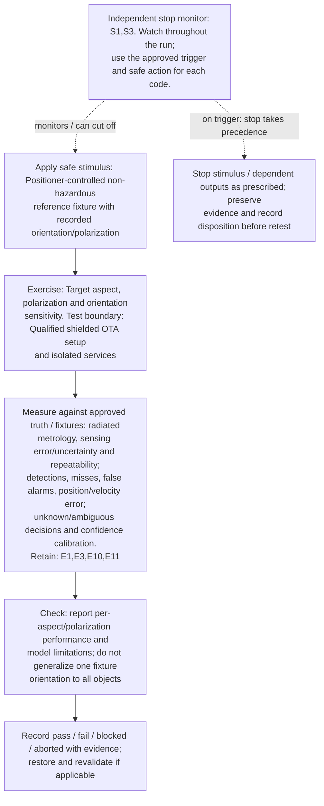

</details>

**Measure against:** A-OTA,A-SEN,A-UNC. [Use every applicable metric and the approved limits](../../README.md#acceptance-profiles); the case-specific check does not replace those profiles.

**Retain:** E1: scene truth, detections, tracks and scores; E3: radio, timing, calibration and instrument health; E10: frequency/beam manifest and qualified RF/model evidence; E11: calibrated radiated OTA setup, truth and uncertainty.

**Stop plan:** S1,S3; [trigger definitions and safe outcomes](../../README.md#evidence-and-safe-stop-codes). **Requirements:** REQ-OTA,REQ-SEN,REQ-UNC.

## TC-164

**What you test:** Sensing-beam sweep, acquisition gaps and reacquisition.

**Setup:** `K/W/R/L=ALL`. Create an approved instance with ground truth, baseline, limits and a named independent stop owner. Apply the exact frequency configuration and its reviewed applicability.

<details>
<summary>Show test flow and independent stop path</summary>

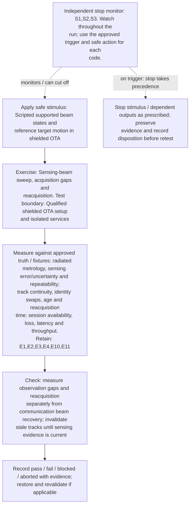

</details>

**Measure against:** A-OTA,A-TRK,A-COM. [Use every applicable metric and the approved limits](../../README.md#acceptance-profiles); the case-specific check does not replace those profiles.

**Retain:** E1: scene truth, detections, tracks and scores; E2: test communication traffic and service KPIs; E3: radio, timing, calibration and instrument health; E4: faults, queues, alarms and recovery state; E10: frequency/beam manifest and qualified RF/model evidence; E11: calibrated radiated OTA setup, truth and uncertainty.

**Stop plan:** S1,S2,S3; [trigger definitions and safe outcomes](../../README.md#evidence-and-safe-stop-codes). **Requirements:** REQ-OTA,REQ-SEN,REQ-COM.

## TC-165

**What you test:** Multi-radio/bistatic/multistatic OTA alignment and fusion.

**Setup:** applicable `K/G/N/X`. Create an approved instance with ground truth, baseline, limits and a named independent stop owner. Apply the exact frequency configuration and its reviewed applicability.

<details>
<summary>Show test flow and independent stop path</summary>

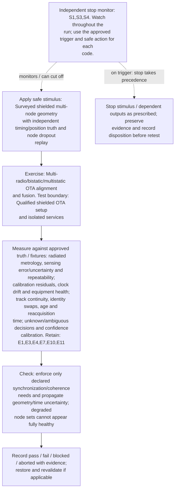

</details>

**Measure against:** A-OTA,A-RAD,A-TRK,A-UNC. [Use every applicable metric and the approved limits](../../README.md#acceptance-profiles); the case-specific check does not replace those profiles.

**Retain:** E1: scene truth, detections, tracks and scores; E3: radio, timing, calibration and instrument health; E4: faults, queues, alarms and recovery state; E7: synthetic identities, core APIs and distributed traces; E10: frequency/beam manifest and qualified RF/model evidence; E11: calibrated radiated OTA setup, truth and uncertainty.

**Stop plan:** S1,S3,S4; [trigger definitions and safe outcomes](../../README.md#evidence-and-safe-stop-codes). **Requirements:** REQ-OTA,REQ-RAD,REQ-SEN,REQ-UNC.

## TC-166

**What you test:** Joint communication-and-sensing radiated operation.

**Setup:** `K/M/W/Q=ALL`. Create an approved instance with ground truth, baseline, limits and a named independent stop owner. Apply the exact frequency configuration and its reviewed applicability.

<details>
<summary>Show test flow and independent stop path</summary>

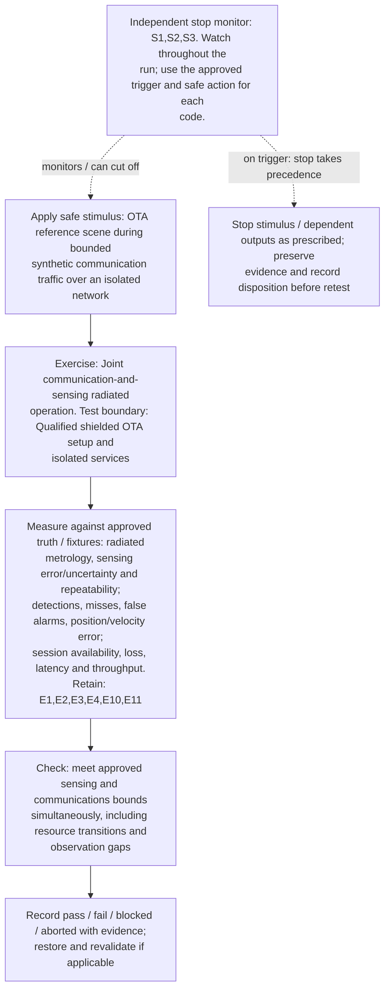

</details>

**Measure against:** A-OTA,A-SEN,A-COM. [Use every applicable metric and the approved limits](../../README.md#acceptance-profiles); the case-specific check does not replace those profiles.

**Retain:** E1: scene truth, detections, tracks and scores; E2: test communication traffic and service KPIs; E3: radio, timing, calibration and instrument health; E4: faults, queues, alarms and recovery state; E10: frequency/beam manifest and qualified RF/model evidence; E11: calibrated radiated OTA setup, truth and uncertainty.

**Stop plan:** S1,S2,S3; [trigger definitions and safe outcomes](../../README.md#evidence-and-safe-stop-codes). **Requirements:** REQ-OTA,REQ-SEN,REQ-COM.

## TC-167

**What you test:** End-to-end OTA sensing path under core/AI load.

**Setup:** `K/C/B/J/Q=ALL`. Create an approved instance with ground truth, baseline, limits and a named independent stop owner. Apply the exact frequency configuration and its reviewed applicability.

<details>
<summary>Show test flow and independent stop path</summary>

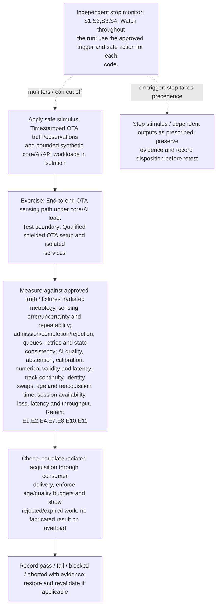

</details>

**Measure against:** A-OTA,A-CORE,A-AI,A-TRK,A-COM. [Use every applicable metric and the approved limits](../../README.md#acceptance-profiles); the case-specific check does not replace those profiles.

**Retain:** E1: scene truth, detections, tracks and scores; E2: test communication traffic and service KPIs; E4: faults, queues, alarms and recovery state; E7: synthetic identities, core APIs and distributed traces; E8: dataset/model versions, AI outputs and quality telemetry; E10: frequency/beam manifest and qualified RF/model evidence; E11: calibrated radiated OTA setup, truth and uncertainty.

**Stop plan:** S1,S2,S3,S4; [trigger definitions and safe outcomes](../../README.md#evidence-and-safe-stop-codes). **Requirements:** REQ-OTA,REQ-CORE,REQ-AI,REQ-SEN.

## TC-168

**What you test:** Supported device/panel orientation, state and repeatable mobility profile.

**Setup:** `K/R/U/L=ALL`. Create an approved instance with ground truth, baseline, limits and a named independent stop owner. Apply the exact frequency configuration and its reviewed applicability.

<details>
<summary>Show test flow and independent stop path</summary>

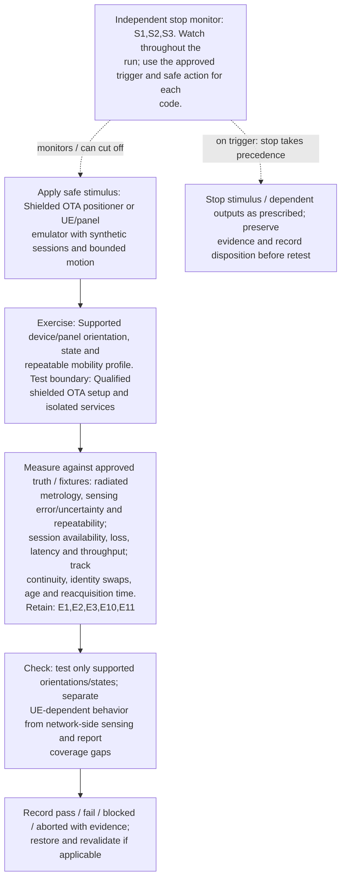

</details>

**Measure against:** A-OTA,A-COM,A-TRK. [Use every applicable metric and the approved limits](../../README.md#acceptance-profiles); the case-specific check does not replace those profiles.

**Retain:** E1: scene truth, detections, tracks and scores; E2: test communication traffic and service KPIs; E3: radio, timing, calibration and instrument health; E10: frequency/beam manifest and qualified RF/model evidence; E11: calibrated radiated OTA setup, truth and uncertainty.

**Stop plan:** S1,S2,S3; [trigger definitions and safe outcomes](../../README.md#evidence-and-safe-stop-codes). **Requirements:** REQ-OTA,REQ-SEN,REQ-COM.

## TC-169

**What you test:** Approved environmental/thermal operating corners during OTA.

**Setup:** `K/R/V/Q=ALL`. Create an approved instance with ground truth, baseline, limits and a named independent stop owner. Apply the exact frequency configuration and its reviewed applicability.

<details>
<summary>Show test flow and independent stop path</summary>

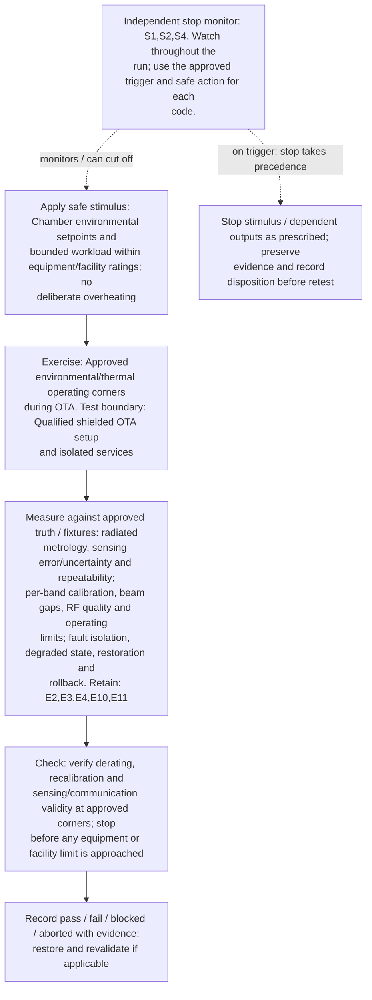

</details>

**Measure against:** A-OTA,A-HF,A-RES. [Use every applicable metric and the approved limits](../../README.md#acceptance-profiles); the case-specific check does not replace those profiles.

**Retain:** E2: test communication traffic and service KPIs; E3: radio, timing, calibration and instrument health; E4: faults, queues, alarms and recovery state; E10: frequency/beam manifest and qualified RF/model evidence; E11: calibrated radiated OTA setup, truth and uncertainty.

**Stop plan:** S1,S2,S4; [trigger definitions and safe outcomes](../../README.md#evidence-and-safe-stop-codes). **Requirements:** REQ-OTA,REQ-HF,REQ-RES.

## TC-170

**What you test:** Unit-to-unit, panel and configuration repeatability.

**Setup:** `K/R/D/L=ALL`. Create an approved instance with ground truth, baseline, limits and a named independent stop owner. Apply the exact frequency configuration and its reviewed applicability.

<details>
<summary>Show test flow and independent stop path</summary>

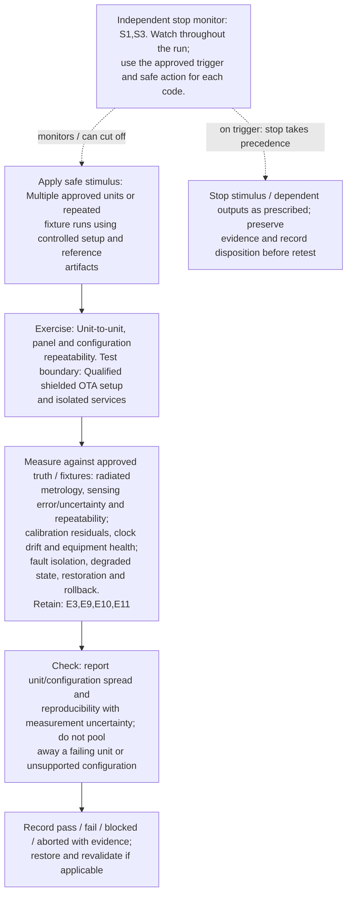

</details>

**Measure against:** A-OTA,A-RAD,A-RES. [Use every applicable metric and the approved limits](../../README.md#acceptance-profiles); the case-specific check does not replace those profiles.

**Retain:** E3: radio, timing, calibration and instrument health; E9: approvals, lineage, rollout and governance/control audit; E10: frequency/beam manifest and qualified RF/model evidence; E11: calibrated radiated OTA setup, truth and uncertainty.

**Stop plan:** S1,S3; [trigger definitions and safe outcomes](../../README.md#evidence-and-safe-stop-codes). **Requirements:** REQ-OTA,REQ-RAD,REQ-RES.

## TC-171

**What you test:** Conducted/model-to-radiated correlation and evidence separation.

**Setup:** `K/R=ALL`. Create an approved instance with ground truth, baseline, limits and a named independent stop owner. Apply the exact frequency configuration and its reviewed applicability.

<details>
<summary>Show test flow and independent stop path</summary>

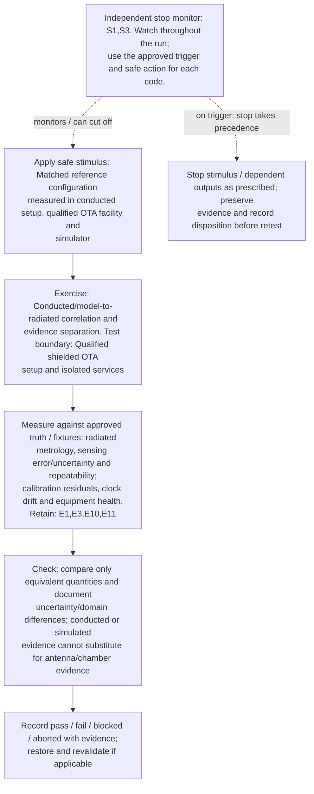

</details>

**Measure against:** A-OTA,A-RAD. [Use every applicable metric and the approved limits](../../README.md#acceptance-profiles); the case-specific check does not replace those profiles.

**Retain:** E1: scene truth, detections, tracks and scores; E3: radio, timing, calibration and instrument health; E10: frequency/beam manifest and qualified RF/model evidence; E11: calibrated radiated OTA setup, truth and uncertainty.

**Stop plan:** S1,S3; [trigger definitions and safe outcomes](../../README.md#evidence-and-safe-stop-codes). **Requirements:** REQ-OTA,REQ-RAD.

## TC-172

**What you test:** OTA setup drift, recalibration and before/after stability.

**Setup:** `K/R/L=ALL`. Create an approved instance with ground truth, baseline, limits and a named independent stop owner. Apply the exact frequency configuration and its reviewed applicability.

<details>
<summary>Show test flow and independent stop path</summary>

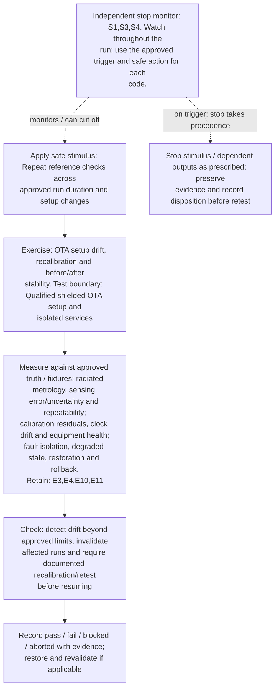

</details>

**Measure against:** A-OTA,A-RAD,A-RES. [Use every applicable metric and the approved limits](../../README.md#acceptance-profiles); the case-specific check does not replace those profiles.

**Retain:** E3: radio, timing, calibration and instrument health; E4: faults, queues, alarms and recovery state; E10: frequency/beam manifest and qualified RF/model evidence; E11: calibrated radiated OTA setup, truth and uncertainty.

**Stop plan:** S1,S3,S4; [trigger definitions and safe outcomes](../../README.md#evidence-and-safe-stop-codes). **Requirements:** REQ-OTA,REQ-RAD,REQ-RES.

## TC-173

**What you test:** OTA fault/degraded-state propagation to RAN, core, AI and operator.

**Setup:** `K/R/C/J/L=ALL`. Create an approved instance with ground truth, baseline, limits and a named independent stop owner. Apply the exact frequency configuration and its reviewed applicability.

<details>
<summary>Show test flow and independent stop path</summary>

```mermaid
flowchart TD
    stimulus["Apply safe stimulus: Shielded OTA reference scene with<br/>isolated calibration/beam-health fault and mocked consumer"]
    exercise["Exercise: OTA fault/degraded-state propagation to RAN,<br/>core, AI and operator. Test boundary: Qualified shielded<br/>OTA setup and isolated services"]
    capture["Measure against approved truth / fixtures: radiated<br/>metrology, sensing error/uncertainty and repeatability;<br/>unknown/ambiguous decisions and confidence calibration;<br/>admission/completion/rejection, queues, retries and state<br/>consistency; AI quality, abstention, calibration,<br/>numerical validity and latency; alarm delivery,<br/>acknowledgement, decisions and operator workload. Retain:<br/>E1,E3,E4,E6,E7,E8,E10,E11"]
    checks["Check: invalid radiated observations become visibly<br/>degraded/unavailable end-to-end and are not presented as<br/>confident current tracks"]
    disposition["Record pass / fail / blocked / aborted with evidence;<br/>restore and revalidate if applicable"]
    monitor["Independent stop monitor: S1,S3,S4,S5. Watch throughout<br/>the run; use the approved trigger and safe action for each<br/>code."]
    safe["Stop stimulus / dependent outputs as prescribed; preserve<br/>evidence and record disposition before retest"]
    stimulus --> exercise --> capture --> checks --> disposition
    monitor -. "monitors / can cut off" .-> stimulus
    monitor -. "on trigger: stop takes precedence" .-> safe
```

</details>

**Measure against:** A-OTA,A-UNC,A-CORE,A-AI,A-HUM. [Use every applicable metric and the approved limits](../../README.md#acceptance-profiles); the case-specific check does not replace those profiles.

**Retain:** E1: scene truth, detections, tracks and scores; E3: radio, timing, calibration and instrument health; E4: faults, queues, alarms and recovery state; E6: operator actions, mock calls, interlocks and stops; E7: synthetic identities, core APIs and distributed traces; E8: dataset/model versions, AI outputs and quality telemetry; E10: frequency/beam manifest and qualified RF/model evidence; E11: calibrated radiated OTA setup, truth and uncertainty.

**Stop plan:** S1,S3,S4,S5; [trigger definitions and safe outcomes](../../README.md#evidence-and-safe-stop-codes). **Requirements:** REQ-OTA,REQ-SEN,REQ-CORE,REQ-AI,REQ-HUM.

## TC-174

**What you test:** Facility loss, RF inhibit and independent safe-stop behavior.

**Setup:** `K/R/H/L=ALL`. Create an approved instance with ground truth, baseline, limits and a named independent stop owner. Apply the exact frequency configuration and its reviewed applicability.

<details>
<summary>Show test flow and independent stop path</summary>

```mermaid
flowchart TD
    stimulus["Apply safe stimulus: Mock facility-monitor, authorization<br/>or containment-state withdrawal with RF source in approved<br/>isolated setup"]
    exercise["Exercise: Facility loss, RF inhibit and independent safe-<br/>stop behavior. Test boundary: Qualified shielded OTA setup<br/>and isolated services"]
    capture["Measure against approved truth / fixtures: radiated<br/>metrology, sensing error/uncertainty and repeatability;<br/>authorization, interlocks, stop deadlines and safe state;<br/>purpose/residency, approvals, revocation and<br/>retention/deletion. Retain: E3,E4,E6,E9,E10,E11"]
    checks["Check: independently inhibit radiated output on invalid<br/>permission/monitor state, preserve event evidence and<br/>verify safe-state indication"]
    disposition["Record pass / fail / blocked / aborted with evidence;<br/>restore and revalidate if applicable"]
    monitor["Independent stop monitor: S1,S5,S7. Watch throughout the<br/>run; use the approved trigger and safe action for each<br/>code."]
    safe["Stop stimulus / dependent outputs as prescribed; preserve<br/>evidence and record disposition before retest"]
    stimulus --> exercise --> capture --> checks --> disposition
    monitor -. "monitors / can cut off" .-> stimulus
    monitor -. "on trigger: stop takes precedence" .-> safe
```

</details>

**Measure against:** A-OTA,A-SAF,A-GOV. [Use every applicable metric and the approved limits](../../README.md#acceptance-profiles); the case-specific check does not replace those profiles.

**Retain:** E3: radio, timing, calibration and instrument health; E4: faults, queues, alarms and recovery state; E6: operator actions, mock calls, interlocks and stops; E9: approvals, lineage, rollout and governance/control audit; E10: frequency/beam manifest and qualified RF/model evidence; E11: calibrated radiated OTA setup, truth and uncertainty.

**Stop plan:** S1,S5,S7; [trigger definitions and safe outcomes](../../README.md#evidence-and-safe-stop-codes). **Requirements:** REQ-OTA,REQ-SAF,REQ-GOV.

## TC-175

**What you test:** OTA acceptance pack, traceability and independent evidence review.

**Setup:** all applicable axes. Create an approved instance with ground truth, baseline, limits and a named independent stop owner. Apply the exact frequency configuration and its reviewed applicability.

<details>
<summary>Show test flow and independent stop path</summary>

```mermaid
flowchart TD
    stimulus["Apply safe stimulus: Replay approved OTA acceptance pack<br/>with independent facility, RF, sensing, core/AI and safety<br/>reviewers"]
    exercise["Exercise: OTA acceptance pack, traceability and<br/>independent evidence review. Test boundary: Qualified<br/>shielded OTA setup and isolated services"]
    capture["Measure against approved truth / fixtures: radiated<br/>metrology, sensing error/uncertainty and repeatability;<br/>every metric required by constituent instances. Retain:<br/>E1,E2,E3,E4,E5,E6,E7,E8,E9,E10,E11"]
    checks["Check: close each applicable configuration/requirement<br/>with linked calibrated radiated evidence, uncertainty,<br/>limitations and disposition; no unresolved blocker<br/>reported as pass"]
    disposition["Record pass / fail / blocked / aborted with evidence;<br/>restore and revalidate if applicable"]
    monitor["Independent stop monitor: S1,S2,S3,S4,S5,S7. Watch<br/>throughout the run; use the approved trigger and safe<br/>action for each code."]
    safe["Stop stimulus / dependent outputs as prescribed; preserve<br/>evidence and record disposition before retest"]
    stimulus --> exercise --> capture --> checks --> disposition
    monitor -. "monitors / can cut off" .-> stimulus
    monitor -. "on trigger: stop takes precedence" .-> safe
```

</details>

**Measure against:** A-OTA plus all constituent profiles. [Use every applicable metric and the approved limits](../../README.md#acceptance-profiles); the case-specific check does not replace those profiles.

**Retain:** E1: scene truth, detections, tracks and scores; E2: test communication traffic and service KPIs; E3: radio, timing, calibration and instrument health; E4: faults, queues, alarms and recovery state; E5: input provenance, validation, access and integrity; E6: operator actions, mock calls, interlocks and stops; E7: synthetic identities, core APIs and distributed traces; E8: dataset/model versions, AI outputs and quality telemetry; E9: approvals, lineage, rollout and governance/control audit; E10: frequency/beam manifest and qualified RF/model evidence; E11: calibrated radiated OTA setup, truth and uncertainty.

**Stop plan:** S1,S2,S3,S4,S5,S7; [trigger definitions and safe outcomes](../../README.md#evidence-and-safe-stop-codes). **Requirements:** REQ-OTA,REQ-HF,REQ-SEN,REQ-COM,REQ-CORE,REQ-AI,REQ-SAF.
