# ISAC modes and sensing-capable radio configurations: designer test diagrams

[Visual guide and shared execution rules](../../README.md#designer-visual-test-guide) | [Authoritative scenario matrix](../../README.md#traceable-scenario-coverage-matrix)

**KPI / PM events:** use each TC ID in the [case-focus table](../kpi-pm.md#case-specific-focus-checks), plus all measurement/event groups inherited from its acceptance profiles. Actual collector names and thresholds need approval; local event labels are not standardized counters.

These are test-design flows, not measured results or an asserted deployment architecture. Solid arrows show the test/evidence flow; dashed arrows show independent stop control. Apply the shared approval gate before every instance. Expand the declared axes and frequency overlay; never treat one diagram as coverage of every configuration.

## TC-013

**What you test:** Communication-centric scheduling.

**Setup:** `M1/D/Q=ALL`. Create an approved instance with ground truth, baseline, limits and a named independent stop owner. Apply the exact frequency configuration and its reviewed applicability.

Show test flow and independent stop path

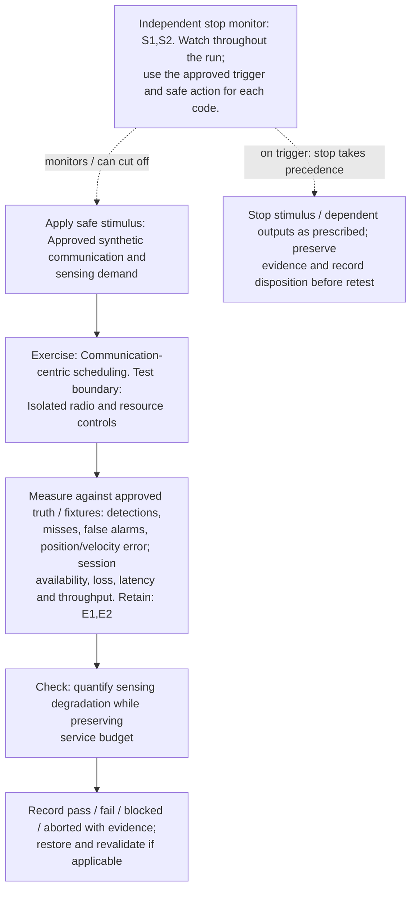

**Measure against:** A-SEN,A-COM. [Use every applicable metric and the approved limits](../../README.md#acceptance-profiles); the case-specific check does not replace those profiles.

**Retain:** E1: scene truth, detections, tracks and scores; E2: test communication traffic and service KPIs.

**Stop plan:** S1,S2; [trigger definitions and safe outcomes](../../README.md#evidence-and-safe-stop-codes). **Requirements:** REQ-SEN,REQ-COM.

## TC-014

**What you test:** Sensing-centric scheduling.

**Setup:** `M2/D/Q=ALL`. Create an approved instance with ground truth, baseline, limits and a named independent stop owner. Apply the exact frequency configuration and its reviewed applicability.

Show test flow and independent stop path

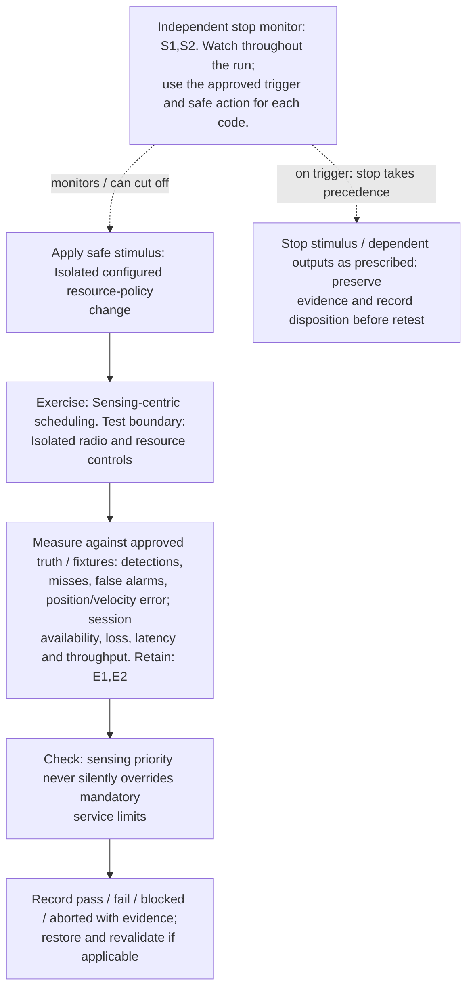

**Measure against:** A-SEN,A-COM. [Use every applicable metric and the approved limits](../../README.md#acceptance-profiles); the case-specific check does not replace those profiles.

**Retain:** E1: scene truth, detections, tracks and scores; E2: test communication traffic and service KPIs.

**Stop plan:** S1,S2; [trigger definitions and safe outcomes](../../README.md#evidence-and-safe-stop-codes). **Requirements:** REQ-SEN,REQ-COM.

## TC-015

**What you test:** Joint operation.

**Setup:** `M3/D/W/Q=ALL`. Create an approved instance with ground truth, baseline, limits and a named independent stop owner. Apply the exact frequency configuration and its reviewed applicability.

Show test flow and independent stop path

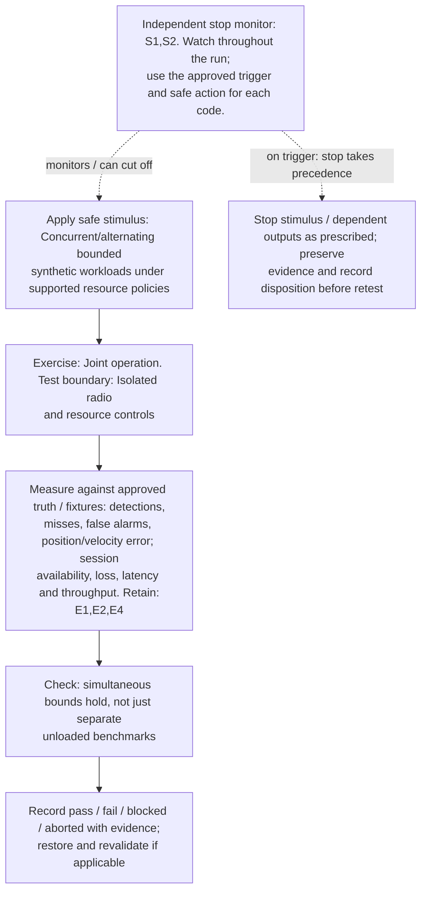

**Measure against:** A-SEN,A-COM. [Use every applicable metric and the approved limits](../../README.md#acceptance-profiles); the case-specific check does not replace those profiles.

**Retain:** E1: scene truth, detections, tracks and scores; E2: test communication traffic and service KPIs; E4: faults, queues, alarms and recovery state.

**Stop plan:** S1,S2; [trigger definitions and safe outcomes](../../README.md#evidence-and-safe-stop-codes). **Requirements:** REQ-SEN,REQ-COM.

## TC-016

**What you test:** Sensing inhibition/fallback.

**Setup:** `M4/L=ALL`. Create an approved instance with ground truth, baseline, limits and a named independent stop owner. Apply the exact frequency configuration and its reviewed applicability.

Show test flow and independent stop path

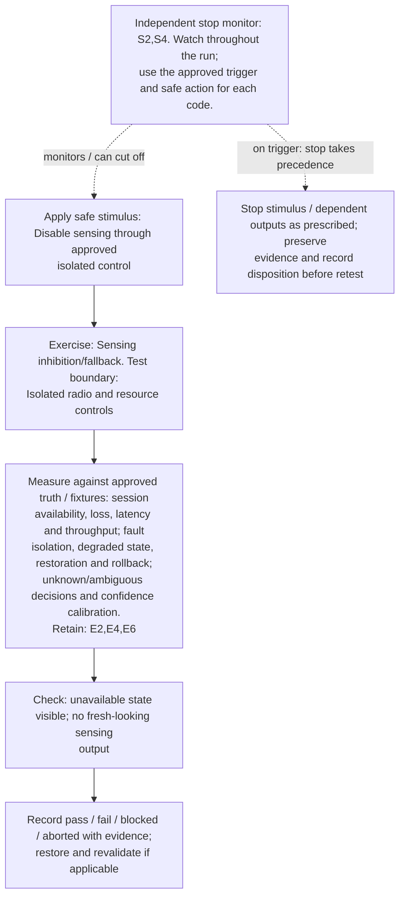

**Measure against:** A-COM,A-RES,A-UNC. [Use every applicable metric and the approved limits](../../README.md#acceptance-profiles); the case-specific check does not replace those profiles.

**Retain:** E2: test communication traffic and service KPIs; E4: faults, queues, alarms and recovery state; E6: operator actions, mock calls, interlocks and stops.

**Stop plan:** S2,S4; [trigger definitions and safe outcomes](../../README.md#evidence-and-safe-stop-codes). **Requirements:** REQ-COM,REQ-RES,REQ-UNC.

## TC-017

**What you test:** Every supported mode transition.

**Setup:** `M/L=ALL` directed transitions. Create an approved instance with ground truth, baseline, limits and a named independent stop owner. Apply the exact frequency configuration and its reviewed applicability.

Show test flow and independent stop path

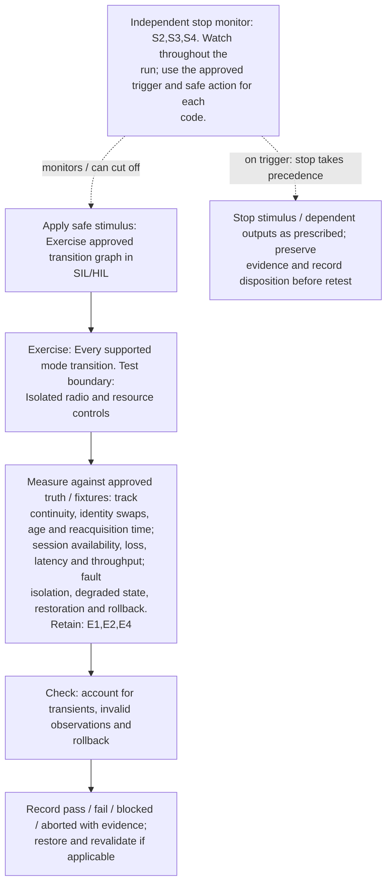

**Measure against:** A-TRK,A-COM,A-RES. [Use every applicable metric and the approved limits](../../README.md#acceptance-profiles); the case-specific check does not replace those profiles.

**Retain:** E1: scene truth, detections, tracks and scores; E2: test communication traffic and service KPIs; E4: faults, queues, alarms and recovery state.

**Stop plan:** S2,S3,S4; [trigger definitions and safe outcomes](../../README.md#evidence-and-safe-stop-codes). **Requirements:** REQ-SEN,REQ-COM,REQ-RES.

## TC-018

**What you test:** Monostatic radio health.

**Setup:** applicable `G/R/D`. Create an approved instance with ground truth, baseline, limits and a named independent stop owner. Apply the exact frequency configuration and its reviewed applicability.

Show test flow and independent stop path

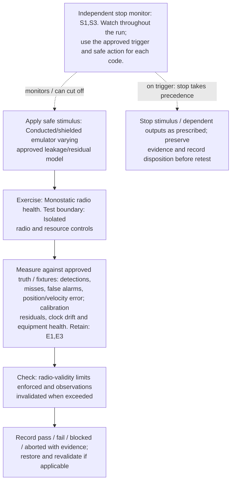

**Measure against:** A-SEN,A-RAD. [Use every applicable metric and the approved limits](../../README.md#acceptance-profiles); the case-specific check does not replace those profiles.

**Retain:** E1: scene truth, detections, tracks and scores; E3: radio, timing, calibration and instrument health.

**Stop plan:** S1,S3; [trigger definitions and safe outcomes](../../README.md#evidence-and-safe-stop-codes). **Requirements:** REQ-SEN,REQ-RAD.

## TC-019

**What you test:** Bistatic alignment.

**Setup:** applicable `G/N`. Create an approved instance with ground truth, baseline, limits and a named independent stop owner. Apply the exact frequency configuration and its reviewed applicability.

Show test flow and independent stop path

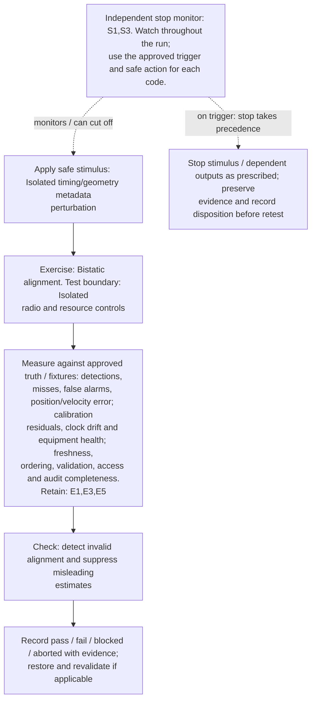

**Measure against:** A-SEN,A-RAD,A-DAT. [Use every applicable metric and the approved limits](../../README.md#acceptance-profiles); the case-specific check does not replace those profiles.

**Retain:** E1: scene truth, detections, tracks and scores; E3: radio, timing, calibration and instrument health; E5: input provenance, validation, access and integrity.

**Stop plan:** S1,S3; [trigger definitions and safe outcomes](../../README.md#evidence-and-safe-stop-codes). **Requirements:** REQ-SEN,REQ-RAD,REQ-DAT.

## TC-020

**What you test:** Multistatic node loss/disagreement.

**Setup:** applicable `G/N`. Create an approved instance with ground truth, baseline, limits and a named independent stop owner. Apply the exact frequency configuration and its reviewed applicability.

Show test flow and independent stop path

**Measure against:** A-TRK,A-RES. [Use every applicable metric and the approved limits](../../README.md#acceptance-profiles); the case-specific check does not replace those profiles.

**Retain:** E1: scene truth, detections, tracks and scores; E3: radio, timing, calibration and instrument health; E4: faults, queues, alarms and recovery state.

**Stop plan:** S3,S4; [trigger definitions and safe outcomes](../../README.md#evidence-and-safe-stop-codes). **Requirements:** REQ-SEN,REQ-RES.

## TC-021

**What you test:** Passive illumination unavailable.

**Setup:** passive `G/R`. Create an approved instance with ground truth, baseline, limits and a named independent stop owner. Apply the exact frequency configuration and its reviewed applicability.

Show test flow and independent stop path

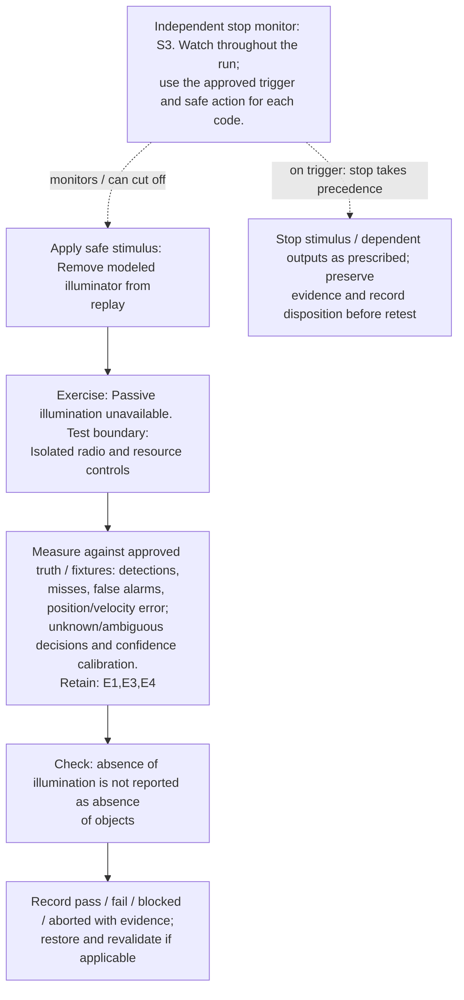

**Measure against:** A-SEN,A-UNC. [Use every applicable metric and the approved limits](../../README.md#acceptance-profiles); the case-specific check does not replace those profiles.

**Retain:** E1: scene truth, detections, tracks and scores; E3: radio, timing, calibration and instrument health; E4: faults, queues, alarms and recovery state.

**Stop plan:** S3; [trigger definitions and safe outcomes](../../README.md#evidence-and-safe-stop-codes). **Requirements:** REQ-SEN,REQ-UNC.

## TC-022

**What you test:** External radar/passive/SDR interface compatibility.

**Setup:** `R/X=ALL`. Create an approved instance with ground truth, baseline, limits and a named independent stop owner. Apply the exact frequency configuration and its reviewed applicability.

Show test flow and independent stop path

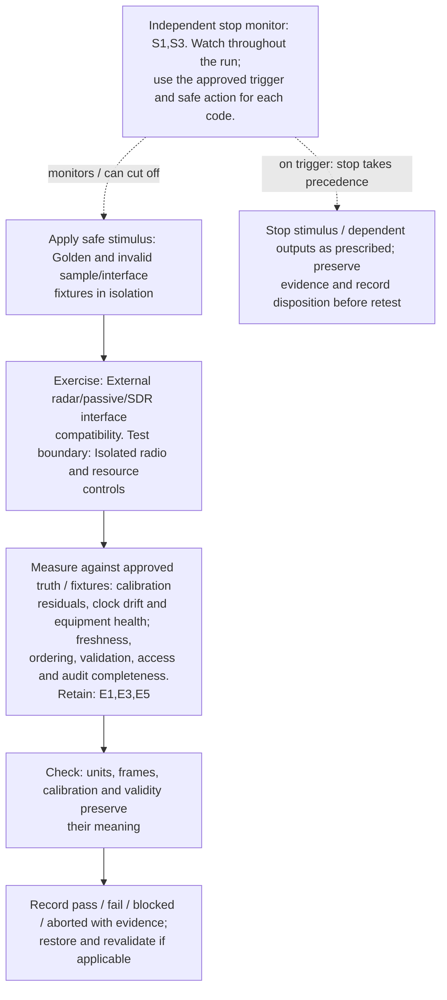

**Measure against:** A-RAD,A-DAT. [Use every applicable metric and the approved limits](../../README.md#acceptance-profiles); the case-specific check does not replace those profiles.

**Retain:** E1: scene truth, detections, tracks and scores; E3: radio, timing, calibration and instrument health; E5: input provenance, validation, access and integrity.

**Stop plan:** S1,S3; [trigger definitions and safe outcomes](../../README.md#evidence-and-safe-stop-codes). **Requirements:** REQ-RAD,REQ-DAT.

## TC-023

**What you test:** Duplex/carrier/band/beam/illumination changes.

**Setup:** `D/W=ALL` supported edges. Create an approved instance with ground truth, baseline, limits and a named independent stop owner. Apply the exact frequency configuration and its reviewed applicability.

Show test flow and independent stop path

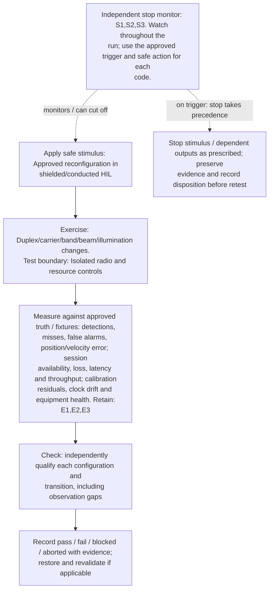

**Measure against:** A-SEN,A-COM,A-RAD. [Use every applicable metric and the approved limits](../../README.md#acceptance-profiles); the case-specific check does not replace those profiles.

**Retain:** E1: scene truth, detections, tracks and scores; E2: test communication traffic and service KPIs; E3: radio, timing, calibration and instrument health.

**Stop plan:** S1,S2,S3; [trigger definitions and safe outcomes](../../README.md#evidence-and-safe-stop-codes). **Requirements:** REQ-SEN,REQ-COM,REQ-RAD.

## TC-024

**What you test:** UE state and network architecture dependencies.

**Setup:** `N/U=ALL`. Create an approved instance with ground truth, baseline, limits and a named independent stop owner. Apply the exact frequency configuration and its reviewed applicability.

Show test flow and independent stop path

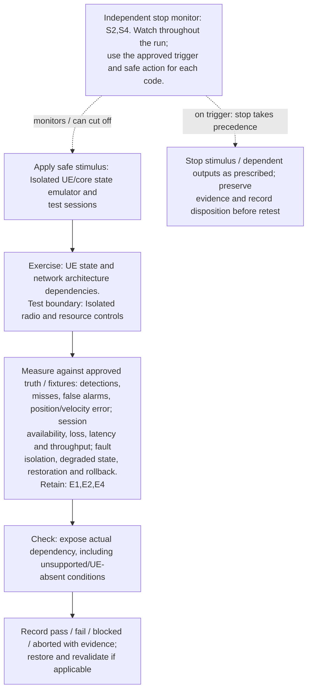

**Measure against:** A-SEN,A-COM,A-RES. [Use every applicable metric and the approved limits](../../README.md#acceptance-profiles); the case-specific check does not replace those profiles.

**Retain:** E1: scene truth, detections, tracks and scores; E2: test communication traffic and service KPIs; E4: faults, queues, alarms and recovery state.

**Stop plan:** S2,S4; [trigger definitions and safe outcomes](../../README.md#evidence-and-safe-stop-codes). **Requirements:** REQ-SEN,REQ-COM,REQ-RES.

## TC-025

**What you test:** Calibration drift or invalid calibration.

**Setup:** `R/D/L=ALL`. Create an approved instance with ground truth, baseline, limits and a named independent stop owner. Apply the exact frequency configuration and its reviewed applicability.

Show test flow and independent stop path

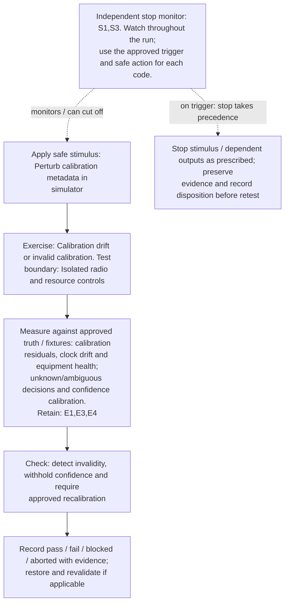

**Measure against:** A-RAD,A-UNC. [Use every applicable metric and the approved limits](../../README.md#acceptance-profiles); the case-specific check does not replace those profiles.

**Retain:** E1: scene truth, detections, tracks and scores; E3: radio, timing, calibration and instrument health; E4: faults, queues, alarms and recovery state.

**Stop plan:** S1,S3; [trigger definitions and safe outcomes](../../README.md#evidence-and-safe-stop-codes). **Requirements:** REQ-RAD,REQ-UNC.

## TC-026

**What you test:** Timing source drift/loss.

**Setup:** `G/N/R=ALL`. Create an approved instance with ground truth, baseline, limits and a named independent stop owner. Apply the exact frequency configuration and its reviewed applicability.

Show test flow and independent stop path

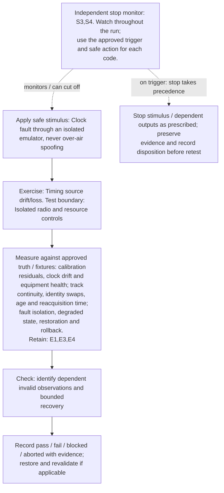

**Measure against:** A-RAD,A-TRK,A-RES. [Use every applicable metric and the approved limits](../../README.md#acceptance-profiles); the case-specific check does not replace those profiles.

**Retain:** E1: scene truth, detections, tracks and scores; E3: radio, timing, calibration and instrument health; E4: faults, queues, alarms and recovery state.

**Stop plan:** S3,S4; [trigger definitions and safe outcomes](../../README.md#evidence-and-safe-stop-codes). **Requirements:** REQ-RAD,REQ-SEN,REQ-RES.
